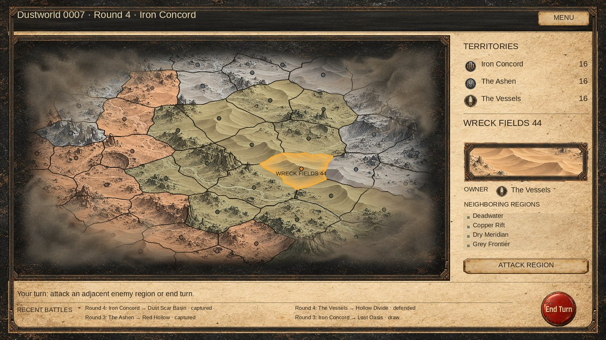

# Campaign — atmosphere and a shared console

Follow-up to PR #166, based on `0ca7f939125bbe9eda8fc36c95a7c3efc66dc820`.

## Result

The map's limb now fades over radius 0.80–1.00 instead of 0.91–1.00, with 64 design units of viewport feathering. A new transparent `Assets/Resources/Campaign/Effects/AtmosphericClouds.png` covers the outer corners with soft dusty clouds while leaving the central region view almost entirely clear. The RGBA source is copied unchanged from the built-in imagegen output (1672×941). Its alpha is preserved; Unity metadata uses a unique GUID, clamp wrapping, no mipmaps, alpha transparency and a 2048 import cap.

A decorative RawImage draws the clouds above the map. The existing CampaignSurface shader has an atmosphere mode that retains cloud texture alpha/color, feathers the image's own perimeter, and bypasses terrain ownership tint and the planet horizon. A separate runtime material uses that mode and is destroyed with the screen. Clouds and frames have raycasts disabled.

Header, region information and battle history now share one outer console. A continuous parchment background joins the right and bottom areas; the header is a dark insert and the map retains its own inset frame. Separate outer frames on the other sections are removed. Dividers and the common edge provide structure. Existing screen positions, content, buttons, dialogs, scrolling and callbacks remain; Render clears only sidebar/footer content and leaves the shared backing intact.

## Validation

- Differential C# compilation: previous PR revision and current campaign UI/tests compile with zero errors against available Unity reference DLLs and explicit dependency stubs. This is not a Unity build.
- Source/layout check: map, sidebar and footer resolve to their original Canvas-space bounds under the new console parent. Decoration cannot intercept raycasts; cloud material cleanup is present.
- Asset checks: RGBA and partial alpha, central 40% alpha maximum 2/255, unique GUID, correct Resources path, clamp and alpha import settings. A cloud resource assertion was added to the existing native asset test.
- git diff --check passed. No scene/prefab YAML was changed.
- CPU preview visually reviewed using actual current polygons, art assets, shader formulas and common-console layout. It approximates shader interpolation and text and is not a Unity screenshot.

The previous geometry tests are not rerun for this follow-up: generator, polygons, projection and region mesh code are unchanged. All ten backgrounds and saved background selection are retained. Campaign rules, AI, banks and battle flow are untouched.

Unity 6000.5.4f1 is unavailable. Native shader/import and EditMode execution remain pending. Check all ten backgrounds, edge clicks/markers, hover/selection, sidebar preview and scroll, End Turn, dialogs, reload, and 1280×720 / 1920×1080 / 2560×1440. Final cloud opacity and visual acceptance must be judged in the running game.



## Final image prompt

Generated with the built-in imagegen tool. The final asset is a new generation; no existing art was overwritten. An earlier terrain-like candidate was discarded.

```text
Use case: stylized-concept. Asset type: a production transparent PNG atmospheric cloud overlay for a post-apocalyptic desert strategy game, wide 16:9 landscape canvas. Create ONLY four loose asymmetric patches of thin smoky CLOUDS and atmospheric dust VAPOR around the outer corners, with wispy filaments extending slightly along the outer edges. The center 70 percent must be completely empty and transparent. Clouds are softly billowing gas, diffuse translucent smoke, fine drifting sand haze, air turbulence with smooth flowing organic curls; not solid surfaces. Colors: restrained warm grey, grey-sand and dusty beige, dim graphite shadow, no bright white. Style: subtle matte painted cloud mist, soft gradients of real alpha opacity through every cloud, very low contrast and feathered dissolving edges. Sparse, airy overlay rather than a frame shape. Each corner different. All outermost canvas edges taper softly to full alpha zero. Actual transparent background, no checkerboard pixels, no sky, no dark rectangle. Absolutely no mountains, rocky relief, craters, rock textures, cliffs, terrain, islands, buildings, map, border, frame, UI, text, stars or objects. Do not draw etching or pencil hatching inside the clouds. Everything shown is airborne atmospheric mist. Appropriate to sit above a sepia desert map without obscuring its regions.
```
