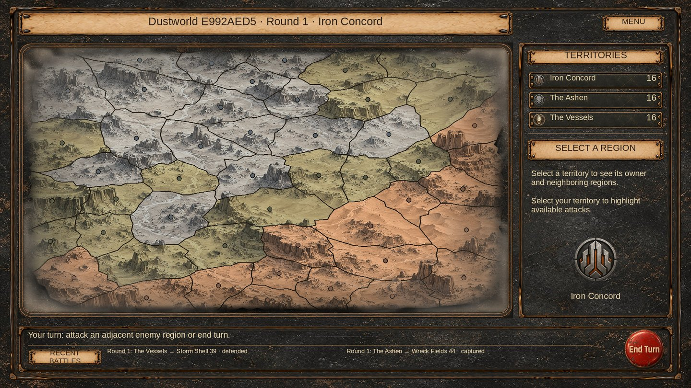
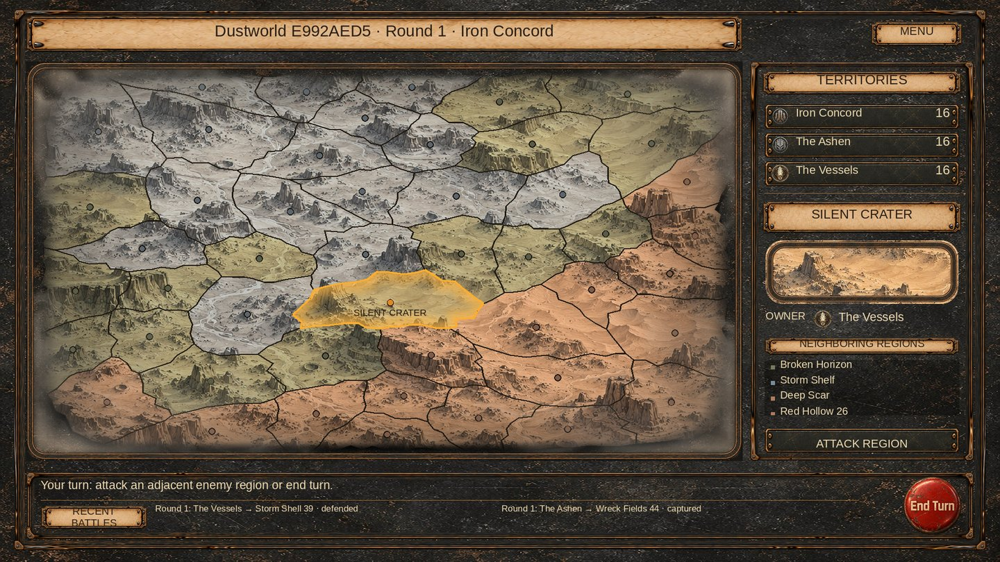

# Campaign console: collection styling and fuller clouds

The campaign now reuses the project's collection artwork and shared styling methods: `CollectionUIElements.ApplySurface`, `ApplyControlsSkin`, `CollectionText` and `CollectionInk`. The outer shell, sidebar and history use bronze metal rails; titles and section headers use parchment plaques. Faction totals sit in inset rows, and the empty region panel shows the player's faction emblem. Region details, attack controls and campaign dialogs use the same palette.

The collection panel sprites draw their rails with `fillCenter = false`, sharing the continuous campaign metal background. This avoids stretching the small source panel's texture into vertical streaks. These nine-sliced images use the default UI material; only map/terrain masks use the campaign shader. Map size, projection, marker positions, saves, turn rules and battle callbacks are unchanged.

Clouds remain above the map and below its frame. Their UV crop expands from `(0.10, 0.10, 0.80, 0.80)` to `(0.04, 0.04, 0.92, 0.92)` so the cloud banks extend farther into the panel. Tint is brighter, outer opacity rises from 0.78 to 0.94, and `_CloudInteriorOpacity = 0.18` limits alpha to 0.1692 over the main region footprint before texture alpha. The rounded projection's radial blend runs from 0.93 to 1.075, with 70% desaturation over regions and dense cloud cover toward the background corners. Decorative graphics do not receive clicks.

## Previews

These are CPU compositions of the real project assets and generated world seed `0xE992AED5`, with fresh initial ownership and example battle history. They are not Unity screenshots or a reproduction of the live save. Text metrics, masking and shader blending still need Game View acceptance.

## Existing assets reused

- `Assets/Resources/UI/Collection/Panel_Outer.png`
- `Assets/Resources/UI/Collection/Panel_Inset.png`
- `Assets/Resources/UI/Collection/Plaque.png`
- `Assets/Resources/UI/Collection/Button.png`
- Existing campaign metal, map, clouds, rounded map frame, faction logos and end-turn artwork.

No raster artwork or `.meta` files are changed. No new image-generation prompt was needed.

## Validation

- Read current master and the new shared collection helper before the final implementation. Target base: `6891102e9c2c9e8b856a8b84ab35f9187b536358`.
- Baseline and changed campaign presentation code compile with zero errors against the available older Unity reference DLLs and explicit verifier stubs. The updated shared helper exposed five identical missing-stub errors in both variants (`TMP_Dropdown.itemText` / `template`); those existing API properties were added only to the scratch verifier's stub copy, after preserving the initial logs. Serialized-field warnings remain. No verifier code is included in this change.
- Managed geometry/input/UV checks pass for 36 generated maps / 1728 regions, including the supplied screenshot seed, with no save-geometry mutation.
- Panel bounds and non-overlap, asset paths and original asset hashes, cloud layer order, input transparency, alpha limits, material ownership and diff whitespace checks pass. Both previews were rendered and inspected.
- The existing translated shader regression now sets the actual 0.18 cloud-interior parameter. Native execution remains pending.

Unity 6000.5.4f1 is unavailable. Shader import, native EditMode/GPU tests, scene input, scaled Game View, scroll behavior and modal acceptance have not run. No scene/prefab YAML is modified. This is a local presentation change, not a gameplay or architecture change.
