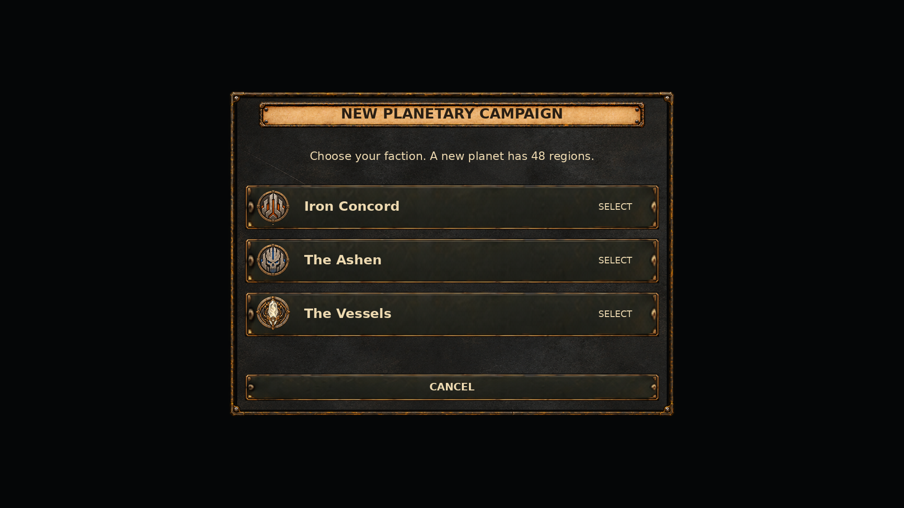
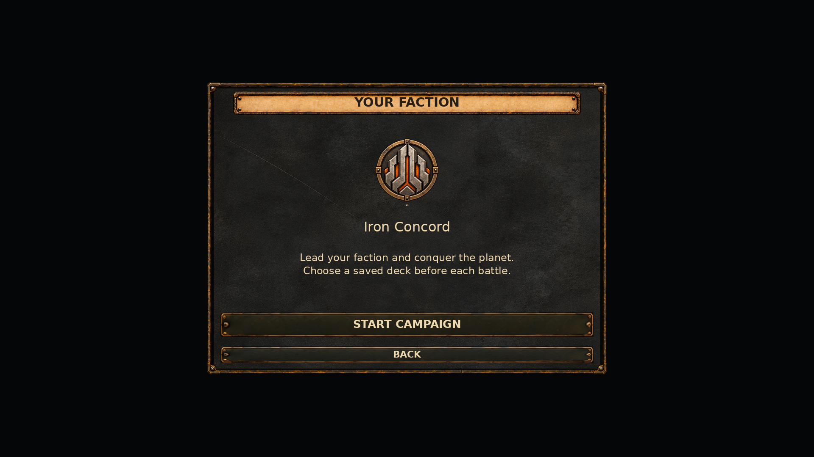
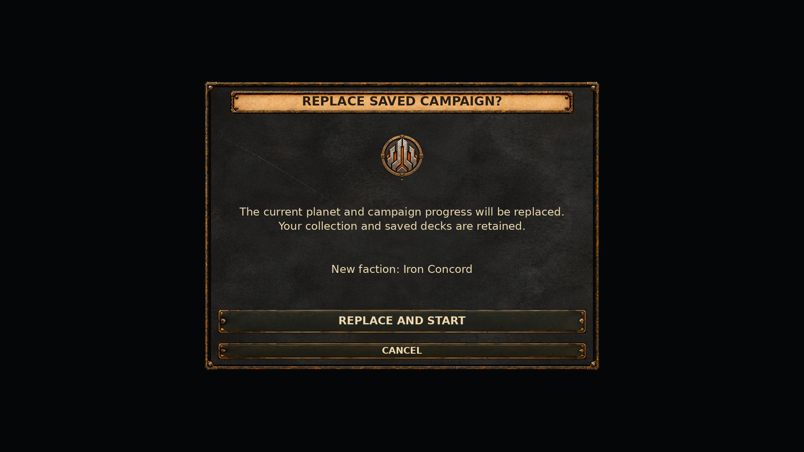

# Campaign entry menus

Base: `02a86b5d824680fd8f321451c0eb9398c80cc373` (Unity 6000.5.4f1).

The screens opened by New Campaign now use the campaign's existing dark metal,
transparent bronze frame, parchment heading and collection button artwork.
The three stages are faction selection, faction confirmation and replacement
of an existing save. New Campaign / Continue Campaign entry buttons receive the
existing collection control skin when MainMenu opens.

The setup canvas retains its 1920 × 1080 reference resolution. Each stage uses
one centered 950 × 700 window at (485, 190), an 880 × 58 heading and consistent
button margins. Faction choices are full clickable rows with the same three
emblems serialized in Campaign.unity. MainMenu.unity now references those existing
sprite GUIDs; no artwork or importer metadata is changed.

`CollectionUIElements.ApplyCampaignSurface` is the shared implementation of the
campaign's previous transparent-frame/plaque selection. CampaignUI delegates its
existing calls to that method. It preserves resource names, sprite selection,
frame densities, fillCenter and aspect handling. Collection/deck windows still
use their existing `ApplySurface` path.

The heading uses `UI/Decorations/Campaign/Plaque_880x58` with Simple rendering and preserved
aspect. Frame and metal are separate graphics, with the transparent frame above
the metal. Decorative graphics and emblems do not receive clicks. Buttons retain
the existing SceneUIAudioBinder callbacks and hover/pressed/disabled colors.

Faction count text reads the generator's default RegionCount (currently 48),
matching CampaignMatchBridge.Create. It no longer incorrectly says 24.
Back rebuilds faction selection within the same overlay. The first faction and
the Start button receive focus on their respective stages; replacement defaults
to Cancel. Closing deactivates the overlay immediately before deferred destruction
and restores the previous active menu selection. ESC continues to close setup.

Campaign generation, save detection (including .bak), overwrite confirmation,
collection/deck retention, match setup and campaign loading keep their existing
calls. This is a local presentation change with small keyboard-focus improvements.

## Previews

CPU compositions of the actual project sprites at 1920 × 1080. These are not
Unity screenshots. They use Liberation Sans, the family in GameMenuFont, with
approximate text metrics and a neutral backing instead of the live main menu.
TMP rendering, selected tint and native canvas behavior still require Game View.

## Validation

- Both Tools/unity-yaml-verify scripts pass on MainMenu.unity: 782 local references,
  787 objects, no missing references, duplicates, overflow or type mismatches.
- All three new serialized sprite references match the existing logo importer
  GUIDs and Campaign.unity references.
- C# syntax parsing passes for MainMenuController, CollectionUIElements and
  CampaignUI; diff whitespace checks pass. This is not a compilation check.
- Window bounds remain inside 1280 × 720, 1920 × 1080 and 2560 × 1440 canvases
  with the existing 16:9 scaling. Preview labels fit their assigned widths.
- All three CPU previews were rendered and visually inspected.
- Unity, the C# compiler and native EditMode tests are unavailable in this session.
  No Unity build or live UI execution is claimed.

In Unity, open MainMenu and verify New Campaign → each of the three factions →
Back → Start, both with and without an existing campaign. Verify Cancel/ESC and
keyboard navigation, disabled Continue without a valid save, emblems, click audio,
and the three supported resolutions. Confirm that Continue loads the saved planet
and replacing a campaign retains the collection and saved decks.
