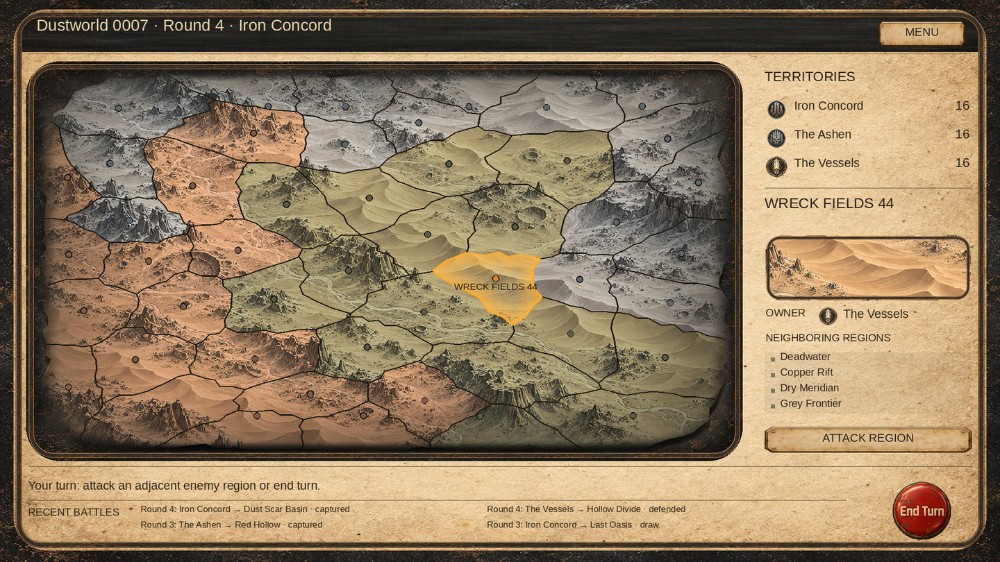

# Campaign map fit and rounded frames

Local presentation correction against master `c659d1d335de3f601c3b7444baf0f756668c3d1b`. Campaign generation, saved polygons, neighboring regions and battle rules are unchanged.

## Cause and correction

- The disk-shaped map left large dark corner areas inside a rectangular panel. Its UI projection now maps the disk radially into a rounded rectangle with exponent 8 and a 2% margin. The resulting outer silhouette covers about 94% of the viewport. Terrain UVs remain linear in pixel space and preserve image aspect; arrows, labels and region hit tests continue to share the existing projection.
- The cloud RawImage was above every region and label. It now precedes the Regions child in sibling order and has reduced alpha (0.36). Terrain feathers only across the outer rim, starting at map radius 0.94, while solid borders and markers retain their opacity. Clouds stay decorative and do not receive input.
- The selected region name is clamped within the map viewport so the label remains readable on outer cells.
- The map frame touched the console's left rail and crowded the header/footer rails. The map panel now starts 24 units inside the console, 18 below the header and 21 above the footer. Its viewport is 1352 × 744 inside a 1376 × 768 panel.
- A new rounded nine-sliced frame replaces the angular frame in CampaignUI only. Its 256px slice boundaries contain the entire curved corners; the sprite uses a unique GUID. The previous MetalFrame asset and metadata are retained.
- The console and map backing use rounded stencil masks through the existing campaign surface shader. The small terrain preview uses a thinner instance of the same frame, a 32-unit corner mask and explicit UV-rect normalization so cropped terrain UVs cannot shift the mask.
- The three panel materials and cloud material are owned by CampaignUI and disposed on destruction. The preview material is reused when the selected region changes.

## Preview



This is a CPU composition using production assets and projected generated polygons, not a Unity screenshot. Texture shading, TMP layout, stencil interaction and input require native verification.

## Validation

- Baseline and changed presentation source/test declarations compile with zero errors against available Unity reference DLLs and explicit verifier stubs. Existing serialized-field warnings remain.
- Managed production-source checks pass: 35 maps / 1680 regions, projection/input coordinates at three resolutions, terrain pixel aspect, UV bounds and unchanged saved polygons.
- Stress check passes: 1000 generated planets / 48000 regions; projected triangulation, polygon area, interior markers, mesh budget, custom region counts, reproducibility and managed restoration of previous 24-region geometry.
- New rounded projection test bounds the limb at 0.98 and confirms corner coverage. GPU regression cases cover Canvas translation, opaque edge markers, cropped overlay UVs and rounded corner clipping. GPU cases are added but not executed here.
- Asset alpha, unique GUID, nine-slice metadata, sibling order, layout spacing and diff whitespace checks pass.
- Unity 6000.5.4f1 is unavailable. Native shader import, EditMode tests, nested stencil masks, player build and visual/input acceptance remain pending. Verify hover/select on every outer region, attack confirmation, scrolling, menu, end turn, and dialogs at 1920×1080 and other 16:9 resolutions.

## Frame generation

Mode: built-in image_gen, transparent-background generation using the old frame only as a style reference. The returned PNG is copied unchanged to `Assets/Resources/Campaign/MetalFrameRounded.png`.

Final prompt:

```text
Use case: stylized-concept. Asset type: production Unity UI nine-sliced frame sprite, transparent PNG. Image 1 is a style reference only: match its worn graphite steel, restrained antique bronze rim and matte post-apocalyptic painted texture. Create ONE square panel frame viewed straight on, symmetrical, on an actual transparent background, with a completely transparent empty center. Change the silhouette into a continuous softly ROUNDED RECTANGLE: large smooth quarter-circle corners, outer radius about 100 pixels on a 1024 square, with matching smoothly curved inner edge. Narrow uniform rail about 18 pixels wide on all four sides. Outer bounding box almost fills the canvas, equal 8 pixel transparent margin on all sides. Continuous thin bronze highlight on inner and outer rail, subtle dark metal between, fine wear and faint scratches. The four curved corners must have the same narrow thickness as the sides and fit entirely within 128 pixel nine-slice corner zones. Straight edges begin by 128 pixels from each corner. Minimal delicate industrial frame, understated low contrast. No angular brackets, no diagonal chamfers, no corner plates, no screws, no rivets, no ornaments, no protrusions, no thick beams, no paper, no center fill, no glow, no text, no logos. Preserve genuine alpha transparency including the center and outside the rounded silhouette. One frame only.
```
