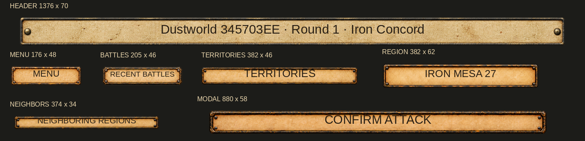
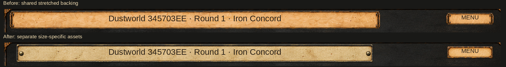
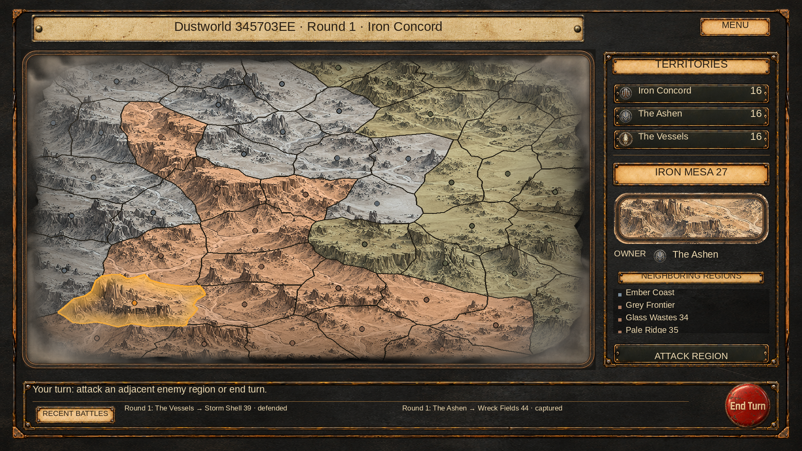

# Campaign: individual field backings

Revision baseline: `4a48c7e89abc0ec40c10b45e01b19b4d8f80fb31`.

A universal nine-sliced SectionPlaque stretched its paper center horizontally in
1376×70 but compressed it in MENU 176×48. Seven independently generated paper
backings now serve the actual seven field size classes, including modal headings.
CampaignUI derives the resource name from the fixed logical RectTransform size;
CanvasScaler does not change that size. All paper images use **Image.Simple with
preserveAspect**, zero sprite borders and full rectangular sprite meshes. Neither
paper nor corner artwork is nine-sliced. This is a local presentation change.
The RECENT BATTLES label uses size 18 so it fits on one line inside its paper field.

Generated PNGs include transparent canvas padding. Unity's single named sprite
rectangle selects the authored silhouette without modifying the original PNG.
Rectangles have the target aspect ratio to within 1%; padding may vary slightly.
PNG canvas dimensions are not the logical UI field dimensions. Each generated
bitmap is copied unchanged. Source resolution exceeds final canvas field size;
Default/Standalone imports keep 4096 max size, no NPOT scaling, no mipmaps,
bilinear clamp, real alpha and no texture compression. GUIDs are unique and new;
previous importer GUIDs are preserved. Original SectionPlaque remains a generation
style reference and is no longer rendered by CampaignUI.

| Field | Logical field | PNG in Assets/Resources/Campaign | PNG canvas | Native sprite rect x, y, w, h | Minimum source pixels per UI pixel |
| --- | --- | --- | --- | --- | --- |
| Header | 1376 × 70 | `Plaque_1376x70.png` | 2103 × 748 | 10, 322, 2084, 106 | 1.514 |
| Menu | 176 × 48 | `Plaque_176x48.png` | 1254 × 1254 | 408, 567, 437, 119 | 2.479 |
| Territories | 382 × 46 | `Plaque_382x46.png` | 1254 × 1254 | 163, 570, 928, 112 | 2.429 |
| Region | 382 × 62 | `Plaque_382x62.png` | 1254 × 1254 | 158, 551, 938, 153 | 2.455 |
| Neighbors | 374 × 34 | `Plaque_374x34.png` | 1254 × 1254 | 144, 581, 968, 88 | 2.588 |
| Battles | 205 × 46 | `Plaque_205x46.png` | 1254 × 1254 | 364, 568, 526, 118 | 2.565 |
| Modal | 880 × 58 | `Plaque_880x58.png` | 1703 × 924 | 2, 406, 1700, 112 | 1.931 |

Sprite y is measured from the texture's bottom, as required by Unity. Each importer
uses mode 2 with one sprite, fileID 21300000, matching internal name tables.

## Visual review







These are lossless CPU UI compositions at native canvas size, not Unity screenshots.
Before is 4a48c7e8; after has the seven assets and the smaller journal caption.
Map seed 0x345703EE, selection, geometry, terrain, clouds and frame densities match.
CPU uses Liberation Sans; TMP font metrics and GPU filtering remain editor checks.

## Generation and exact final prompts

Built-in imagegen, **edit / precise-object-edit**, one call per asset. Native vector
layout guides described below supplied exact silhouette proportions; their flat
fills were replaced with materials by imagegen. No generated raster was cropped,
resampled, recolored or cleaned outside imagegen. Native sprite metadata excludes
padding at import; preview composition renders those imported rectangles.

Six smaller fields used a two-input edit: image 1 was a centered exact geometry
guide in a 1024×1024 transparent canvas, or 1888×1024 for Modal; silhouette width
and height were exactly twice the logical field size, radius 8, perimeter 6 pixels.
Image 2 was `Assets/Resources/Campaign/SectionPlaque.png`, material reference only.

```text
Use case: precise-object-edit. Image 1 is the EDIT TARGET: an exact-size empty UI rectangle. Image 2 is a STYLE REFERENCE only.
Replace ONLY the surfaces of image 1's rectangle: warm light parchment with fine subtle fibers inside; a narrow worn dark iron and brass frame with compact rounded ends and tiny rivets on the border. Use image 2's colors and material identity, but NOT its proportions, corner size or paper blotches.
CRITICAL: preserve image 1's exact canvas, exact rectangle silhouette, position, width and height. Do not change, widen, thicken or shorten the rectangle. The frame is only the narrow dark strip already shown in image 1 (6px thick); corners may be embellished INSIDE that existing silhouette only. Paper fine natural texture, not broad crumpling. No text. Transparent background outside exactly the same rectangle. One sprite only.
```

Header used one geometry guide: 2880×1024 canvas, centered 2752×140 silhouette,
radius 8, perimeter 6 pixels. This final selected edit retained the unusually
shallow proportions without borrowing the universal plaque's thicker shape.

```text
Edit ONLY material detail in this exact rectangle layout. Keep its geometry IDENTICAL, especially its extreme WIDTH TO HEIGHT RATIO of 19.657:1. Do not thicken the strip vertically. Do not change width or height. Fill the tan area with fine light parchment fibers, restrained minute creases and faint speckling. Make the thin dark perimeter a flat worn dark iron rail with muted antique brass highlights; perimeter thickness stays exactly as in input. Small round rivets at ends, maximum 3% of strip height. No text. Transparent background. The entire very shallow 20:1 rectangle must remain identical to the target image, just change flat fills into detailed materials. This is a GUI sprite, not a scene or object photograph.
```

## Validation and remaining editor checks

- Seven resources cover all current paper field dimensions; no universal plaque
  is loaded on the current campaign paths.
- PNG originals, RGBA alpha, retained alpha>64 silhouette, non-clipped native crop
  bounds, one named sprite, matching fileID/name tables, zero borders and target
  aspect ratio were checked independently from importer YAML.
- Existing campaign textures and .meta files were compared byte-for-byte with
  the immutable baseline. Serialized fields are unchanged.
- Both Tools/unity-yaml-verify scripts passed on all seven .meta files; these
  contain no scene object references, so importer fields were checked separately.
- Baseline and final code compiled with zero errors against available older Unity
  reference DLLs and explicit scratch stubs; seven pre-existing serialization
  warnings remain. This does not establish a native Unity build.
- Full CPU screen, both comparison rows and all seven dimensions were inspected
  without enlarged crops or JPEG compression.
- Unity 6000.5.4f1, native import, full EditMode tests and Game View were unavailable.

In the project editor, verify all seven single-sprite imports, modal headings,
MENU hover/pressed/disabled tint, TMP text fit and supported aspect ratios.
