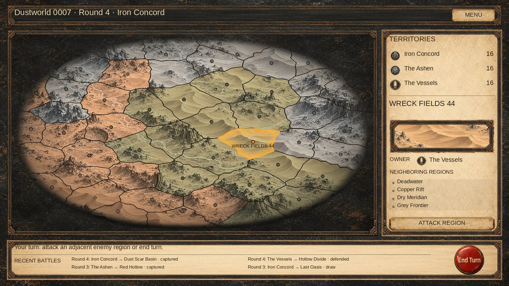

# Campaign presentation correction — 2026-10-11

Local presentation fix against master `987e8d8151c4bf79bcbfcf07821b90b4be6fca61`.
The right information panel, footer, campaign state and ten background assets are retained.

## Causes confirmed from code and the supplied screenshot

`CampaignSurface.shader` compared `POSITION` against `_SurfaceRect` in the map's local coordinates. UI Canvas batching can put POSITION in Canvas coordinates, while the material bounds remain map-local. For the 1920×1080 layout the map's Canvas-space center is (-234, 38), but its local bounds are ±680/±370. The old horizontal fade therefore starts 234 canvas units inside the left edge (about 192 pixels at the supplied screenshot width), matching the visible vertical cut. Per-vertex normalized viewport coordinates now travel in TEXCOORD2.zw; batching cannot translate them. `_SurfaceSize` converts those coordinates to design units. The normal UI clip/stencil handling stays intact.

The square terrain texture formerly covered the entire 1360×740 rectangle. This stretched terrain horizontally by about 1.84. Shared UV mapping now uses aspect-preserving cover: the square texture is cropped vertically instead of stretched. The sidebar samples the same selected surface coordinates and preserves its own texture aspect ratio.

## Presentation changes

- More elliptical silhouette with less central expansion (tanh factors 0.55/0.35, extent 0.995).
- Per-fragment radial lighting and a restrained dusty rim; smooth fade before the geometric boundary.
- Muted blue-gray, terracotta and olive ownership. A common tint brightness replaces per-faction peak normalization, which made the olive too yellow/bright.
- Clearer dark contours; a wider inward amber selection glow and stronger selected outline. Attackable neighbor outlines remain quieter than the selected region.
- Slightly larger markers and a smaller direct map label without the parchment rectangle.

Projection is still shared by region meshes, borders, markers, arrows and hit-testing. Stored polygons, neighbor relationships, ownership, background selection, resource banks and battle flow are untouched.

## Validation

- Baseline and changed campaign UI/source plus visual tests compiled with zero errors against the available Unity reference DLLs and explicit dependency stubs. This is not a native Unity build.
- Managed checks passed for 35 maps / 1680 regions: interior markers, UV bounds, pixel/hit-test coordinate roundtrips at three resolutions, unchanged saved geometry, concave markers and selection falloff.
- A further managed stress run passed for 1000 planets / 48000 regions, including projected triangulation, marker containment, UI mesh limits, custom counts and legacy geometry.
- Aspect-ratio regression passed for square and wide textures in wide and tall viewports.
- Added a native render-to-texture regression that draws the shader with Canvas-translated positions and samples both sides. It targets the original left-cut failure; execution is pending Unity.
- The native mesh regression now asserts normalized viewport coordinates on every terrain/border/marker vertex; the former mesh's zero zw values fail this contract. Native mesh execution is pending Unity.
- CPU preview uses current seed-7 geometry, production assets and matching shader formulas. It approximates interpolation, antialiasing and TMP text; it is not a Unity screenshot.

## Native acceptance still required

Unity 6000.5.4f1 is unavailable here. Import/compile the shader, run CampaignVisualTests, and open the campaign at 1280×720, 1920×1080 and 2560×1440. Check the formerly clipped left side, resize, click edge/concave regions, inspect selection and sidebar previews, then resume a saved campaign to verify its existing geography/background. Final visual matching must be assessed in the running scene.
