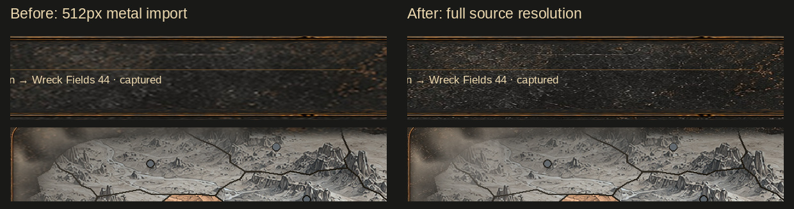
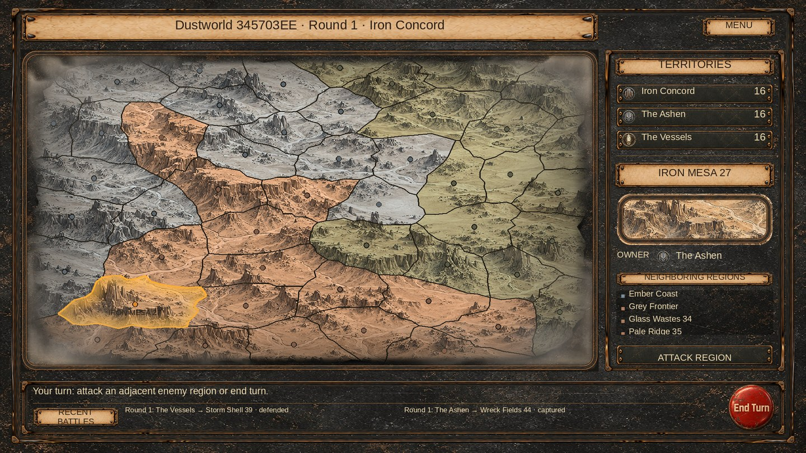

# Campaign texture quality and cloud corner alpha

The metal background source is 1254×1254, but its `DefaultTexturePlatform` import limit was 512 while the `Standalone` entry was not overridden. The background was therefore reduced before being stretched across the screen. The fallback terrain image had the same 512 limit. The top-level 2048 value alone did not remove the lower platform limit.

The default and Standalone import settings now retain the full source resolution under a 2048 limit. GPU texture compression is disabled for the campaign metal background, cloud overlay, rounded map frame, fallback map and ten random map backgrounds (14 textures). Bilinear filtering, no mipmaps, clamp wrapping, GUIDs, sprite borders and all other importer settings are preserved. This retains fine metal/terrain lines and smooth cloud alpha without changing the original artwork. The collection's plaques and controls already have uncompressed 2048 import settings and are untouched.

Clouds now have a separate `_CloudCornerOpacity` parameter, set to 0.72 alongside the existing 0.18 interior setting. A smooth diagonal weight uses `min(abs(mapPosition.x), abs(mapPosition.y))`, blending from 0.65 to 0.95. This increases corner coverage without increasing opacity over the center or the middle of straight sides. The existing rounded-footprint attenuation, desaturation, viewport feather and layer order remain in use.

For normalized map position `(0.88, 0.88)`, the shader's alpha ceiling rises from 0.253 to 0.643 before texture alpha. At `(0.90, 0.90)` it rises from 0.392 to 0.726. Center and straight-side values remain 0.1692. These are numeric shader checks, not GPU readbacks.

## Previews

CPU compositions use the real assets and fresh generated screenshot seed `0x345703EE`, with Iron Mesa 27 selected and example history. They are not Unity captures or the live campaign save. The comparison emulates the metal import's 512-pixel downscale versus full source resolution; GPU block compression is not simulated.

## Validation

- Current master source and SHA read before edits; immutable baseline at `a9067da425eeababcf0b48cea90194a43683a655`.
- Baseline and changed campaign presentation code/test declarations compile with zero errors using available older Unity reference DLLs and explicit scratch verifier stubs. Serialized-field warnings remain. No verifier changes are included in the repository update.
- All 14 importer documents parse successfully; only size/compression fields differ. GUIDs, sprite borders, pivots, PPU, alpha flags and other fields are unchanged. The 16 original campaign image hashes match current master.
- Both Unity YAML validation scripts report no reference/type errors on the metadata files. Their scene-object checks do not validate importer semantics; the separate importer checks do.
- Numeric shader checks confirm greater diagonal corner alpha and identical center/straight-side alpha. The existing native shader regression now sets the actual 0.72 corner parameter.
- Managed geometry/UV/input checks pass for 36 maps / 1728 regions, including the supplied seed. Scoped diff whitespace checks pass; both previews were rendered and inspected.

Unity 6000.5.4f1 is unavailable. Texture reimport, shader compilation, native EditMode/GPU tests, Game View appearance/input and runtime texture-memory profiling remain pending. Uncompressed imports use more build/runtime texture memory; no memory measurement is claimed. No scene, prefab, gameplay rule, map projection or saved geometry changes. This is a local presentation/import correction.
