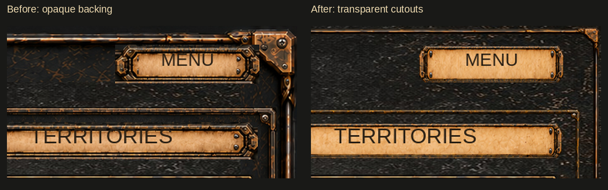
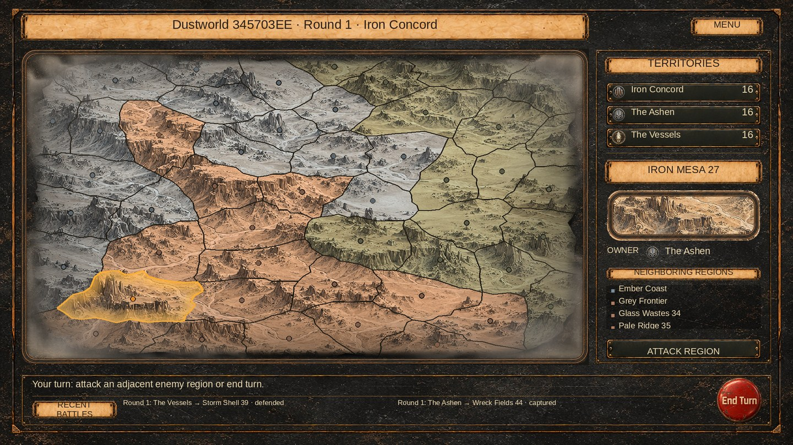

# Campaign: seamless frame cutouts

Base: `9e357c5302788014f352e3e6d8ce90e111940a2f`.
Initial diagnosis used `57ee38e6a53768192119334b586694f914ba0362`; the later
collection dropdown/statistics fix is retained, and its shared helper was checked
and included in the final compile baseline.

The current shared collection PNGs are fully opaque (alpha 255 everywhere).
Campaign's frame-only nine-slice rendering therefore exposes rectangular blocks
of baked metal around corner plates and rails. The plaque also brings an opaque
exterior rectangle into the header.

Campaign now uses transparent cutouts of the same authored designs. One existing
ConsoleMetal backing remains visible inside and outside the rails. Frame borders
include the corner joints, and campaign uses its own four-times pixel density
(eight for the larger extracted plaque). Other collection windows retain their
current assets and helper behavior.

Only `CampaignUI.CollectionSkin` changes. Serialized references, region geometry,
callbacks, map materials, cloud opacity and gameplay are unchanged.

## Assets

Generated using the built-in imagegen **edit / background-extraction** mode.
Each final PNG is copied unchanged from the generated result; no bitmap cleanup,
resampling or alpha reconstruction is performed.

| Saved path | Size | Imported border | Canvas density |
| --- | --- | --- | --- |
| `Assets/Resources/Campaign/ConsoleFrame.png` | 1672 × 941 | 128, 112, 128, 112 | 4 |
| `Assets/Resources/Campaign/InsetFrame.png` | 1239 × 1269 | 96, 96, 96, 96 | 4 |
| `Assets/Resources/Campaign/SectionPlaque.png` | 2170 × 725 | 180, 64, 180, 64 | 8 |

SectionPlaque has one imported sprite, named SectionPlaque, rect
`x=0, y=245, width=2170, height=240` (Unity bottom-left coordinates).
This excludes the generated transparent padding through native sprite metadata;
the PNG and its alpha remain intact. It is loaded with
`Resources.LoadAll<Sprite>(path).FirstOrDefault()`.
New assets have new GUIDs; existing .meta files are untouched.
Imports retain full resolution, alpha transparency, no mipmaps, bilinear clamp,
and uncompressed Default/Standalone settings.

## Review previews





These are CPU nine-slice compositions, **not Unity screenshots**. Both comparison
halves use identical geometry (seed 0x345703EE), source textures, labels and .72
cloud corner opacity. TMP font metrics, UI button tint transitions, native sprite
import and GPU rendering still require editor verification.

## Validation

- Read master source, shared assets and importer metadata before changes.
- Verified the shared helper, map shader and existing campaign textures against
  master blob hashes.
- Verified all three output PNGs match their generated originals byte-for-byte.
- Verified transparent frame openings, transparent plaque exterior, opaque paper
  center, connected metallic silhouettes, sprite crop bounds, border sizes, GUIDs
  and full-resolution uncompressed import settings.
- Both Tools/unity-yaml-verify scripts passed on the three new .meta files.
  These files contain no scene fileID references; separate YAML checks cover
  their importer fields.
- Fresh immutable master baseline and changed presentation code compiled with
  the available older Unity reference DLLs and explicit scratch verification
  stubs: zero errors in each. This is not a native Unity build.
- Unity 6000.5.4f1, full EditMode tests and Game View were unavailable.

Editor follow-up: check header/menu joins, sidebar, footer and modal corners at
1920 × 1080 and narrower aspect ratios; verify the single imported plaque sprite
and button hover/pressed states.

## Exact edit prompts

### ConsoleFrame

```text
Use case: background-extraction
Asset type: transparent Unity UI nine-slice outer panel frame.
Input image 1: EDIT TARGET, the current campaign bronze/gunmetal panel frame.
Primary request: Extract only the complete connected metallic outer frame from this image. Remove ALL of the large dark scratched metal center fill AND ALL exterior dark backing/background around the outside of the rails and corner plates. Both the enclosed center and outside the physical metal silhouette must be genuinely transparent alpha. Retain the complete continuous thin metal rails and four ornate riveted bronze corner plates, crisp highlights, scratches on the bronze, bolts, thickness, position and proportions. The rails must physically join the corner plates without any rectangular backing or detached stamps. Frame is flat, front-facing orthographic 2D game UI. Preserve the source design, dark worn bronze and steel color, and roughly 16:9 composition; keep equal small transparent margins on all sides, entire frame visible and no crop. Source corners and straight rails should not be redesigned. No inner dark material, no parchment, no extra ornament, no text, no cast shadow outside the silhouette, no glow, no background, no scene. Real RGBA transparent center and exterior, sharp detailed production sprite.
```

### InsetFrame

```text
Use case: background-extraction
Asset type: transparent Unity UI nine-slice inset panel frame.
Input image 1: EDIT TARGET, the inset panel border used in the current game UI.
Primary request: Extract only the complete connected thin outer metallic border, including the four small riveted corner joints. Remove ALL of the large scratched dark metal center fill, and remove ALL dark backing outside the physical metallic silhouette. The enclosed central opening and outside the frame must be genuinely transparent alpha. Preserve precisely the source thin worn bronze/steel border thickness, continuous rails connecting seamlessly into the four riveted corner pieces, corner shapes, scratches on the border, front-facing orthographic 2D perspective and near-square composition. Entire border visible, not cropped; equal tiny transparent margins. Do not enlarge the corner plates, do not add decorations or make rails thicker. Crisp production sprite, no rectangle background patches, no dark center material, no blur, no cast shadow outside the frame, no glow, no text. Real RGBA transparency in the central opening and exterior.
```

### SectionPlaque

```text
Use case: background-extraction
Asset type: horizontal parchment-and-metal Unity nine-slice section plaque.
Input image 1: EDIT TARGET, the current project's narrow horizontal paper plaque.
Primary request: Remove only the rectangular dark background outside the physical metal frame silhouette, especially the backing triangles and rectangular areas around the two decorative end caps and the thin top and bottom rails. Exterior must be truly transparent alpha. Keep the entire parchment center opaque and unchanged. Preserve the original VERY WIDE AND SHORT strip proportions, bronze/steel riveted end caps, continuous thin horizontal rails, aged paper color and fine crisp paper texture. This is ONE front-facing orthographic 2D UI strip, occupying essentially the full image width and height with minimal transparent edge margins, NOT a card or square panel. Preserve the target design, shape, positions and blank paper surface; no added text. All visible metal pieces must remain solid and join seamlessly, no halo, no surrounding dark rectangle, no new shadows, no glow, no extra decoration, no watermark. Sharp production RGBA cutout sprite, only outside backing removed.
```
