# Playtest — 12 октября 2026

База анализа: `master` / `1f82df4c7f2f81b8d2e1fd248aabb645a54a9f94`. Архитектурное дерево: `Assets/Scripts/Ai/V2/ARCHITECTURE.md` (ARCH-02).

Продолжение прерванной задачи: проверен сохранённый PR #182 / `0de4695af2a6a72971915ecb0621e1544a698250`. При повторном разборе прочитаны все 549 C# файлов `Assets/Scripts`; поиск владельцев и всех вызовов подтвердил существующие единственные классы и partial-владельцев. Уточнение владельца от 12 октября: пункт 5 должен показывать количество копий **в коллекции**, а не в выбранной колоде.

Масштаб: изменение поведения в существующих слоях и сериализация представления наград. Новых стратегических осей, банков, исполнителей боя и формул оценки нет. Логи матча не приложены; логи из Git не читались. Ниже подтверждены свойства кода и закрываемые сценарии, а не точная реконструкция решения ИИ в конкретном матче.

## 1. Самолёт облетает угрозу цитадели

Подтверждено: `AiAirSortiePlanner` не отсекает маршруты по стратегической AA-угрозе. `AirReconStepDirector` атакует попутно на текущем хексе, но разведывательный маршрут не обязан проходить через врага. AirSweep удерживает исполнителя через Continuity/ActorCommitments; `AppendActiveDefenceAirSupport` исключает занятые крылья. Поэтому пригодный самолёт может оставаться разведчиком около известной угрозы.

Логика:
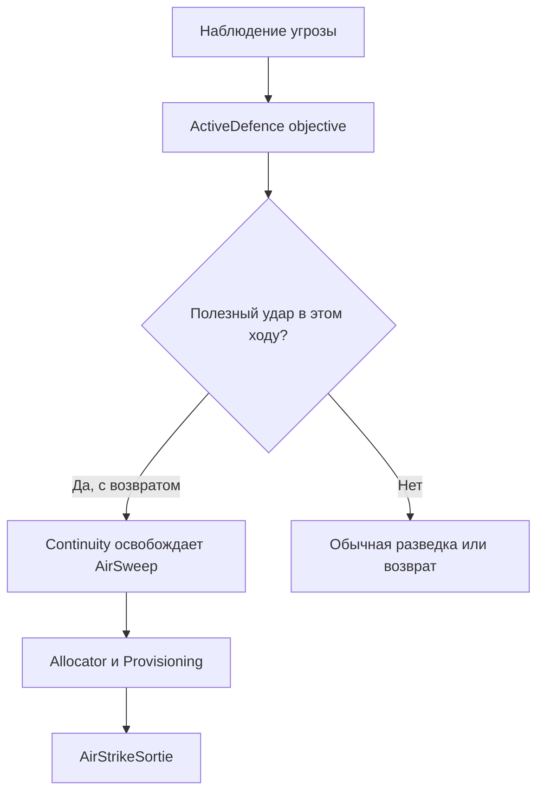
Зависимости:
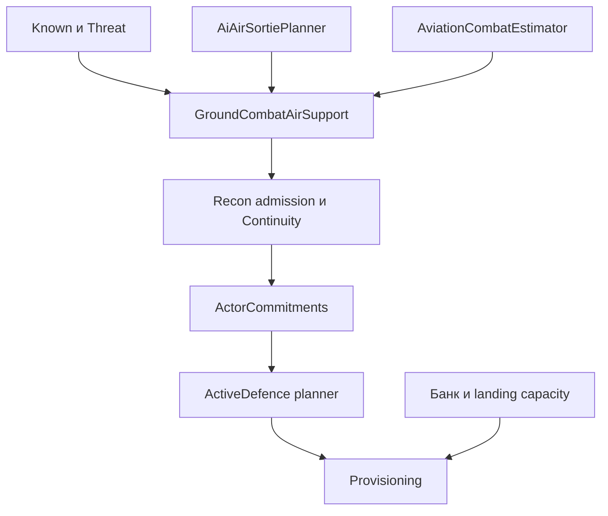

Решение на уровнях `Missions/GroundCombat`, `Continuity`, `Recon`, `Execution`: существующая проекция вылета доказывает полезный удар в текущем ходу по известному составу близкой угрозы, с реальными MP и endurance. Continuity снимает AirSweep; Recon не назначает его обратно тому же крылу. Воздушный оборонный планировщик рассматривает угрозы по EnemyEta. Старые записи разведывательного полёта закрываются только при старте профинансированного боевого вылета.

Повторная проверка выявила неточность черновика: `FirstStrikeEta == 1` означает достижение цели сейчас, но оценка многоходовой серии могла давать положительный урон от **следующего** хода уже атаковавшего самолёта. Для перехода из Recon существующий `ProjectService` вызывается с `firstStrikeThisTurnOnly: true`: маршрут и посадка доказываются прежним способом, а тот же `AviationCombatEstimator` оценивает только один проход с настоящими `HasAirAttackedThisTurn`. Дальний вылет и полностью потраченный удар не освобождают Recon. Обычная поддержка, покрытие потребностей, производство авиации и перебазирование вызывают проекцию в прежнем режиме всей серии.

Пример после исправления: самолёт с неиспользованной атакой около известного врага у цитадели может перейти с облёта на удар и возвращение. Уже атаковавший самолёт, отсутствие урона, недостижимый аэродром или чужой начатый Strike/Rebase не дают такого перехода. Проверки AP/энергии остаются обязательными. Без логов нельзя установить, какие из этих альтернатив имел самолёт из наблюдаемого матча.

## 2. Дальний рейд при близкой ударной армии

Корень в коде: свежий Raid не учитывал конкретных свободных исполнителей ближайшего оборонного ответа; действующий Raid сохранял собственную миссию. Кроме того, `IsPinnedStrongholdDefender` снимал защиту существенного защитника при наличии любой другой боевой единицы на базе, без оценки её достаточности.

Логика:
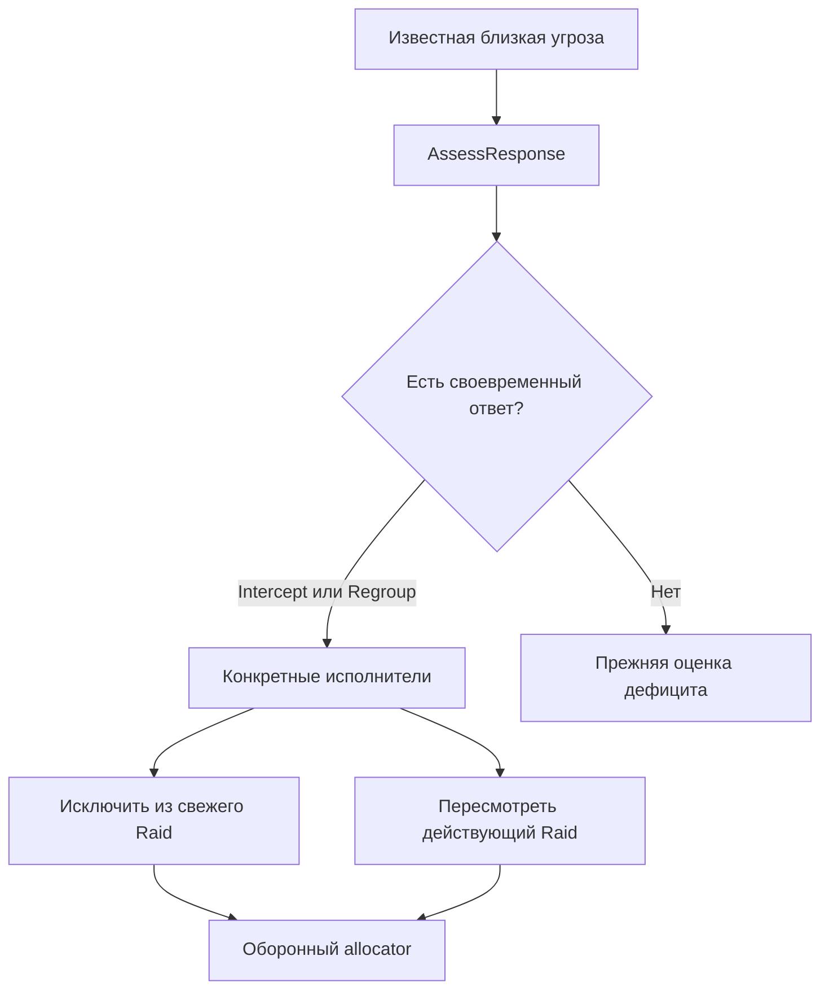
Зависимости:
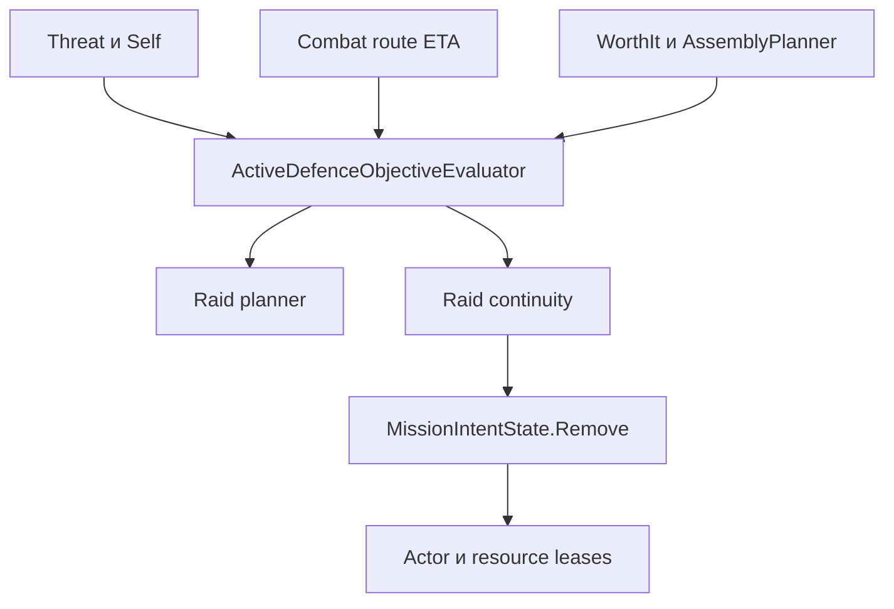

Решение на уровнях `Strategy/Objectives`, `Missions`, `Continuity`: переиспользованы `AssessResponse`, состав перехвата (host, merge actors и доноры) и набор своевременных подкреплений. Пин защитника оценивает удержание базы **без уходящей армии** через прежний `HoldChanceAtAsset`. Это проверка защитной роли боя, а не сравнение произвольных power-порогов.

После исправления нужная для своевременного перехвата/сбора армия не уходит на необязательный рейд; начатая Assault/Reinforcement-миссия уступает её обороне. Далёкая армия, не успевающая помочь, сохраняет рейд. Достаточная независимая оборона позволяет рейды. Return/RecoveryReturn не отменяются этим правилом. Новых резервов ресурсов на этапе чтения не создаётся.

## 3. Меню пустого ресурсного хекса без героя

Корень: `SelectHex` открывал панель по `hasResources`, тогда как `RefreshResourceActionRow` уже проверял героя и остальные условия стройки.

Логика:
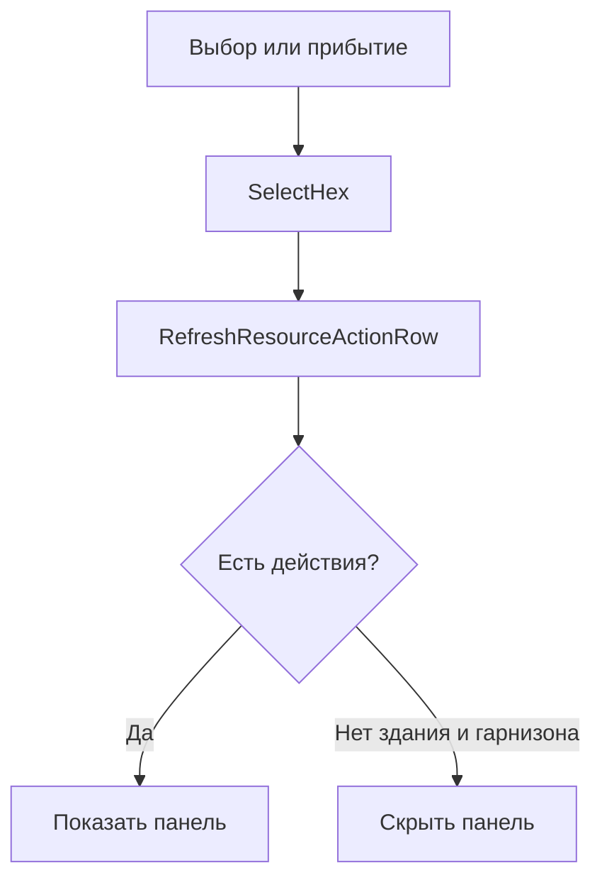
Зависимости:
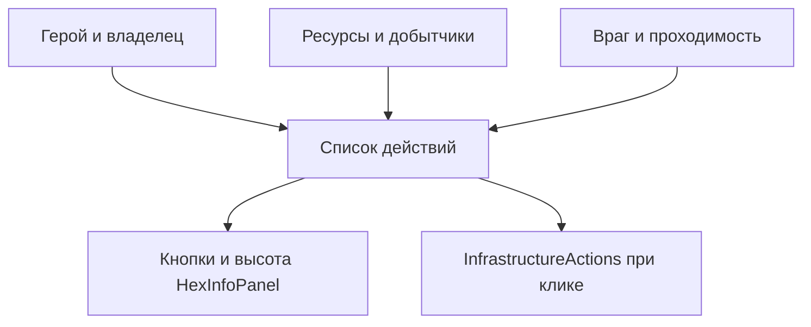

Решение в `Map/HexSelectionController`: панель и её высота используют количество действий, уже вычисленное единственным владельцем списка строительства. Правила строительства не изменены. Без героя на пустом ресурсном хексе меню скрыто; существующие база и гарнизон остаются доступны.

## 4. Выбор объекта и его хекса

Корень: прямой клик по армии присваивал `_selectedHex`, но пропускал `SelectHex`; callbacks кнопок и highlight могли оставаться от предыдущего выбора. Общие входы модалок не гарантировали синхронизацию.

Логика:
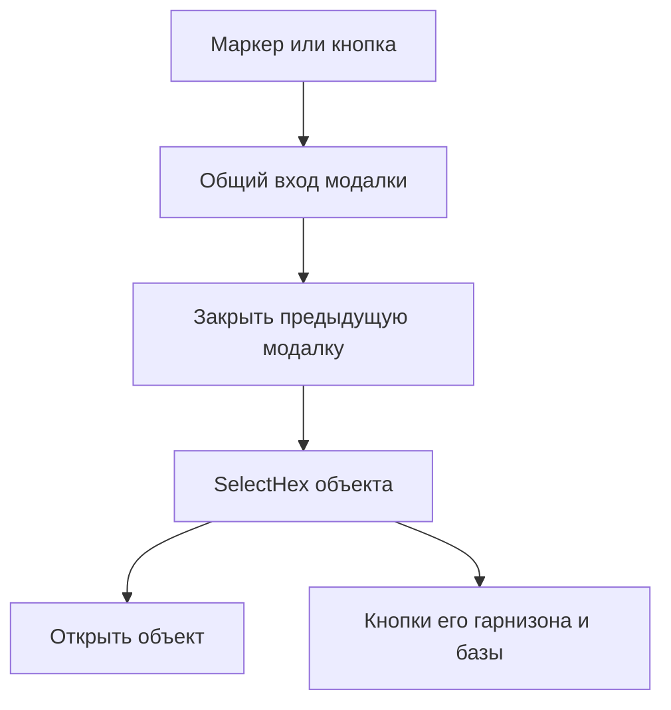
Зависимости:
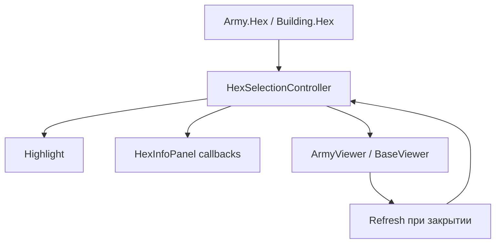

Исправлены общие own/read-only входы, remembered army click и выбор армии для приказов. Смена объекта A → B обновляет координату, подсветку и кнопки B. Порядок учитывает callback закрытия предыдущей модалки. Просмотр врага и наблюдатель остаются read-only.

В продолжении удалены ранние присваивания `_selectedHex` из кликов по своей армии и маркеру наблюдателя: callbacks закрытия прежнего окна должны видеть прежний выбор до канонического `SelectHex`. В ветке remembered army сначала закрываются Base/ResearchProduction, затем выбирается хекс и открывается `ShowLastSeen` по сохранённым `Snapshot`/siblings. Живой скрытый состав вместо снимка не подставляется.

## 5 и 5.1. Счётчик и префабы наград

Корень: окно и карточки наград собирались программно. Оформление события также перестраивалось при открытии. Отдельного счётчика копий при выборе не было.

Логика:
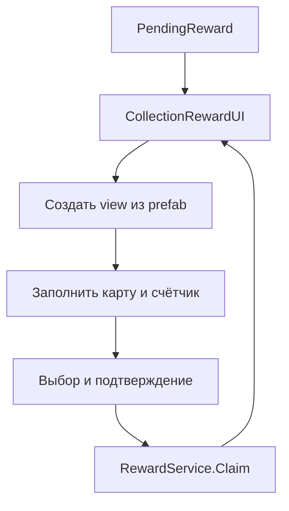
Зависимости:
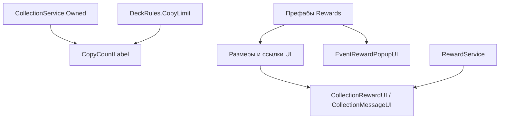

Все четыре представления находятся в `Assets/Resources/Prefabs/Rewards/`:

| Префаб | Назначение |
|---|---|
| CollectionRewards.prefab | Окно выбора, сетка, статус, подтверждение, ошибка сохранения |
| CollectionRewardCard.prefab | Art, Details, **CopyCount**, Choose, Selection |
| RewardDialog.prefab | Описание награды и ошибки профиля |
| EventReward.prefab | Награда события, получатель, карта, текст, Continue |

На `CollectionRewardCardView` поле `copyCountLabel` связано с CopyCount. Счётчик `Owned: текущее / максимум` читает `CollectionService.Owned` и `DeckRules.CopyLimit`, включая настоящий лимит equipment/mutator. Это доступные копии **в коллекции**, из которой собираются колоды: награда не относится к одному редактируемому deck draft. После Claim отображается уже увеличенное значение.

UI не меняет транзакции профиля, случайную выдачу, лимиты и подтверждение. Размеры и связи новых представлений авторские; открытие не переставляет их через прежний генератор оформления. В сцене сохраняется прежний владелец видимости EventRewardPopupUI; его прежние визуальные дети скрываются при создании prefab view.

## 6. Пустые служебные строки в списке колоды

Проверены `CollectionCardCellView`, `CollectionScreensUI.Change`, `DeckRules.TryChange`, `CollectionProfile.CopyDeck`, `RefreshDeck`, пул `DeckItem`, `CollectionDeckRowView`, префаб строки и MainMenu. `TryChange` на копии draft находит одну запись по ключу и увеличивает её count; повторное добавление не создаёт новую запись. `DeckItem` переиспользует строки, неиспользованные скрывает. Менять эту логику ради визуального пустого поля оснований нет.

В представлении подтверждены две причины пустого места:

- Для каждой непустой категории создаётся отдельная строка `SetHeader`. Её высота была 14 px, тогда как шрифт заголовка 13 px и его высота строки определяется метриками TMP, а режим `Ellipsis` установлен общим оформлением. При нехватке высоты заголовок может стать пустой строкой над первой добавленной картой.
- `Checks` — постоянно активный TMP-объект в `MainMenu/CollectionWindow/Deck/DeckCards/Viewport/Content`. `VerticalLayoutGroup` учитывает его даже с пустым текстом: остаются высота строки/интервал после последней карты.

Это подтверждённые дефекты раскладки. Без снимка исходного сбоя или Unity-прогона нельзя доказать, какой именно из них наблюдал владелец; исправление не заявляет воспроизведение конкретного кадра.

Логика:
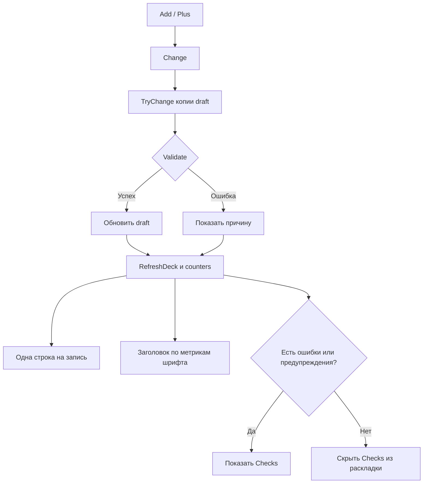
Зависимости:
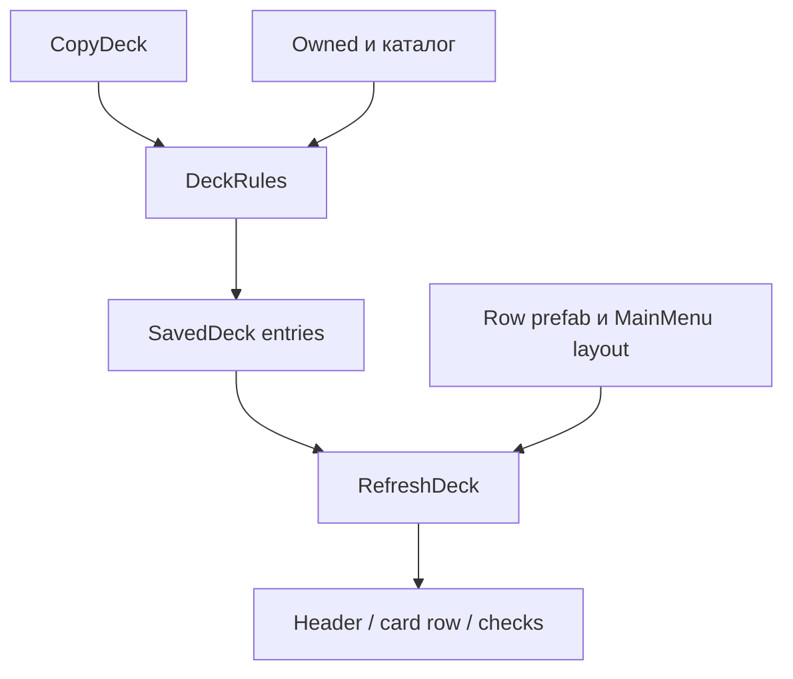

Решение на уровне `UI/Collection`: `CollectionDeckRowView.SetHeader` выделяет не менее 22 px и не менее `headerLabel.preferredHeight + 4`. Это учитывает реальный авторский шрифт, а не подгоняет одну строку под конкретную карту. `CollectionScreensUI.RefreshDeck` оставляет Checks активным только при непустых ошибках/предупреждениях. Заголовки категорий сохраняются; они видимы и отличимы от строк карт.

Игровой пример: при добавлении первой карты в пустую категорию показываются читаемый Main/Equipment/Mutator и одна карточная строка. Повторное добавление этой карты меняет её счётчик, не добавляет строку. Для корректной колоды после последней карты нет пустого Checks; при удалении последнего героя появляется настоящее предупреждение, при его возврате служебная строка снова исчезает. Пул строк, порядок категорий, прокрутка, количественные лимиты, очки, владение картами и сохранение колоды продолжают использовать прежние владельцы.

## Связанные механизмы и проверка

- Цепочки рассмотрены от входных фактов/клика до исполнителя и обратно до источника данных и владельца состояния.
- Физическая пригодность вылета остаётся у AiAirSortiePlanner, урон — у AviationCombatEstimator, оборонный ответ — у AssessResponse, удержание — у HoldChanceAtAsset, стройка — у прежнего списка действий, копии — у DeckRules/CollectionService.
- `TryFinishWing` по-прежнему проверяет tentative AP, physical Energy, spendable stock, уже занятые ресурсы и маршрут посадки. Новые проверки только читают данные.
- Удаление миссии проходит через существующий `MissionIntentState.Remove`/lease lifecycle. Изменение состояния боевого вылета — через прежний исполнитель и WorldDeltaLifecycle.
- Новый долгоживущий кэш не добавлен; используются snapshot и существующие владельцы read-cache. Нет копии формул стоимости, боя или лимитов.
- Усиленный `IsPinnedStrongholdDefender` читают также Attack, ImmediateOpportunity, GroundCombatActorEligibility и Provisioning. Они теперь не принимают слабую оставшуюся единицу за достаточную защиту; достаточная независимая защита снимает пин. Чужой занятый мобильный защитник не считается свободным, присутствующий гарнизон продолжает учитываться как физическая защита.
- `git diff --check`: без ошибок.
- На четырёх префабах выполнены оба штатных YAML-валидатора: нет отсутствующих/дублирующихся fileID, переполнений и проверяемых несовпадений типов.
- Дополнительно проверены GUID новых view-компонентов и 22 обязательные сериализованные ссылки на поля представления во всех четырёх префабах.
- Добавлены 9 регрессионных случаев в существующие EditMode-файлы: 6 сочетаний силы/гарнизона/занятости оставшейся защиты, авиационная проекция «удар сейчас против будущего урона», читаемый заголовок после переиспользования строки, два добавления одной карты с одним UI-элементом и появлением/скрытием настоящих предупреждений. Старый тест неизвестного оставшегося состава теперь ожидает консервативный пин; достаточная известная защита проверяется отдельно.
- Unity 6000.5.4f1, C#-сборка и EditMode/runtime-тесты не запускались: Unity, dotnet и Mono отсутствуют. Compile baseline и дифференциальный прогон `ai-verify` поэтому недоступны; C#-синтаксический анализатор тоже недоступен. Успешная компиляция и прохождение новых тестов не заявляются. По заданию ручной прогон не блокирует передачу.

## Ручная приёмка

1. Самолёт с оставшейся атакой возле известной угрозы цитадели; затем уже атаковавший самолёт и случай без достижимого аэродрома.
2. Слабый гарнизон плюс сильная полевая армия: свежий и начатый Raid. Отдельно достаточный гарнизон и армия, которая не успевает к угрозе.
3. Ресурсный хекс без героя/с героем; база и гарнизон без героя.
4. Выбрать хекс A, кликнуть армию/базу B, переключиться на гарнизон B; повторить для врага, запомненной армии и режима наблюдателя. Подсветка и callbacks должны относиться к B до закрытия окна.
5. Выбор 2 из 5, запрет третьего выбора, Claim, defeat, восстановленная награда, описание, ошибка сохранения и награда события; счётчик до/после выдачи и настройка через prefab.
6. Первая карта категории, вторая копия той же карты, удаление/возврат последнего героя, смена колоды и повторное открытие: читаемые заголовки, одна строка карты с обновляемым count, отсутствие пустых предупреждений, реальные предупреждения видимы, неиспользованные строки пула не занимают место.
