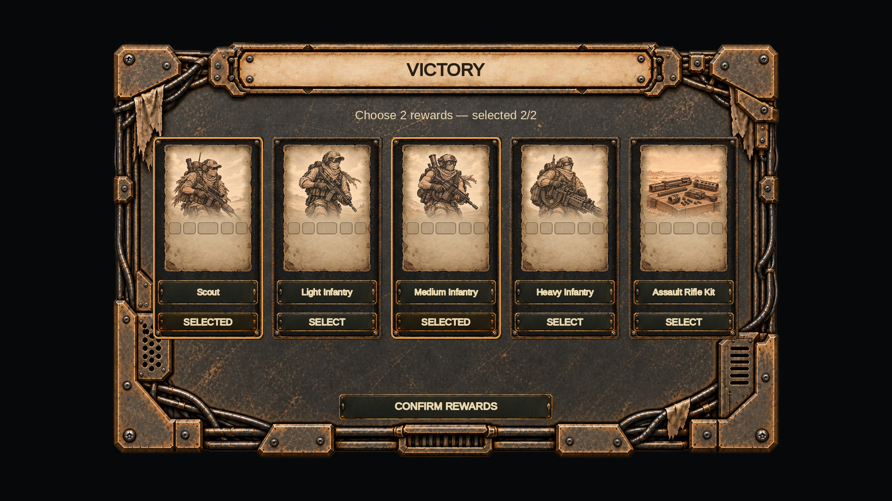
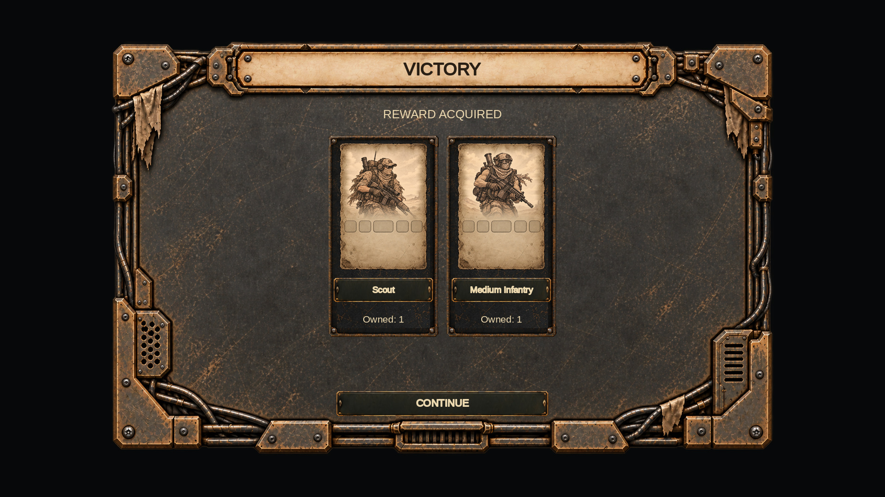
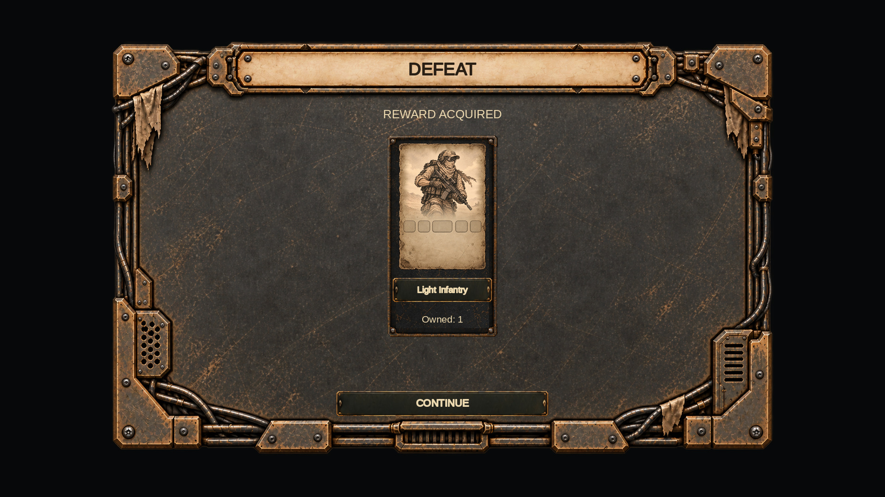
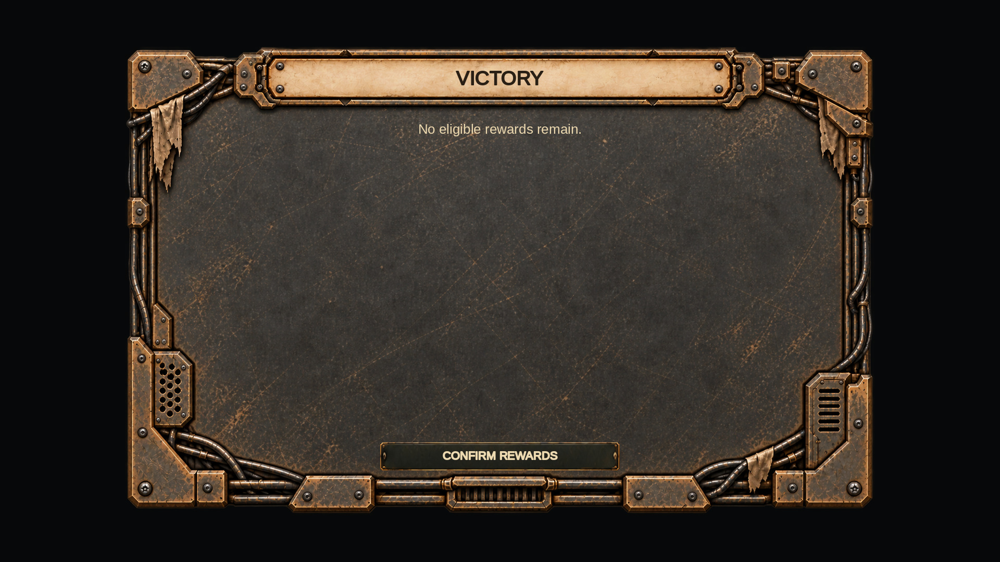
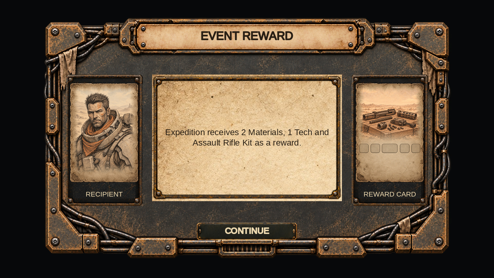
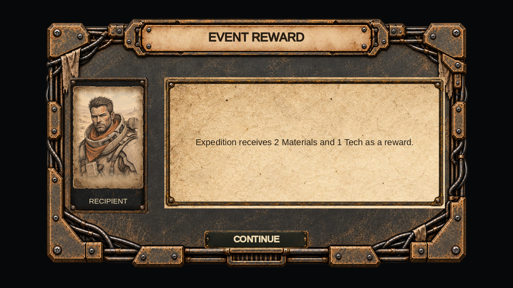
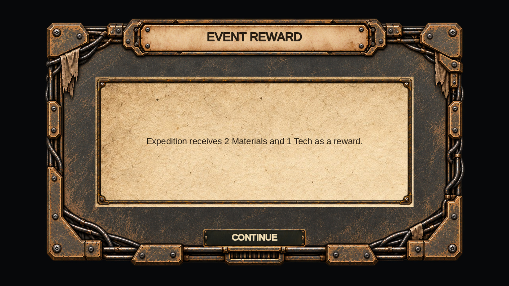
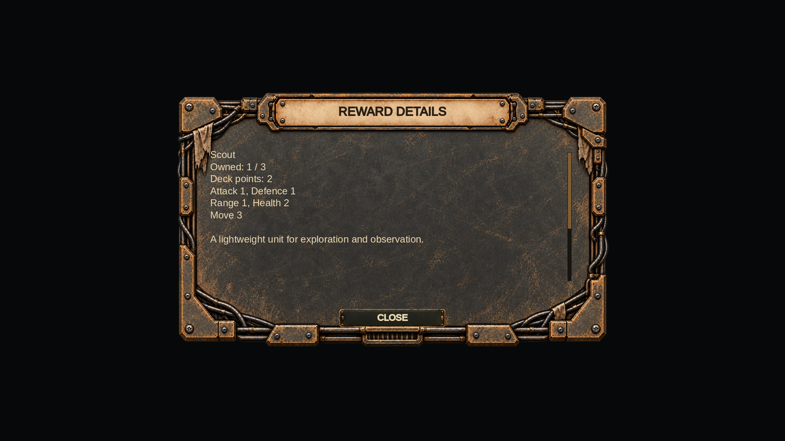
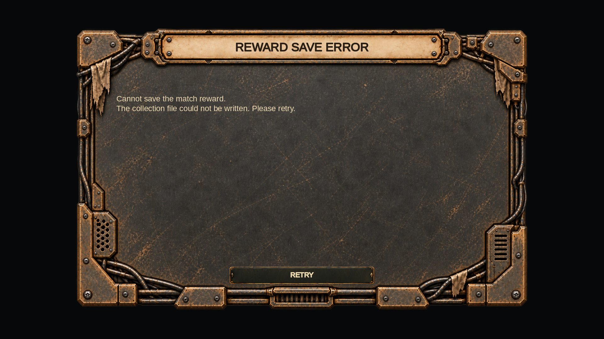

# Награды — оформление по Panel_PreBattle

Масштаб: локальное изменение UI. Оформлены выбор наград после победы, подтверждение, полученные карточки после победы/поражения, пустое предложение, описание карточки, уведомления и ошибки сохранения/продолжения кампании. Окно награды события показывает портрет получателя, итоговую фразу и первую наградную карточку; ширина текста меняется при отсутствии изображений.

## Реализация

- `CollectionRewardUI`: затемнение, консоль 1440×900, до пяти предложений в одном ряду; один или два результата центрируются. Выбранные карточки отмечены бронзовой обводкой и надписью SELECTED. Используется существующий `ArmyUnitCardUI.SetupPreview` с характеристиками/стоимостью; кнопка названия и сама карточка открывают описание. Длинные подписи ограничены размером превью.
- `EventRewardPopupUI`: существующие сериализованные объекты переносятся в компактную консоль при первом показе. Их идентичность и ссылки сохранены. Состояния с портретом и карточкой, только с одним изображением и без изображений используют разные ширины пергаментного поля.
- `CollectionMessageUI.ShowReward`: отдельное оформление описаний/уведомлений наград, прокрутка длинного текста, возврат фокуса после закрытия. Обычный `Show` сохраняет прежний вид.
- `CollectionUIElements`: общие рамки, заголовки, кнопки и скролл наград. Существующая формула вписывания карточки вынесена в `FitCardPreview` и используется также `CollectionCardCellView`.

Правила выдачи, лимиты, баланс и операции записи не изменены. `RewardService`, `CollectionService`, `HexSelectionController.Events` и `CampaignMatchBridge` совпадают с исходной ревизией. Сцены, существующие .meta и GUID не изменялись. Событие по-прежнему подтверждается кнопкой или Space; действия Confirm/Claim/Dismiss/Retry и продолжение кампании сохранены.

## Ассеты

Две рамки созданы встроенным ImageGen по приложенному Panel_PreBattle и геометрическим направляющим. Исходники генерации скопированы в проект без обрезки, перекрашивания или изменения пиксельных размеров. Числа в именах обозначают **логические размеры UI**, а не фактический размер PNG.

| Resource path | Логический размер | PNG | Применение |
|---|---:|---:|---|
| UI/Rewards/RewardConsole_1440x900 | 1440×900 | 1586×992 | Результат матча и ошибки сохранения |
| UI/Rewards/RewardDialog_1060x630 | 1060×630 | 1627×967 | Событие, описание и уведомление |

Импорт: отдельный Sprite, FullRect, нулевые borders, alpha сохранён, mipmaps выключены, NPOT без пересчёта, MaxSize 4096 для Default/Standalone, без компрессии. В UI применяется Image.Simple с preserveAspect. Пропорции отличаются от целевых менее чем на 0.1%. Внешние срезанные углы прозрачны; внутренняя поверхность практически непрозрачна (генератор сохраняет небольшую вариацию alpha). Кнопки, вложенные рамки, полоса прокрутки, пергамент и игровые иллюстрации переиспользованы из проекта.

## Проверки

- git diff --check: без ошибок.
- Разбор изменённых C# через tree-sitter: без синтаксических ошибок.
- Оба инструмента Tools/unity-yaml-verify: новые три .meta прошли; сцены/префабы не редактировались.
- Проверены уникальность новых GUID между собой и среди локально доступных .meta, пути Resources, Sprite importer и совпадение PNG с оригиналами генерации.
- Геометрия рамок и рядов проверена для 1280×720, 1920×1080 и 2560×1440. Просмотрены девять композиционных превью.
- Дифференциальная компиляция относительно исходной ревизии b9d2f9b (532 исходника) через Roslyn с Unity 2021 reference DLL и EngineStubs: новых ошибок 0. Исходная и изменённая версии имеют одинаковые четыре ошибки совместимости проверочной среды: FindObjectsByType в SceneUIAudioBinder/GameMenuPanelUI и отсутствующие itemText/template у TMP_Dropdown в EngineStubs. Проверочная среда не менялась для сокрытия ошибок.

Unity 6000.5.4f1, EditMode и PlayMode здесь не запускались. Превью ниже — CPU-композиции реальных ассетов по координатам UI, **не скриншоты из Unity**. Текст и набор карточек демонстрационные; метрики шрифта/выделение приблизительны. На них не воспроизведены динамические характеристики, стоимость и подписи игрового префаба. В событии показана репрезентативная иллюстрация; игра выбирает detailArt с fallback на art.

Перед принятием проверить в Unity: победа (5 предложений → выбор 2 → Claim → Continue), поражение (1 полученная карточка), уменьшенные/пустые предложения, повторное открытие ожидающей награды из меню/кампании, Details/Close/Escape/фокус, ошибки записи и Retry, продолжение кампании, многократное Show/Hide события с обеими/одной/без иллюстраций и подтверждение Space. Запустить полный EditMode набор.

## Превью











## Промпты генерации

Каждый запрос: edit, input 1 — направляющая указанного логического размера, input 2 — Panel_PreBattle.png; transparent_background=true.

### RewardConsole_1440x900

```text
Use case: style-transfer. Asset type: a production Unity UI background sprite. Input image 1 is an exact geometry/layout guide, NOT a style reference. Input image 2 is the sole material/style reference (Panel_PreBattle).
Replace the flat guide's surfaces with the visual style of image 2: hand-painted worn graphite iron and muted antique bronze, hard beveled mechanical corner plates, bolts, short thick conduits hugging the outside rails, restrained scuffs and a few scraps of worn cloth tucked along the frame. Warm pale aged parchment inside the one header plaque. Matte, readable, post-apocalyptic strategy UI; reproduce the reference's substantial dark metal and weathered bronze, not polished gold.
CRITICAL geometry: retain image 1's exact 1440 by 900 canvas and entire panel silhouette, no cropping. Maintain the guide's exact aspect ratio 1.600000. The header plaque remains at x=200,y=20,width=1040,height=85. Border embellishments stay within a 52px outer edge band, top header stays only in its allotted band. Large central and lower body must be uninterrupted dark, calm fine-grained metal, with no divisions or internal slots. No circular watermark, emblems, weapons, cards, words, letters, symbols or numbers. No light paper in the body. No additional buttons. Keep all four corners visible. Transparent outside the panel's lightly clipped/rounded corners; fully opaque metal and paper inside. Straight-on flat UI sprite, no perspective, no shadow cast beyond the sprite. Make a clean complete game-ready backing, matching input image 2's materials; preserve exact layout of image 1.
```

### RewardDialog_1060x630

```text
Use case: style-transfer. Asset type: a production Unity UI background sprite. Input image 1 is an exact geometry/layout guide, NOT a style reference. Input image 2 is the sole material/style reference (Panel_PreBattle).
Replace the flat guide's surfaces with the visual style of image 2: hand-painted worn graphite iron and muted antique bronze, hard beveled mechanical corner plates, bolts, short thick conduits hugging the outside rails, restrained scuffs and a few scraps of worn cloth tucked along the frame. Warm pale aged parchment inside the one header plaque. Matte, readable, post-apocalyptic strategy UI; reproduce the reference's substantial dark metal and weathered bronze, not polished gold.
CRITICAL geometry: retain image 1's exact 1060 by 630 canvas and entire panel silhouette, no cropping. Maintain the guide's exact aspect ratio 1.682540. The header plaque remains at x=170,y=16,width=720,height=62. Border embellishments stay within a 52px outer edge band, top header stays only in its allotted band. Large central and lower body must be uninterrupted dark, calm fine-grained metal, with no divisions or internal slots. No circular watermark, emblems, weapons, cards, words, letters, symbols or numbers. No light paper in the body. No additional buttons. Keep all four corners visible. Transparent outside the panel's lightly clipped/rounded corners; fully opaque metal and paper inside. Straight-on flat UI sprite, no perspective, no shadow cast beyond the sprite. Make a clean complete game-ready backing, matching input image 2's materials; preserve exact layout of image 1.
```
