# AI: реализация согласованных пунктов 1–8

Исходная ревизия: `715fa6d85dc7be71d3caf3b0d660167364c46d04` (`master`). Рабочая ветка: `codex/ai-match-behavior-calibration`. Масштаб — локальные исправления и калибровка поведения в существующих владельцах логики. Новых игровых классов, миссий, слоёв и хранимых флагов нет.

Источник игровых примеров — предоставленный `AiDebug(2).log`, а не файл из git. Пункты 1–2 — подтверждённые дефекты. Пункты 3–4 и 8 — согласованная калибровка. Пункты 5–7 устраняют конкретные несогласованности фактов/допусков; они не доказывают ошибочность каждого похожего игрового решения.

Каноническое дерево ответственности — `Assets/Scripts/Ai/V2/ARCHITECTURE.md`: Analysis формирует факты, Strategy/Objectives оценивает цели, Missions предлагает действия, State фиксирует допуск, Provisioning проверяет и собирает возможности, Execution исполняет доменные действия. Recon/Reaction принимает только немедленное тактическое решение. `AiArmyRoles` остаётся общим владельцем допустимого изъятия гарнизонных войск. Поиск определений и вызовов выполнен по всему `Assets/Scripts`; частичные файлы WorldAnalysis и AggressionMissionLayer — части существующих классов.

## 1. Разведчик перестаёт бегать между двумя угрозами

**Владелец:** `Reaction/ReconReactionPolicy.FindStrongExposedThreat → PickFleeTarget`.

Раньше оценивалось удаление от одного выбранного противника и привлекательность конечной клетки. Первый фактический шаг мог приблизить разведчика ко второму противнику, который до шага находился за радиусом реакции. Следующая реакция выбирала обратный путь. Ysolde T23, армия #44: `(1,-3) → (2,-3) → (1,-3)`, расход движения без улучшения положения.

Теперь реакция сравнивает исполнимые соседние клетки по минимальной дистанции до всех известных сильных угроз в текущем радиусе и одном внешнем кольце. Шаг должен строго увеличивать этот минимум. Без улучшения возвращается существующий Flee без цели; исполнитель останавливается. Скрытый разведчик сохраняет прежнюю отдельную реакцию на детекторы. Среди одинаково безопасных вариантов сохраняются оценки дружественного направления, разведки, детекторов и следа.

Логика:
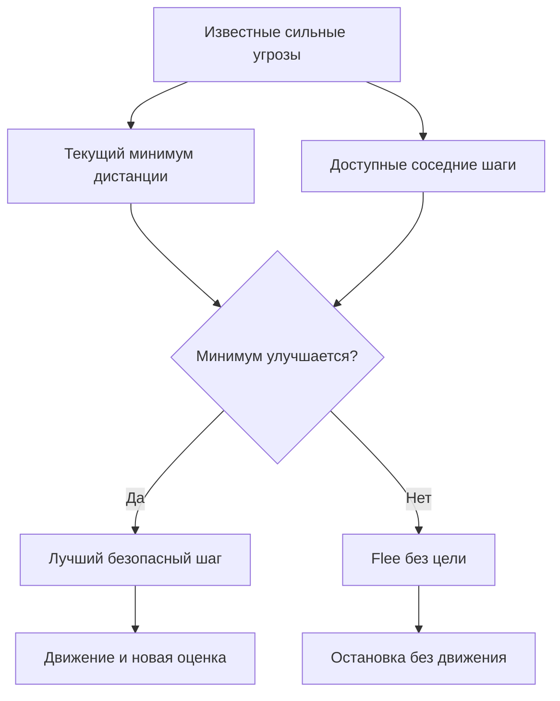

Зависимости:
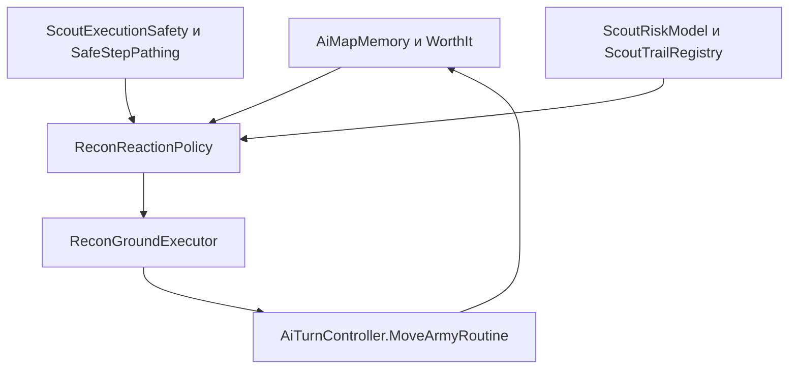

Почему исправляется причина: строго возрастающая величина на фактических шагах исключает цикл при неизменных угрозах; дальний привлекательный пункт не скрывает первый опасный шаг. Полный постоянный запрет возврата не нужен: при изменившихся знаниях ранее посещённая клетка может стать безопаснее. Обычный шаг разведки продолжает использовать `LastEscape`; аварийная реакция нового состояния не получает. Возможный компромисс: разведчик удержит позицию, если выход требует сначала не улучшать минимальную дистанцию. Это согласованный безопасный вариант вместо расходования MP на колебание.

Проверки: два противника, внешнее кольцо, остановка между угрозами, сохранение MP; существующие сценарии безопасного обхода и заблокированных клеток.

## 2. PREPARE проверяет применимость выпуска ко всей собственной колоде

**Владелец:** `Strategy/Objectives/DevelopmentOpportunityEvaluator.StructuralPreparationBlock`.

Brynn T12 построила лабораторию `(4,-5)` за 2 AP и по одному H/E/T, хотя доступные мутагенные результаты не имели совместимого носителя на поле, в руке и оставшейся колоде. Наличие каталога само по себе открывало подготовку.

Теперь после `OfferedCards` каждый чертёж разрешается через `ResearchProductionCatalog.ResolveResult`. Достаточен хотя бы один результат: Unit/Hero, либо Equipment/Mutator с совместимым носителем. Для собственных живых юнитов и карт руки используется `EquipmentSystem.CanAttachPreview` — совместимость и свободный слот без требования оплатить будущую установку сейчас. Для всей оставшейся колоды — `EquipmentSystem.FitsHost`. Пленные и призванные живые юниты не обосновывают подготовку.

Логика:
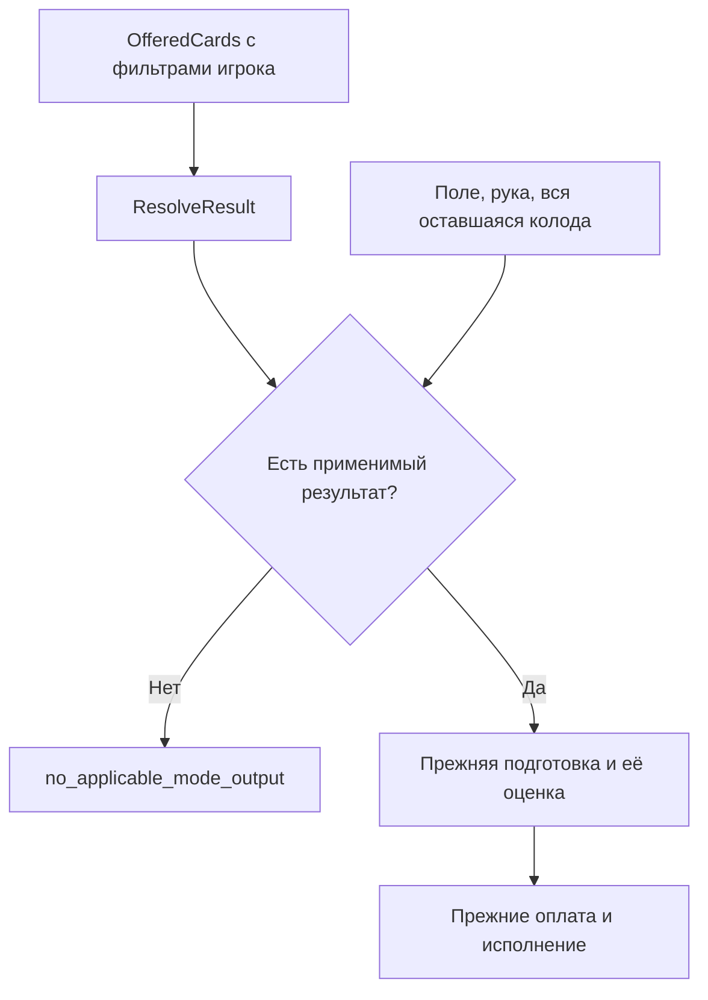

Зависимости:
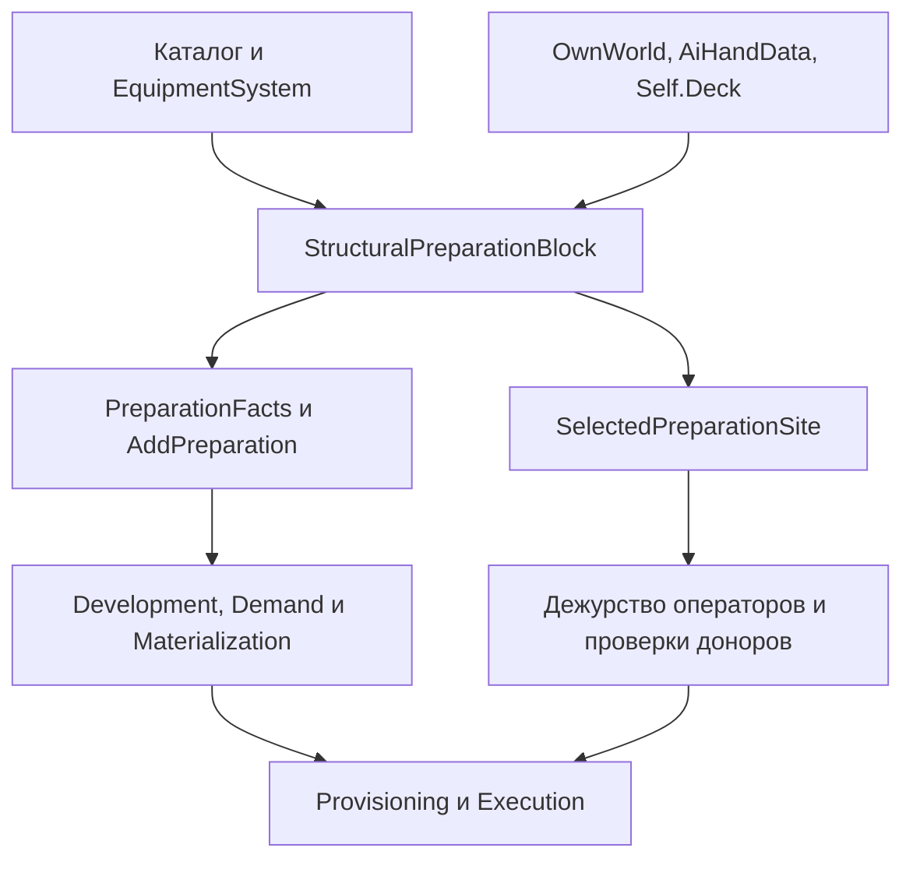

Ожидаемый результат примера: бесполезная подготовка Brynn не предлагается; ресурсы и оператор остаются доступны другим задачам. Bio-носитель только в недобранной колоде уже разрешает подготовку. Отдельный дорогой будущий продукт не выбирается заранее, текущая нехватка его AP/ресурсов не является структурным запретом. READY-генерация на существующем оснащённом объекте продолжает прежние проверки. Доставка оператора к уже построенному объекту также повторно требует структурно применимый выпуск; это проверка назначения доставки, а не изменение генерации. Та же структурная оценка снимает необоснованное закрепление оператора за ещё не построенным объектом; новое исключение в каждом потребителе не добавлялось.

Проверки: механическая/Bio-колода, разрешённый результат чертежа, занятый слот руки и самостоятельно размещаемый результат. Обновлён прежний тестовый каталог с некорректным Equipment без EquipmentGrant: теперь его нейтральный результат — Unit.

## 3. Будущий доступ базы меньше перевешивает текущий доход

**Владелец:** `Foundation/AiConfigV2.TaskScore`; прежние преобразования `Evaluation/TaskScoreEvaluator`.

Изменены только максимумы: `taskScoreAirfieldMax: 8 → 4`, `taskScoreEconomicExpansionMax: 6 → 3`. Цена AP/ресурсов, доходные слоты, Radar, фронт и коридор сохранены. Общий преобразователь EconomicExpansion используется также ценностью расширения добычи и освобождения кластера в Raid: их соответствующая часть оценки тоже уменьшается вдвое. Это общее действие согласованной калибровки, а не изолированное исключение для FoundBase.

Логика:
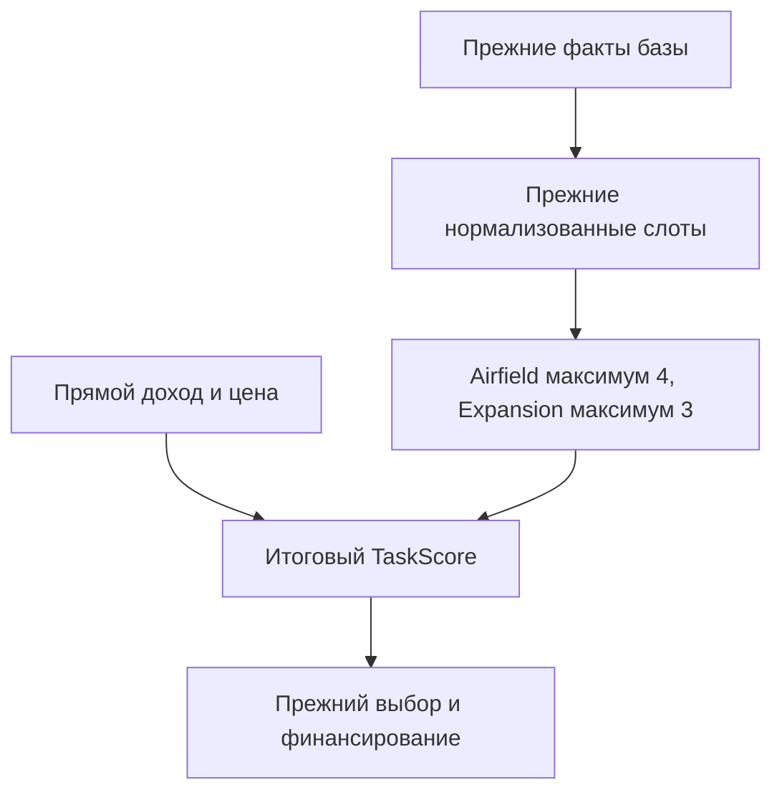

Зависимости:
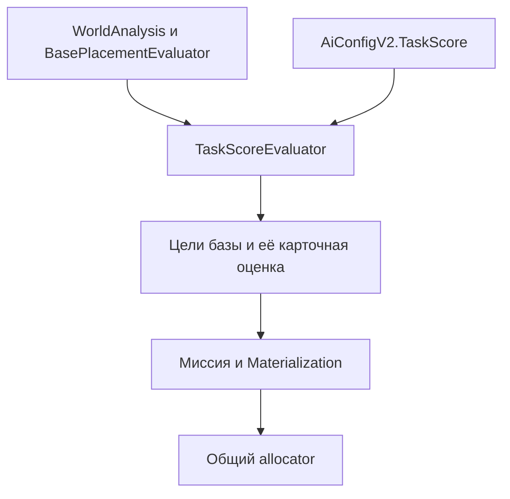

Thane T10, база `(0,-3)`: при прежних входах оценка `6,5 → -0,5`, поскольку доходных слотов нет. T13: `5,7 → -1,3`. Это арифметическая чувствительность, не повтор матча и не обещание отмены уже принятого обязательства. Наличие лучшей доступной добывающей альтернативы проверяется отдельно прежними правилами. Решение масштабируется на любую базу с такими же признаками, а не на координаты примера.

## 4. Существующий Hunt получает приоритет возле своей добычи

**Владелец:** `Strategy/Objectives/ReconObjectiveEvaluator.HuntAt`.

Уже доказанная выполнимая охота получает StrategicRelevance `1` вместо `0,7`, если цель находится в существующем `economySiteThreatRadius` от известного собственного добывающего объекта с ненулевым `CollectedAmount`. Base/Citadel, чужие и недобывающие объекты исключены.

Логика:
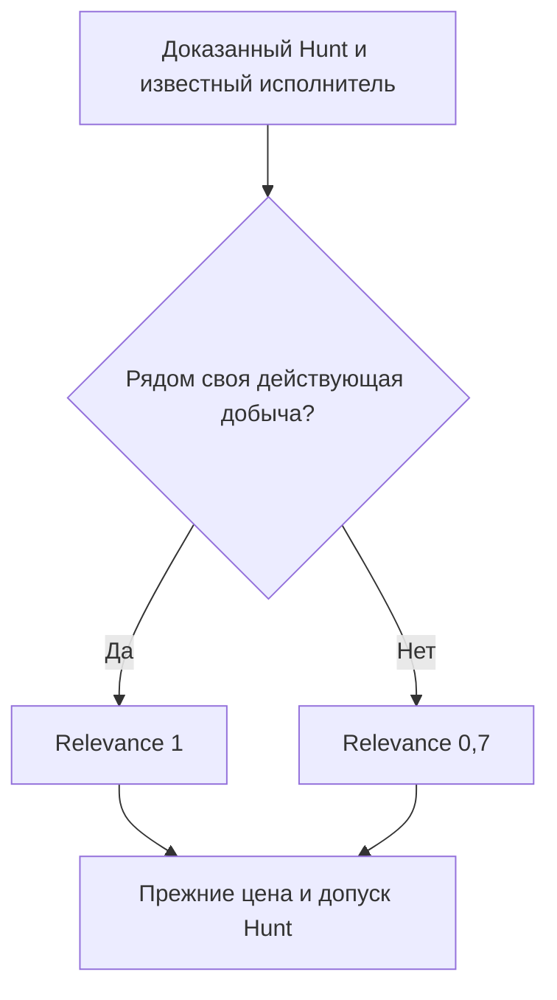

Зависимости:
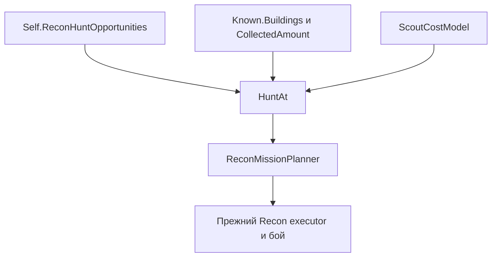

На одной и той же доступной охоте это прибавка `1,8` TaskScore без изменения стоимости или боевой силы. Армия, которая не может победить или добраться, не становится пригодным охотником из-за важности добычи. Новых постовых армий, постоянного назначения охраны или производственного спроса не вводилось. Это повышает шанс убрать доступного диверсанта рядом с доходом, но не гарантирует сохранность каждого объекта.

## 5. Возраст угрозы гарнизону не зависит от контейнера памяти

**Владелец:** `AiArmyRoles.GarrisonThreatFloor`; часы/наблюдение — существующий `State/AiReconMemory.Observe`, порядок — `Analysis/WorldAnalysis`.

Раньше контакт в `AllKnownEnemySightings` всегда получал возраст 0; после перехода того же контакта в Historical начинали работать SeenTurn, затухание и расширение зоны возможного движения. Первый BuildSelf также мог читать часы прошлого хода, потому что Observe выполнялся позже.

Теперь видимый контакт имеет возраст 0, невидимый — `currentTurn - SeenTurn`, независимо от источника. Уже существующий Observe перенесён перед BuildSelf в Scan и RefreshStrategicKnowledge. Новых часов, параметров во всех потребителях и обходных резервов не добавлено.

Логика:
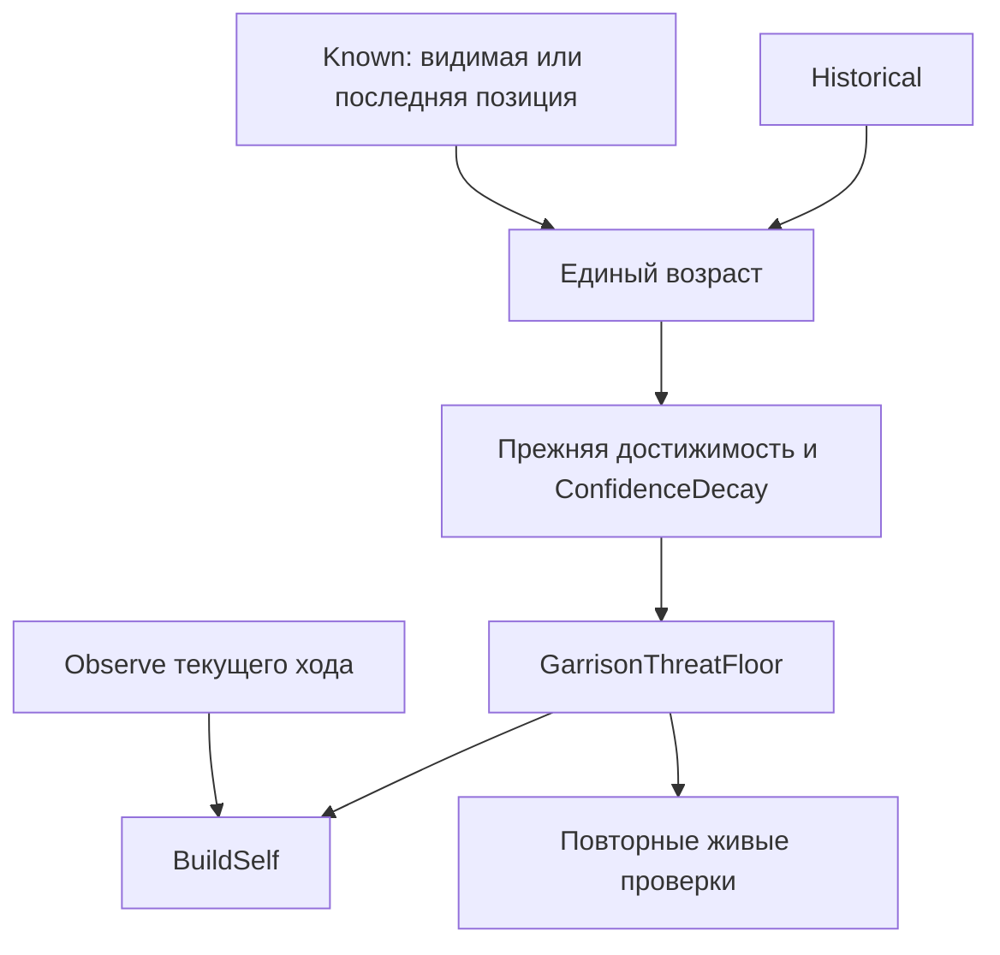

Зависимости:
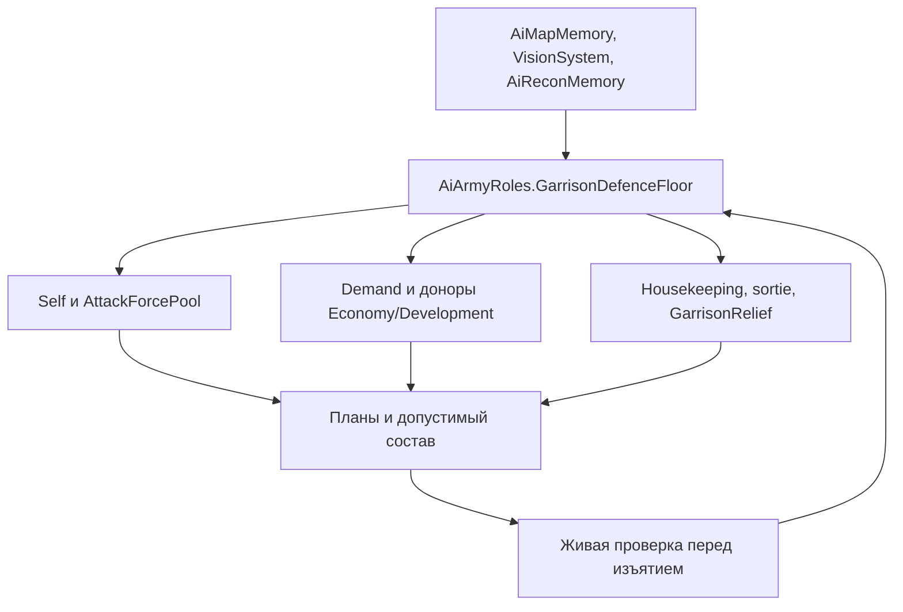

Контакт силой 40 возрастом два хода теперь даёт один и тот же вклад `40 × 1,3 × 5/6 = 43,33` до и после перехода между контейнерами, вместо скачка `52 → 43,33`. Это пример формулы, не восстановленный контакт из матча. Расширение возможной зоны движения старого врага иногда повысит осторожность, поэтому не обещается снижение каждого floor. Сохранены доли 10%/5%, минимум прикрытия, множитель 1,3, сумма угроз и отдельное правило Citadel. У Thane T25 большой резерв не исправлялся произвольным снижением множителя.

## 6. Используется уже существующая атака по возможности

**Владельцы:** `Missions/AggressionMissionLayer.AppendAttack` и общий допуск `AttackSecondaryPolicy.CanStart`.

До оценки состава ранний `MobilizationOpen == false` исключал свежую цель. Поэтому существующий `AttackForceReadiness.IsOpportunity`, уже умеющий обходить порог 80% силы, не получал возможности сработать.

Ранний отсев снят. При закрытой мобилизации новая основная операция проходит общий допуск только при свежем наблюдении и существующем IsOpportunity: шанс не ниже `raidMinViableWinChance` против известных наземных защитников. Пустая неизвестная защита не является такой возможностью. Обычные проверки прикрытия дома, маршрута, опасных контактов, состава и стоимости сохраняются. Неудача не открывает свежий Gather; Preparation и несвязанный Demand остаются за прежним мобилизационным барьером. Вторичная операция сохраняет собственный surplus-допуск, включая её прежнее правило наблюдённой пустой базы.

Логика:
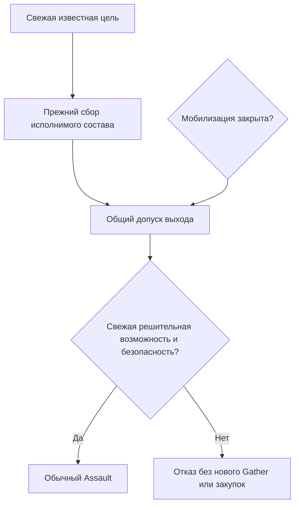

Зависимости:
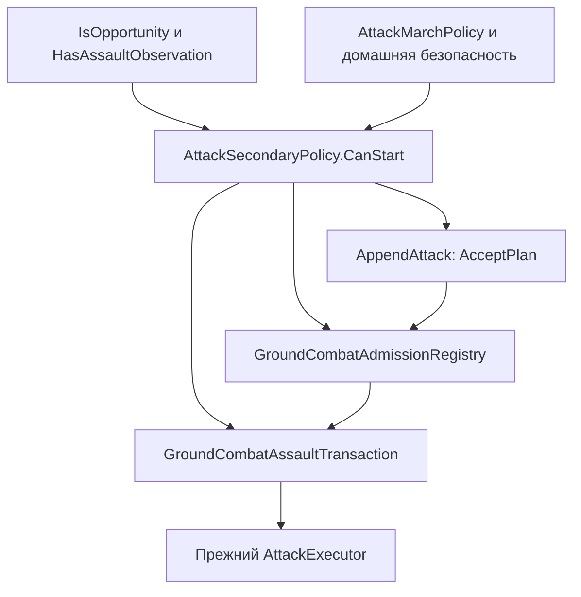

Brynn T15, база Thane `(0,-3)`, доля развернутых сил `33,75%`: теперь конкретный свободный состав может быть рассмотрен. Лог не содержит расчёта победы для ранее отсеянного состава, поэтому обещания захвата нет. Если фактический шанс ниже порога, сведения устарели или дом лишается нужной защиты — отказ остаётся. Обязавшийся состав использует прежний ForceCommitted, нового долговечного флага нет. Исключение проверяется повторно при допуске и provisioning, а не только в генераторе предложения.

## 7. Защита учитывает полный бонус, возвращение — исполнимый срок

**Владельцы:** `Analysis/WorldAnalysis.BuildThreat`, `Strategy/Objectives/ActiveDefenceObjectiveEvaluator.HoldChanceAtAsset` и существующие методы ArrivalEta/GroundArrivalEta/CanReachNow, `Missions/AttackMarchPolicy`.

В StrategicAssetSnapshot раньше попадала только защита постройки; HoldChance отдельно повторял ту же неполную оценку. Теперь Analysis замораживает канонический `WorthIt.HexDefenseBonus` собственной клетки — местность и базу. HoldChance читает эту величину для каждого защитника, включая прибывающих; DefenseBonusOverride не складывается с запасным аргументом повторно. Отрицательная местность не обнуляется. Для неполного снимка без Assets остаётся прежний доступный факт постройки.

Геометрическая оценка specific-mover ETA заменена существующим маршрутом с упаковкой стоимости шагов и оставшимися MP. В будущем равный ETA не означает успеть раньше врага. Уже находящаяся дома армия может оставаться защитником; решительный удар в текущий ход действительно должен быть исполним по маршруту. GroundArrivalEta открыт для существующего соседнего потребителя; оба решения Attack используют его существующий режим `fastestByTurns`, совпадающий с FindAffordableStep. В ArrivalEta/CanArriveBeforeThreat добавлен необязательный выбор этого режима, прежний default для подкрепления сохранён. Дополнительный алгоритм поиска пути не создан.

Логика:
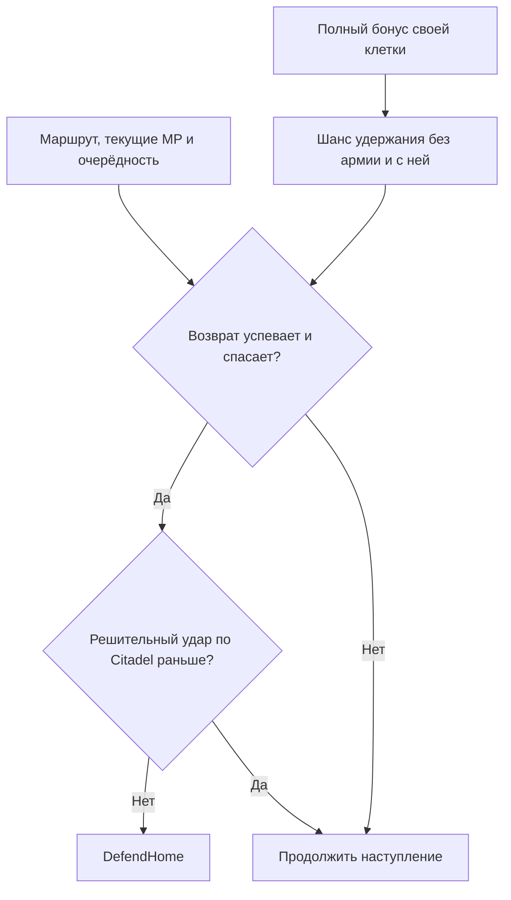

Зависимости:
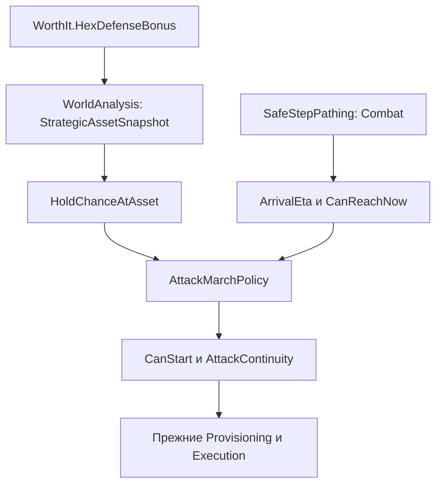

Ysolde T21 не объявляется доказанным ошибочным возвратом: перед ним разведчик #44 обнаружил армии #17/#39 (31333), затем появился отзыв (31341). Новые сведения по-прежнему могут обоснованно потребовать защиты. Изменяется ложный отзыв при недооценённом удержании либо бессмысленный отзыв уже опаздывающей армии. Сохранены пороги старта 0,55, продолжения 0,40, удержания 0,70 и горизонт угрозы 2 хода. Соседняя ActiveDefence получает ту же корректную оценку удержания.

## 8. Разведка важной цели сильнее обычного интереса к руинам

**Владельцы:** `Strategy/Objectives/ReconObjectiveEvaluator.BuildExploreScore`, `Foundation/AiConfigV2.Recon`.

Существующая ObservationNeeds уже включала нужные Attack координаты, но никогда не наблюдавшийся Explore получал лишь обычную важность клетки. Теперь нужный Explore имеет StrategicRelevance 1, как уже имеющийся нужный Refresh. Бонус не складывается с руинами. Руины без операционной потребности: `reconRuinsRelevance: 1 → 0,5`.

Логика:
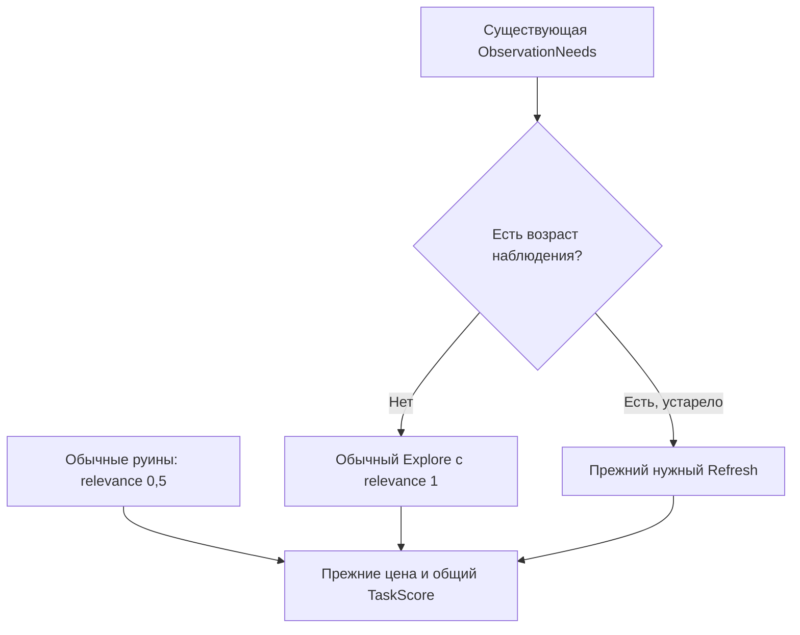

Зависимости:
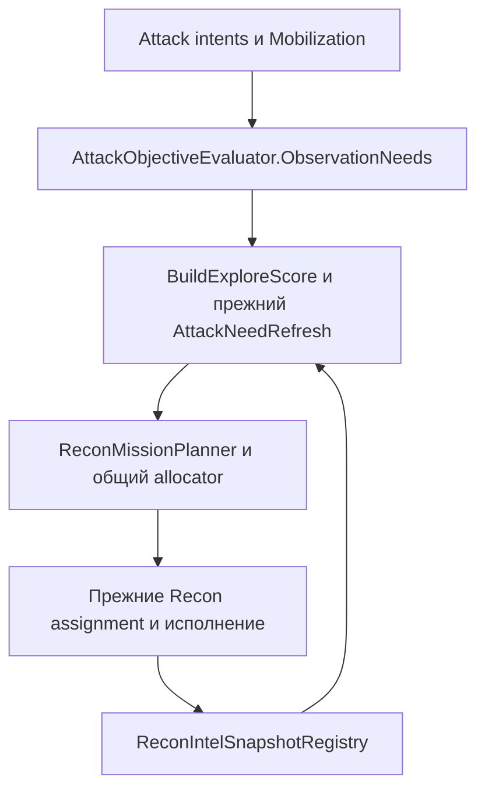

Brynn T15: при прежних входах Explore `(-5,5)` меняется `10,0 → 7,0`, `(-4,3)` — `9,6 → 6,6`. Refresh `(5,-1)` с `10,5` становится относительно предпочтительнее, что не доказывает его стратегическую оптимальность. После закрытия операционной потребности клетка возвращается к своей обычной важности. InfoGain, staleness, concurrency, гистерезис направления и тактические шаги не менялись.

## Дополнительная проверка снизу вверх

Повторно прочитаны цепочки от доменных мутаций к Execution, Provisioning, Continuity, Strategy/Demand и Analysis. Затем пройдены обратные связи: затрата → обновление мира → пересчёт целей/намерений → actor/card claims → следующий допуск. Отдельно сверены альтернативные входы Reaction, отложенное создание армии, резервы созданных карт и повторные действия Phase A.

### A. PREPARE проверялся шире, чем продолжение уже начатой подготовки

**Корень:** структурная применимость выпуска была добавлена в владельца свежего предложения и выбора площадки, но ранее созданная доставка, резерв карты оператора и отложенное исполнение проверяли главным образом физическое наличие собственной базы. После потери последнего совместимого носителя это позволяло продолжать резервирование и тратить AP. Дополнительно извлечение оператора выполняется до обычного MissionRevalidator: временный противник у цели мог появиться уже после Provisioning.

**Исправление по утверждённым уровням:** в `Strategy/Objectives` существующий `IsPreparationSite` для contextual-вызовов повторно использует тот же `StructuralPreparationBlock`, с реальными рукой/оставшейся колодой и разрешёнными результатами каталога. `Continuity/DevelopmentContinuity`, `Provisioning/ProvisioningManager.Development`, `Continuity/MissionRevalidator`, `Strategy/Demand/InfrastructureFulfillment` и `Execution/TaskExecutor` обращаются к этому владельцу. Новых методов, классов, хранилищ и вертикальных переходов не добавлено. Существующий transient `ActiveResolution` получает контекст; параметр `refreshSafeRoutes` сохраняет прежний первый проход расчёта маршрутов Raid, вместо случайного повторения этого расчёта на каждой реакции.

Логика:
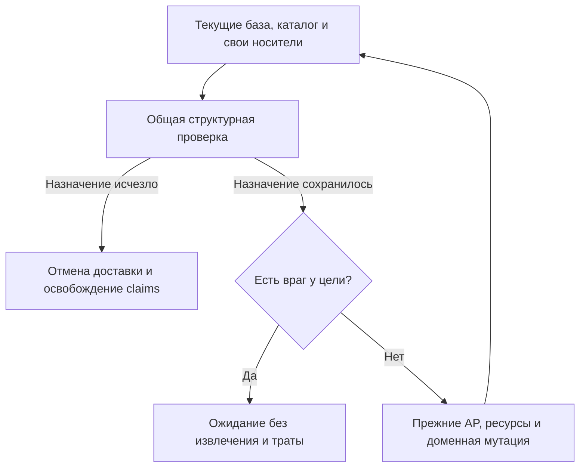

Зависимости и все входы:
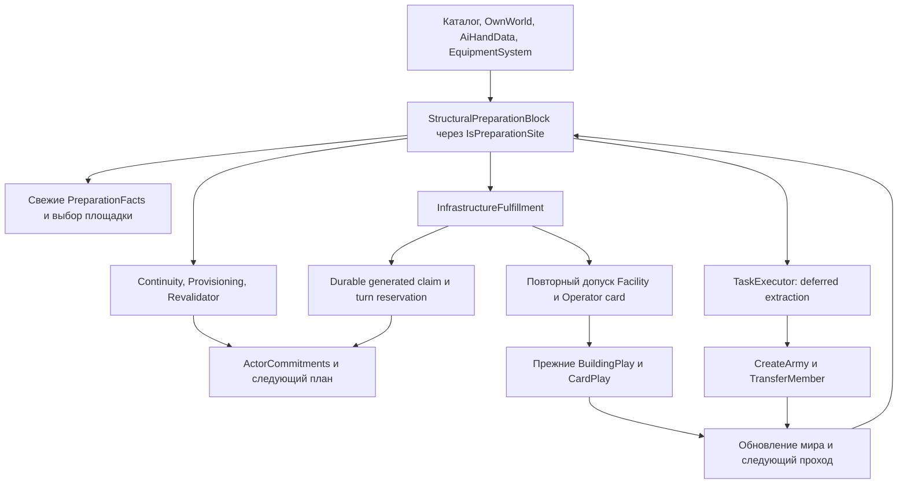

Пример изменения: сначала Bio-носитель ещё есть и доставка Assembler к фабрике обоснована; затем носитель погибает или покидает руку, а в оставшейся колоде совместимых карт нет. Раньше герой продолжал идти/извлекался либо его карта оставалась закреплённой до срока истечения. Теперь назначение снимается в текущем проходе до следующей траты. Если носитель только в оставшейся колоде, подготовка сохраняет смысл. Если у базы появился противник, доставка ждёт; отложенное извлечение получает `NoSafeStep`, который Development уже классифицирует как Waiting. Нехватка текущих AP, ресурсов или закрытое инвестиционное окно не подменяются потерей структурного назначения.

Параллельный функционал: READY-генерация, обычная Economy extraction, физическая проверка `OperatorPreparedAt` и источники операторов сохраняют своих владельцев. Резерв снимает только конкретную привязку карты Development, карта остаётся в руке. Повторные card-candidate проверки защищают уже выпущенный demand после другой мутации Phase A; отдельного калькулятора применимости в потребителях нет. Добавлены 8 native случаев: доставка с/без построенной фабрики, резерв с/без неё, два card-spend пути и deferred extraction при потере назначения/contest. Их выполнение в Unity остаётся за владельцем проекта.

### B. Выбывший владелец по-разному учитывался источниками памяти

**Корень:** `AiReconMemory.Historical` уже исключает `Owner.IsEliminated`, но canonical sightings могли продолжать повышать гарнизонный резерв и запускать Flee. `GameTurnController` пропускает ходы выбывшего игрока; физически оставшиеся армии всё ещё могут защищаться при нападении на них.

**Исправление:** общий существующий `AiArmyRoles.GarrisonThreatFloor` исключает такого владельца до расчёта наступательной угрозы. `Reaction/ReconReactionPolicy.FindStrongExposedThreat` использует то же условие. Память не очищается, боевые оценки защитников и правила входа в занятую клетку не меняются.

Логика:
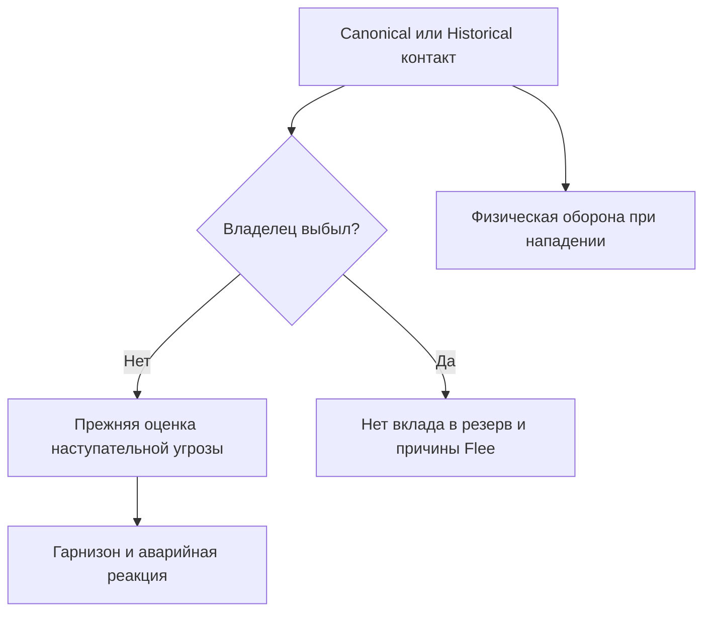

Зависимости:
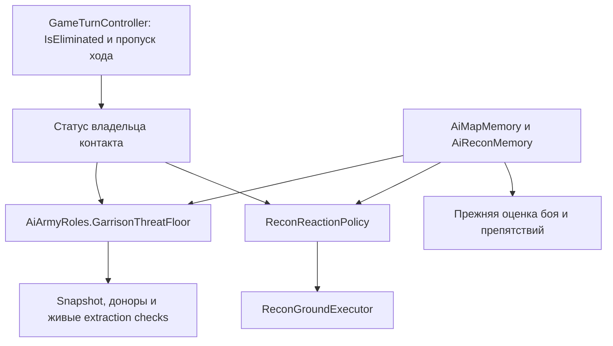

Пример: после падения Citadel оставшаяся неподвижная армия выбывшего противника перестаёт удерживать избыточный гарнизон у соседней базы и вызывать бегство разведчика. Попытка войти в её клетку по-прежнему проходит обычные безопасность и бой. Паритет источников памяти дополнен исполняемым assertion: до исправления expected `0`, actual `7,210666`; после исправления тест проходит. Добавлен отдельный native сценарий отсутствия Flee.

## Проверки и доставка

Сравнение выполняется с исходной ревизией, baseline не заменяется изменённым кодом. Весь материализованный C# набор — 848 файлов — совпадает по составу для baseline/current. Нативный Unity 6000.5.4f1 отсутствует.

- `git diff --check`: без ошибок.
- Полный compile check с reference DLL/заглушками: одинаковые 11 declaration-level ошибок Editor API в исходной и рабочей версиях.
- Дополнительная проверка тел методов с одинаковым исключением шести незатронутых Editor-файлов: 48 прежних ошибок заглушек, 0 новых. Две найденные ошибки типов в новых правках исправлены до повторной проверки.
- Для выполнения AI-тестов подготовлен отдельный временный net472 runner по проектному Tools/ai-verify. В обеих копиях одинаковые адаптации старых UI reference API и .NET Framework находятся только за пределами игрового репозитория. Включены все Scripts, AI-тесты и их существующие вспомогательные определения. Игровой код такими адаптациями не изменён.
- Дифференциальный AI-прогон: исходная версия — 2265 случаев, 1443 успешных; рабочая — 2301 случай, 1447 успешных. Регрессий среди ранее успешных проверок: 0. Добавлено 36 случаев: 4 проходят вне Unity, 32 требуют нативного движка и здесь завершаются ошибками его недоступности. Прежние 821 неуспешная проверка и один случай с предупреждением не объявляются успешными.
- Для трёх новых проверок выполнен red/green: на исходном игровом коде подтверждены ожидаемые assertion failures, на исправленном — успех. Проверены возраст canonical/historical и два варианта operational Explore с руинами/без. В дополнительном проходе того же теста отдельно подтверждён red/green для выбывшего владельца.
- Итоговый независимый review завершён. Замечание о выборе самого дешёвого вместо самого быстрого по ходам маршрута проверено по FindAffordableStep и исправлено через существующий fastestByTurns; добавлены случаи дешёвого `[3,1]` пути с ETA2 и обхода `5×1` с ETA1 для возврата и решающего удара по Citadel. Открытых Important/Critical замечаний после повторного чтения reviewer нет. Основной исполнитель отдельно сверил маршрут, очерёдность, общий допуск и соседние вызовы. Повторный bottom-up review подтвердил новые исправления назначения, claims и отложенного извлечения; основной исполнитель повторно проверил все изменённые production-вызовы.

Обязательный ручной прогон владельца проекта: полный EditMode в Unity версии проекта; затем матч с проверкой каждого сценария выше. Ожидаемый результат — отсутствие колебаний Flee, невозможность бесполезного PREPARE, единый возраст угроз, честный допуск opportunity и корректные сроки защиты. Повтор матча и успешная сборка в настоящем Unity здесь не заявляются.

## Интеграция в master

Локальный коммит реализации: `b8137a98d0d0d98c9c1a2bd008ddf688fdb5227f`. Перед публикацией получен актуальный `master` `ac8ebd8fa74704760c23168e4a1fc453085df746` и выполнено обычное слияние. Сохранены новые изменения колод/стартовой руки, выхода из матча и UI; добавленный в Development сброс кеша не затёрт. Относительно этой версии master меняются только согласованные 34 файла.

Повторная проверка объединённого дерева: runner собран; 2301 случай, 1447 успешных, 853 неуспешных, один Inconclusive. Все исходные 1443 успешных случая сохранены, регрессий 0. Отдельный compile baseline для актуального master сохранён дополнительно к исходному: 48 общих ошибок reference/stub API, новых ошибок в объединённом дереве 0. Новые объявления TMP для свежего UI добавлены одинаково только во временные проверочные копии. Unity и матч не запускались.
