# Rustmarch — four AI fixes and behaviour calibration

Base: `e47aca20ca3842641416920cdce340b03cac307f`, Unity `6000.5.4f1`.
Delivery parent: `73eb495d17337a22dd1d0cc0a5f29b80c899c6a5`. Two upstream
battle-effect commits were incorporated without overlapping AI changes. The final
combined managed source was rebuilt and rerun: the same 219 passes, zero regressions
against the original task baseline. Additional TMP properties needed by that upstream
UI exist only in the temporary verification adapters.
Scope: behaviour corrections within existing ARCH-02 owners. No new runtime classes,
layers, desire axes, registries, managers or payment mechanisms.

The previously prepared local commit was removed by workspace maintenance before
publication. This change reconstructs the agreed implementation against the same
master revision. Verification below belongs to this reconstructed source revision.

## F1 — global income in Economy actionability

**Root:** `Analysis/WorldAnalysis.BuildEconomy` derived actionable Economy opportunities
from extraction, bases and collectors, omitting an own held global income carrier.
The effect evaluator knew the source's value but the Economy desire gate did not
know the opportunity existed. Raising an effect score would not correct that gate.

**Log example:** Ysolde T1 had Dorian with ProduceHuman and an infantry alternative.
The carrier's availability should contribute to Economy actionability before these
cards compete. This does not prescribe Dorian regardless of the other scores.

Logic:

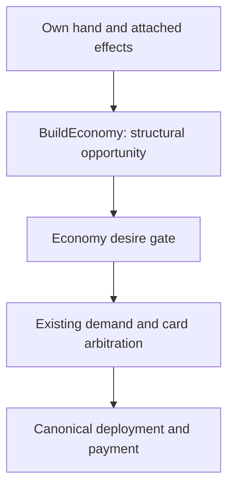

Dependencies:

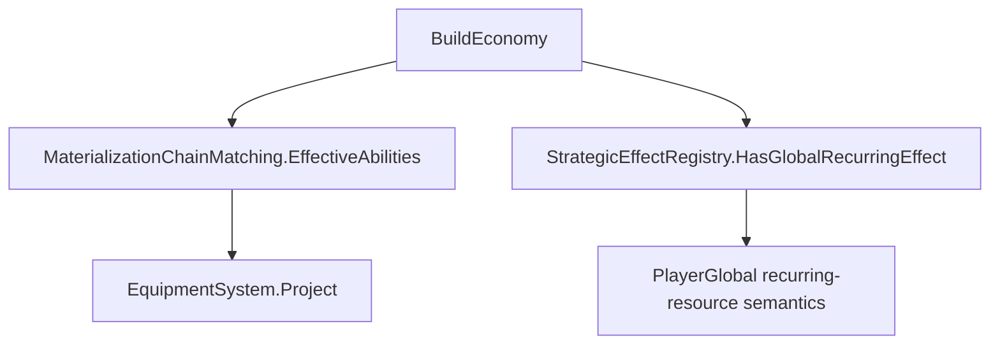

The existing analysis now includes a non-aviation Unit/Hero/Facility in hand whose
effective abilities carry a global recurring effect. Standalone Equipment and Base
cards retain their existing paths. Analysis selects no card and promises no legal
placement. Materialization still proves placement, ownership, capacity, resources
and AP. The radar is not recalculated within a turn. If physical resource deficits
are absent, actionability alone creates no resource deficit or independent AP desire.

## F2 — legal hero extraction and honest failure reporting

**Root:** shared sparable-hero selection protected defender power and facility work,
but omitted the capacity left after removing the commander. Shell/Host paths had a
canonical transfer probe; Create assumed the first hero always fit. Gameplay rejects
both an overcrowded source and a first hero whose Command cannot hold himself.
An uncreated synthetic Economy mover could then be reported as a lost real mover.

**Log example:** Brynn T12, Miller Command 8 + Rusty Command 3 + six bodies.
Removing Miller leaves seven members under Command 3. Miller must not be offered;
the existing tree must choose a legal alternative or defer the operation.

Logic:

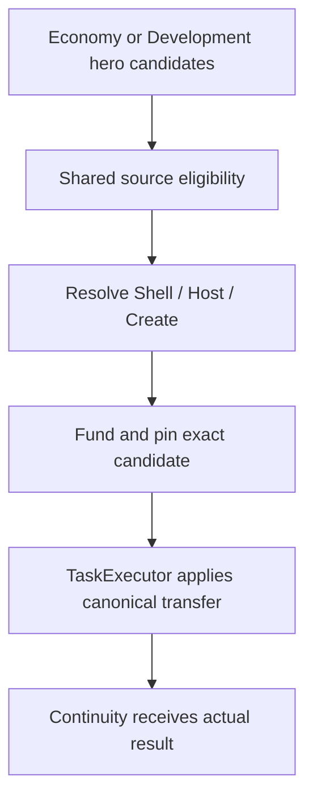

Dependencies:

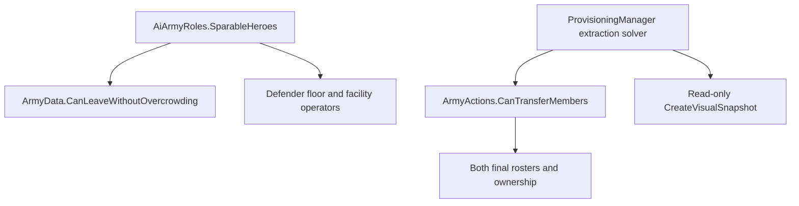

`AiArmyRoles` is the shared source selector. `Provisioning/` proves Create against
the same final-roster domain predicate used by `CreateArmyWithMember`, through a
snapshot that allocates no real army ID, registers nothing and spends nothing.
`Execution/` preserves the actual gameplay rejection string. Failed synthetic
materialization means TargetInvalidated; an absent real direct mover still means
MoverLost. Existing stale-actor preparation also requests replanning.

Economy and Development consume the same rule. Mission ownership, funded envelope,
one-mutation-per-step extraction, donor preparation and real payment stay with their
existing owners. No fallback forcibly removes the commander or creates a fake army.

## F3 — patrol equipment preserves mobility

**Root:** the shared equipment delta protected Recce radius, spotting and required
stealth on Scout assignments, but allowed combat gains to compensate for losing
patrol movement or increasing activation AP.

**Log example:** Brynn T26, Portable Mortar on Hooded, Move 2 → 1. An Explore/Refresh
carrier must reject that item even when its combat delta is positive. A local Hunt,
CaptureStructure or AirSweep keeps its existing evaluation rather than inheriting
a patrol restriction.

Logic:

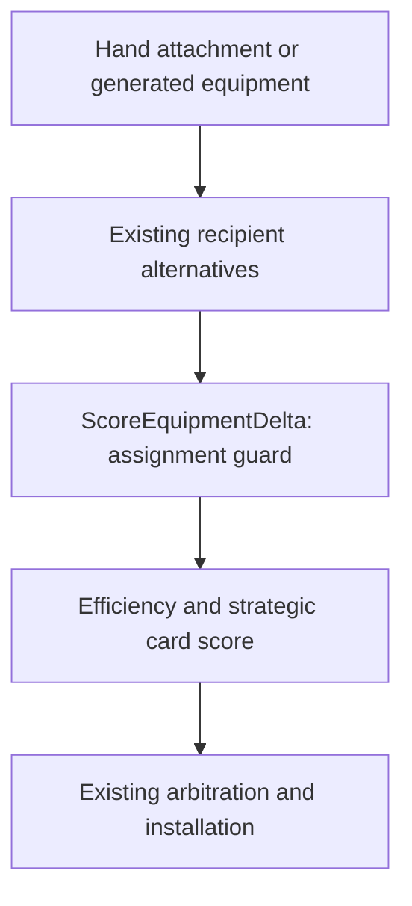

Dependencies:

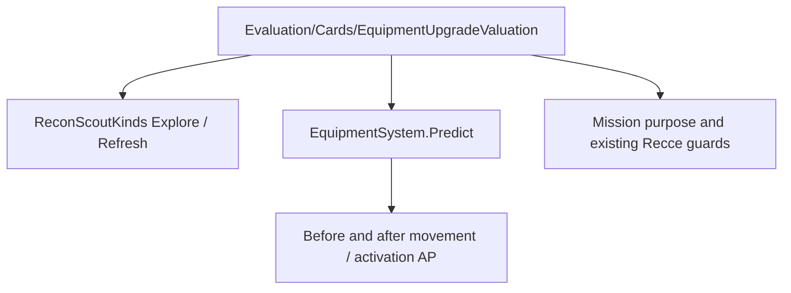

The change extends the existing assignment-capability veto in `Evaluation/Cards/`.
Every current user of the common equipment valuation inherits it, including hand
installation and Production recipient evaluation. No separate item blacklist,
production preference or equipment score formula is introduced. Economy/Development
capability guards and equipment persistence remain in their existing owners.

## F4 — AP history measures useful legally available work

**Root:** `State/ApTurnPressure.Measure` summed resource-affordable cards remaining
in hand without proving purpose, placement, reservations or joint feasibility. It
also treated LowValuePerAp and physical-resource refusals as AP scarcity. End-turn
measurement occurred after owner reservations were cleared.

**Log example:** Ysolde T31, start 18 AP → end 14 AP, with a 4-AP Base awaiting its
Economy delivery. The old card sum added CardsUnmet 4. The corrected witness adds
zero for that reserved/unavailable Base: demand is the 4 AP actually spent.
Conversely, 6 AP of useful remaining work with only 4 AP left is real unfinished
work, so the full 6 belongs in demand, not merely the 2-AP shortfall.

Logic:

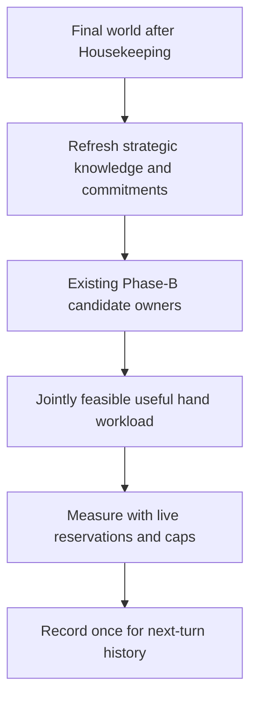

Dependencies:

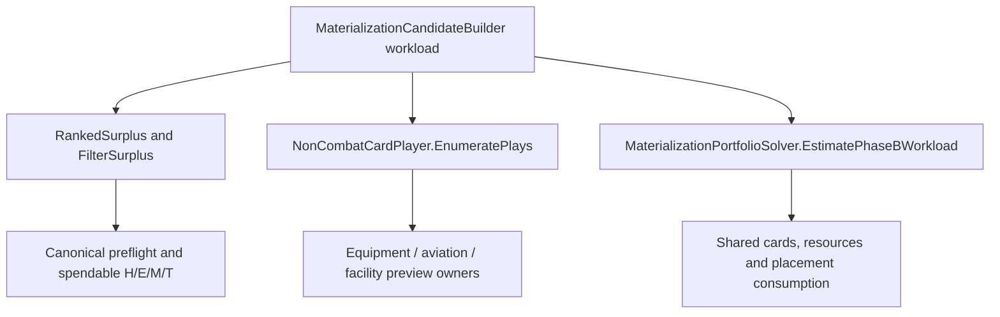

`Materialization/` extends its existing workload method with a turn-end measurement
mode; `Orchestration/` only orders the calls and transports the result. Both existing
candidate lanes retain their scoring and must exceed `tempoMinSpendUtility`. Only
the current AP ceiling is relaxed. The canonical joint solver preserves physical
cards, resources, recipient constraints and competing alternatives. Economy build
card claims and Development operator claims remain protected.

The witness deliberately measures existing hand plays, without forecasting generated
outputs. It is conservative and does not claim to estimate every possible future
Production action. Ordinary Phase-B workload evaluation retains its original mode.

Equipment measurement uses existing attachment previews and does not populate the
executable recipient-verdict cache. Aviation reuses investment-preview placement.
Facility preview extends the existing domain check with `requireCurrentAp`; all
real placement/payment callers keep its default `true`. Negative AP, ownership,
resource costs, card presence and facility slots remain checked.

Draw workload is bounded by actual deck, hand slots and per-turn draw/tempo caps.
It contributes unmet demand only when raw remaining AP cannot cover it. Deferred
missions contribute only positive InsufficientBudget proposals with an actual AP
shortfall, no physical-resource shortfall and a requirement beyond raw end AP.
Their maximum requirement is used instead of summing competing proposals. The
history lifecycle and separate initiative-purchase analytics are unchanged.

## Calibration

| Existing parameter / owner | Before | After | Expected behaviour |
|---|---:|---:|---|
| Foundation/taskScoreEconomicDeficitBonusMax | 3 | 4 | Moderately favour useful income for a real deficit; physical income value unchanged |
| Foundation/raidParkValuePerAp | 2 | 3 | Park thin fresh optional raids for the existing AP remainder pass |

The raid calibration does not change active operations or demand-driven raids.
No combat thresholds, Attack continuation, secondary Attack rules, equipment
persistence or future-base forecasting were changed. These are starting values
for match calibration, not a claim that every turn must select a particular card.

## Verification

The changed owners were traced from candidate generation to gameplay transaction
and backward to their consumers. A project scan found one BuildEconomy, one shared
ScoreEquipmentDelta, one extraction solver and one ApTurnPressure.Measure. Both
ApplyGarrisonExtraction call sites were updated. No new runtime method or class was
added; existing methods/signatures were extended.

Compile comparison against the same base revision uses identical old reference DLLs
and a temporary TMPro enum: 12 pre-existing diagnostics in each revision, no new
diagnostics. This is not a successful native Unity compile. A separate managed
NUnit harness uses identical temporary API adapters for both revisions, exclusively
outside the repository. Eight affected/adjacent fixtures: base 331 cases, 212 passed;
current 348 cases, 219 passed. All 212 baseline passes are preserved: zero regressions,
seven newly passing cases (six equipment cases and the extraction regression).
The remaining current failures are 128 native-engine errors and the same pre-existing
`ActiveEconomyBuildIntent_ProtectsResourcesWithoutRepeatedDemand` assertion that fails
on the base revision. Three additional staged-preparation cases compile but require
Unity. No claim is made that the entire managed run or the Unity suite passes.

Regression coverage includes held global-income carriers; source and destination
capacity on extraction; six patrol/local-action equipment cases; useful AP work
versus idle AP; real AP versus resource/priority deferrals; a reserved waiting Base;
and a useful zero-AP card versus the same card lacking Tech.

Full EditMode and match reruns in Unity remain with the project owner, as requested.
Check the four log situations above and their legal alternatives, the next-turn AP
history, bank reservation release, and optional raids using only leftover AP. No
manual Unity run or completed match is claimed by this delivery.

## Bottom-up follow-up audit of published 3438a790

The audit starts from canonical deployment, equipment installation, roster transfer
and resource admission, then follows their data back to scoring and turn history.
It found one remaining runtime defect in F4 and one invalid native-test fixture.

### A1 — AP-first deferral discarded simultaneous physical shortages

**Root and owner:** `Allocation/AllocationSession.Pack` checks AP before its physical
gate. `AddBudgetDeferred` used to fill Required/Available/Missing with AP alone.
Thus `State/ApTurnPressure.Measure` could not distinguish a genuinely AP-only refusal
from a mission also missing Tech or another owner's reserved resources. Filtering
`Missing.AnyPhysical` in the consumer was insufficient because that fact had been lost
by its producer. There is one AddBudgetDeferred and exactly two callers.

Logic:

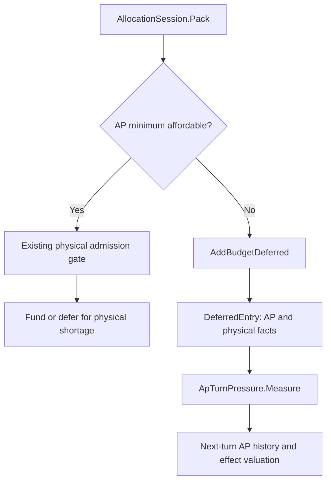

Dependencies:

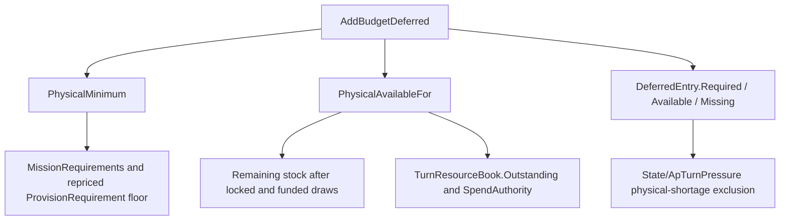

**Correction:** extend the existing AddBudgetDeferred with the current physical
remainder and reuse PhysicalMinimum/PhysicalAvailableFor. The first rejection reason
remains InsufficientBudget. Mission order, funding, spillover, quantities paid and
reservation writes are unchanged. The ledger's Economy-completion exceptions and
repriced floors are inherited from the same physical-admission owners, so later rule
changes need no duplicate correction in State. The fix writes no new cache or bank row.

**Reproduced situation, not an additional claim about the attached match:** a positive
Scout mission requires 6 AP and 2 Tech. With AP 0 / Tech 0, the published allocator
reported Missing.AP 6 and Missing.Tech 0; additional AP alone cannot execute it.
It now reports Missing.Tech 2 and the existing AP-history filter excludes that mission.
With Tech 2, the AP-only witness remains valid. Likewise, raw Energy 4 minus another
owner's reservation 3 cannot fund a sortie costing 2: Missing.Energy is now 1 even
when the AP gate fires first. A completing Economy build still ignores another
build's deferred hold while respecting its completion hold, exactly as before.

**Other consumers:** spillover and commitment-starvation checks use the unchanged
Reason and recompute admission through their original methods. MissionOutcomeLedger
records Reason, not the added vector components. The physical facts now reach the
existing State consumer intact; no new resource priority or shortage policy is added.

### A2 — zero-AP workload test lacked a deployment controller

**Root:** the staged-preparation fixture creates a root, owned Barracks base, garrison
and hand, but no HexSelectionController. CardPlayExecutor.Preflight requires that
controller for every deployment. The positive workload case therefore stopped at
"missing deployment controller" before testing relaxed AP admission.

Logic:

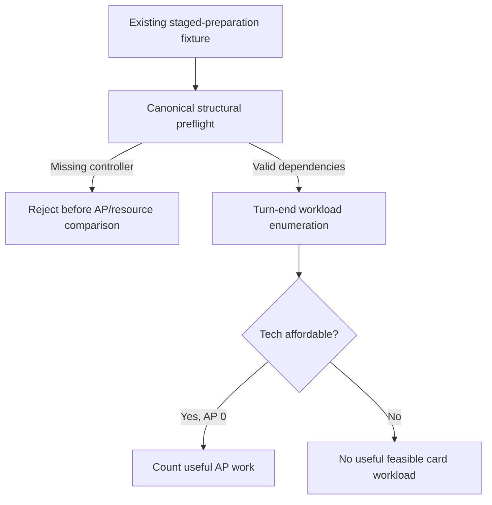

Dependencies:

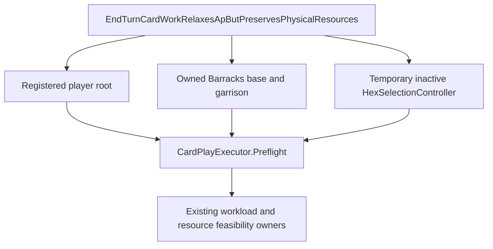

**Correction:** the test creates and destroys its local inactive controller and
explicitly asserts structural preflight succeeds before measuring work. Both the
resource-affordable and Tech-short variants now have the necessary dependency.
No gameplay code or shared fixture lifecycle is weakened. The native tests remain
pending execution in Unity; successful compilation is not reported as a native pass.

Additional native integration coverage follows an actual registered Explore scout
and active intent through EquipmentPurpose, EquipmentDeltaParts, recipient rejection
and NonCombatCardPlayer enumeration, with both ordinary and AP-relaxed measurement
paths. This supplements the earlier six private-scorer cases and checks no equipment
installation, movement change or AP spend occurs during evaluation.

### Recheck and limits

* Three new managed assertions reproduced A1 on unchanged published runtime.
* After the fix, the affected/adjacent ten-fixture set has 402 cases, 259 passes.
  All 254 baseline passes from 3438a790 are preserved: zero regressions and five
  new passes, including reserved-resource and Economy-spend-authority cases.
* Remaining results: 142 native/reference-engine errors and the same pre-existing
  ActiveEconomyBuildIntent assertion; this is not a fully passing Unity suite.
* Runtime and tests compile in the same temporary managed harness/reference setup;
  no adapter or tool change is included in the game repository.
* The other three fixes were followed through their existing shared owners. Source
  and destination capacity, real transaction rejection reasons, patrol purpose lookup,
  explicit recipient-cache exclusion for measurement, canonical effect semantics,
  next-turn history timing and match reset remain intact in the inspected paths.
* Both calibration constants remain 4 and 3. No new runtime class or method, new
  layer, new manager, balance adjustment or changed combat threshold is introduced
  by this follow-up. Full EditMode and match reruns still belong to the owner.
