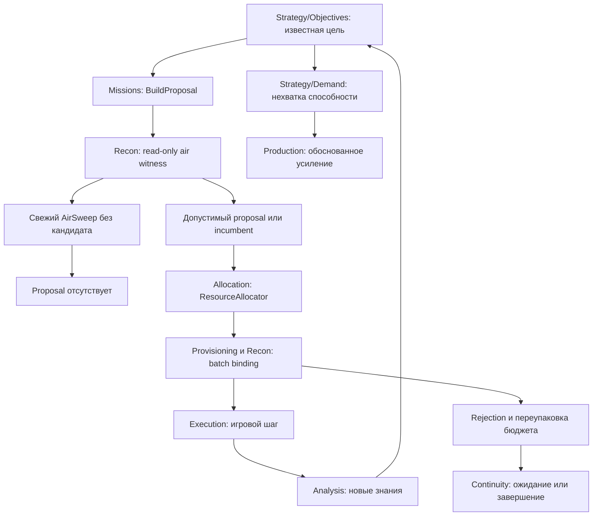
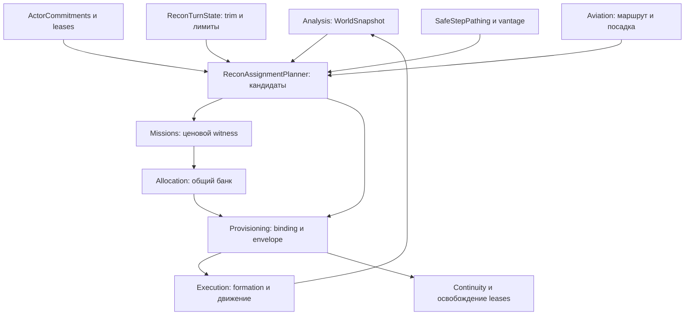

# Назначение разведки: AirSweep и диагностика

Исходный master проверен через GitHub-коннектор: `8993a11d05aed660f261b021ff345710cbb79298` (2026-10-12). Прочитаны актуальные `AGENTS.md`, `Assets/Scripts/Ai/V2/ARCHITECTURE.md` и `Tools/ai-verify/README.md`. Runtime C# и тесты локальной рабочей копии сверены с Git blob SHA этой ревизии. PR #186 и #187 уже присутствуют; их реализации не повторялись.

Масштаб: локальное изменение допуска свежей воздушной миссии и уточнение диагностического текста. Вертикальных слоёв, нового состояния, коэффициентов и правил финансирования нет.

Во время работы master продвинулся через PR #188 (`c6202fe6…`) к `ecf44ce9d1dd943569c5feef0b55a1a9338550ec` (AI decks и Resources cleanup). Эти изменения не пересекаются с пятью изменёнными C# файлами задачи. Их актуальный код включён в повторную проверку: 1377/1377 passed, на той же новой базе без runtime-фикса воспроизводятся те же три падения. Публикация строится поверх `ecf44ce9…`, сохраняя новые колоды, каталоги, перемещения и UI.

## Причина и единственный владелец

`Missions/ReconMissionPlanner.BuildProposal` — единственное место построения Recon proposal. Оно уже вызывает read-only `Recon/ReconAssignmentPlanner.PlanAirCandidate`, но раньше продолжало работу с `airWitness=false`. `ScoutCostModel.Estimate` мог вернуть условную цену, и свежий AirSweep проходил к allocator без исполнимого воздушного актёра.

Теперь свежий AirSweep с пустым witness возвращает `null` до оценки цены и создания proposal. Существующий AirSweep (`IsIncumbent`) этим условием не отсекается: временная блокировка остаётся в обычном assignment → Blocked → stall/retirement lifecycle. Положительный witness по-прежнему только предпочтение и цена; окончательный actor binding выполняется после funding.

Правила кандидатов не копируются в Missions. `PlanAirCandidate` использует те же `AppendAirCandidates` и `AppendStoredAirCandidates`, что и окончательное назначение: фактический актёр/самолёт, движение, исключения, доступный режим крыла, полезный шаг к конкретному anchor и доказанный маршрут с посадкой. `AirExisting` и `AirStored` сохранены.

`ProvisioningManager.AssignmentFailure` — единственный перевод rejection в сообщение для batch Scout. Текст NoExecutableStep теперь: `assignment found no executable {Kind} candidate this pass toward (q,r)`. Он не утверждает наличие eligible scout или vantage и не пытается сам определить конкретную причину. Обновлён также комментарий enum: этот результат включает отсутствие воздушного кандидата и потраченное движение наземного. Kind, disposition, parking и lifecycle не меняются.

## Граф логики и обратный обход

Прямой обход воздушной цепочки: стратегический anchor → objective → Missions → общий probe кандидата → proposal → allocator → повторный batch binding → ProvisionAir → executor → наблюдение → replan. Обратный: NoExecutableStep → пустой набор assignment → AirSweep без авиации → пропущенный запрет BuildProposal → условная цена. Исправлен вход операционного предложения, а не стратегическая цель.

Прямой обход наземной цепочки: Explore/Refresh → оценка стоимости → allocator → структурные и исполнимые актёры → claims/trim → безопасный первый шаг или vantage → совместное назначение → шаг → refocus. Обратный: отказ конкретного attempt → кандидатный список и ограничения solver → ownership/движение/маршрут → сама цель и её актуальность. Пустой результат назначения не доказывает отсутствие разведчика на карте и не даёт ему дополнительного движения.

## Граф зависимостей и соседний функционал

Проверены источники данных и их потребители в обоих направлениях:

- **Strategy/Objectives, Desire, Demand:** стратегический AirSweep остаётся видимым для оценки авиационных карт; наземные цели без актёров сохраняют proposal и bootstrap ScoutCapability. AirSweep не превращается в заказ наземного разведчика. Принцип Recon → знания → Economy → бюджет возможностей → Attack/Defence → потребность → Production сохранён.
- **Allocation:** только ResourceAllocator распределяет AP/физические ресурсы. Probe не проверяет стратегические резервы и не решает, стоит ли финансировать вылет. EvaluateDetailed читает кошелёк для своего отдельного loose fallback, но PlanAirCandidate использует не отфильтрованный им список актёров. Кандидат может существовать при нулевых AP/Energy; оплачивать его должен allocator.
- **Банк и резервы:** ProvisionAir сравнивает реальные AP/Energy с envelope, живым остатком и reservations; AirSortieReservationAdmission остаётся единственным стратегическим решением о резерве вылета. RegisterProvisionSuccess блокирует уже заявленные физические средства; RegisterProvisionFailure и Pack возвращают непригодное предложение в обычный механизм переупаковки. Для исключённого свежего AirSweep до этих стадий не возникает ни funding, ни spend, ни claim. Существующие ресурсы других операций не освобождаются ранним gate.
- **Claims/leases:** read-only probe исключает нормализованные claims других операций; для incumbent допускается его собственный preferred actor. Никакой pass claim, durable intent, самолёт или посадочная reservation здесь не создаётся. Batch повторно проверяет actor uniqueness и общие air/ground caps. ProvisioningSession и MissionLeaseBook сохраняют прежние границы жизни и release.
- **Lifecycle:** NoExecutableStep остаётся RetryNextTurn. CapabilityPoolExhaustionRegistry.DeferNoExecutableStep и PassParking не изменены. Заблокированный incumbent не превращается в ground CapabilityUnavailable; обычное stall aging и завершение сохраняются. Formation выполняется исполнением профинансированного AirStored, а не ранним probe.
- **Кеши и версии:** отрицательные witnesses не кешируются новым кодом. При каждом Propose воздушный кандидат заново строится из текущего состава/движения и live маршрута; после allocator он проверяется снова. Player+Turn+KnowledgeVersion, ReconIntelSnapshotRegistry и WorldDeltaLifecycle не меняются. Сам probe не публикует знаний и не повышает execution revision. `recon-air` operational forecast, как раньше, содержит только предложения с положительным witness; условная миссия без witness и раньше не формировала этот forecast.

## Повторная проверка старого лога

Использован только приложенный `AiDebug.log` (Library `libfile_13385a5292648191a848b7ec57e92a46`), 25 849 строк, 6 411 398 байт; это запись до исправлений. Логи из Git не использованы.

В предыдущей выборке 323/313 пропущены 14 сообщений с вложенным `causeDemand=[…]`: regex принимал вложенную закрывающую скобку за конец correlation. Повторный разбор полного лога даёт:

| Цель | Отказ | Сообщения | Разные attempt |
|---|---|---:|---:|
| Explore | MoverContended | 111 | 106 |
| Refresh | MoverContended | 98 | 93 |
| Refresh | NoExecutableStep | 74 | 74 |
| Explore | NoExecutableStep | 40 | 40 |
| AirSweep | NoExecutableStep | 12 | 12 |
| Refresh | EnvelopeTooSmall | 2 | 2 |
| Всего | | 337 | 327 |

Внешних Refresh — 43, включая дополнительно найденный `Refresh -7,1` на строке 17 544: 36 NoExecutableStep и 7 MoverContended. Они уже закрыты PR #187. Коррекция статистики не требует повторного исправления карты.

Все 12 воздушных отказов по-прежнему соответствуют ближайшему измерению `structuralObsLanes=0`, airborne 0/0, launch 0/0. После удаления внешних Refresh остаётся 78 наземных NoExecutableStep (40 Explore + 38 Refresh); старый лог не позволяет строго разделить их все на движение, безопасный маршрут и vantage. 199 уникальных MoverContended включают семь внешних Refresh; остальные не являются доказательством зависания.

Проверены альтернативы, текущее движение, claims, turn-wide trim, per-pass HardCap, лимит новых distinct scouts в ходе и безопасный первый шаг. При наличии альтернативы binding может заменить ценовое предпочтение; чужой claim или trimmed актёр не обходятся. Нужен безопасный первый шаг, а не достижение далёкой цели за один ход. Отсутствие любого исполнителя сохраняет стратегический bootstrap; spent scout не создаёт автоматически потребность в ещё одном.

Контрольные события:

- Rurik T1: #14 получает OutOfMovement в `(-6,5)` (108), затем refocus на Explore `(-6,6)`; отказ и ожидание следующего хода не дают ему второй запас движения.
- Дополнительно найденный Tessek T1 attempt на строке 380 идёт после HexEventStarted у #15 (346). Одного диагностического текста недостаточно, чтобы приписать его нулевому MP или небезопасному пути; общий наземный фикс по нему не обоснован.
- Tessek T21 `T21-P4-M-M37`: EnvelopeTooSmall (23 447), движение #34 после переоценки (23 455). Rurik T21 `T21-P0-M-M64`: отказ (24 471), движение #22 в том же ходе (24 478). Оба не являются незавершёнными задачами без исполнителя.
- Tessek T9: AirSweep отклоняется одновременно с реальным назначением двух ground Explore; бюджет перепаковывается. Подтверждены лишние предложение и provision, а не потраченный воздушный AP.

Изменение наземного назначения, ускорение Attack Rurik и новые коэффициенты Materials не добавлены: доказательств отдельного сбоя нет. Эффект PR #186 на открытие ближайших материалов оценивается по новой партии.

## Проверки и границы результата

| Проверка | Результат |
|---|---|
| Baseline до runtime-изменений | 1372/1372 passed |
| Новые переносимые проверки на исходном runtime | 3 ожидаемых падения: свежий AirSweep и две диагностики; 1374/1377 passed |
| Исправленная реализация | 1377/1377 passed; ни один из 1372 baseline cases не потерян |
| Differential compile | Те же четыре ошибки UI/Audio reference/stub среды, новых нет |
| Сборка тестовой проверочной копии | Без ошибок; включает native тесты как C# |
| Whitespace check | `git diff --no-index --check baseline source` пройден |

Добавлены переносимые проверки отсутствия proposal при пустом air witness, сохранения objective, ground bootstrap, blocked air incumbent/stall и перевода NoExecutableStep для AirSweep/Explore без claims или AP. Два прежних snapshot-only allocator теста теперь напрямую подают proposal, оценённый ScoutCostModel: их проверки mandatory Energy, funding и банковской конкуренции сохранены; искусственная snapshot inventory больше не выдаётся за live route witness.

Добавлены семь native EditMode cases с реальными HexMap/PlayerRoot: допустимые AirExisting и AirStored, занятое Strike-крыло, отсутствие безопасной посадки, нулевое движение. Положительные случаи также проверяют отсутствие ранних claims/formation/spend, исключение чужого actor, нулевой кошелёк и повторный probe после исчерпания движения в том же ходе. Отдельный ground test проверяет замену spent preferred mover свободной альтернативой после funding.

В переносимой копии добавлена замена двух явных `UnityEngine.Mathf.Clamp01` в ScoutCapabilityContext на уже используемый managed Mathf, только для тестового выполнения bootstrap; игровой файл и baseline runtime не изменялись. Сохранённые четыре compile errors не исправлялись проверочными заглушками в игровом коде.

Для повторной проверки после PR #188 проверочная копия EngineStubs дополнена `AssetDatabase.GetAssetPath`, который бросает NotSupportedException при выполнении: это только возможность скомпилировать новый native UI test, а не имитация успешной загрузки ассетов. Ни этот адаптер, ни скрипт переносимого прогона не публикуются в игровом проекте.

Unity, полная native EditMode suite и новая игровая партия здесь не запускались. Семь native air cases и ground alternative с Unity object comparison скомпилированы, но требуют запуска владельцем в Unity. Ручной прогон: обе формы авиации, чужое/занятое крыло, невозможная посадка, восстановление заблокированного incumbent на следующем ходе, bootstrap первого ground scout и отсутствие внешних Refresh на разных размерах карты. Доставка и merge разрешены владельцем без ожидания этих прогонов.

## Отдельная находка в обновившемся master

В добавленном соседними изменениями `Assets/Scripts/Core/GameAssetCatalog.cs` getter `Instance` вызывает `GameAssetCatalog.Load<GameAssetCatalog>(ResourceName)`. `Load` вызывает `LoadAll`, а тот снова читает `Instance`: при первой загрузке `_instance == null`, поэтому получается бесконечная рекурсия. Корневая загрузка каталога должна использовать фактический Resources loader, а не собственный lookup. Этот дефект не внесён Recon-патчем и им не исправляется. Переносимые tests не выполняют native загрузку каталога и потому его не обнаруживают; перед игровым прогоном его следует исправить отдельной задачей.
