# Семь контрактов ИИ: реализация и проверка, 24 октября 2026

## Состояние работы

Исходная ревизия — `cf748a787393b49a96f6d3595d6dbe45adfb9bbd`. При получении репозитория удалённый `master` совпал с ревизией ТЗ. Рабочая ветка — `fix/ai-contracts-20261024`; по последующему поручению пользователя пакет включает калибровку и доставляется через commit → merge в master → push. Итоговый SHA фиксируется в истории GitHub.

Источник эпизодов — приложенный `AiDebug(4).log`, 17 804 строки. Его имя отличается от `AiDebug(3).log` в ТЗ, но описанные строки и эпизоды совпадают. Начаты 20 ходов каждого игрока; последний ход Cassia оборван. SHA игровой сборки лог не содержит. Анализ текущего исходного кода подтверждает перечисленные причины; повтор того же матча после исправлений здесь не выполнен.

Прочитаны корневой `AGENTS.md`, архитектурные границы `Assets/Scripts/Ai/V2/ARCHITECTURE.md`, инструкции проверки. Версия проекта — Unity `6000.5.4f1`; manifest/lock сверены, зависимости не изменены. Навык `superpowers:executing-plans` в доступном наборе отсутствует. Другие агенты не привлекались.

Масштаб — локальные исправления фактов/договоров и согласованные изменения поведения 4–6. Новых игровых классов, слоёв, реестров, видов миссий и test harness нет. Карты, цены, навыки, сцены, ассеты, GUID и `.meta` не менялись. Combat admission, opportunity override, бюджетные полномочия и правила cooldown сохранены.

## Результат по семи задачам

| № | Подтверждённая причина и свидетельство | Фактический владелец / изменённые методы | До → после | Статус |
|---|---|---|---|---|
| 1 | Предварительная Economy-проверка проверяла suitability синтетического героя без полного кандидатного допуска. Cassia T5, строки 2398–2415: Kessa → #19, 1 AP, затем `combat_fist_not_a_builder`. T8, 5265–5273: Bolt → #17, затем нет mobile builder. | `MaterializationDeliveryPolicy.AssessDemandOperationally`; `EconomyBuilderSelection.SelectEconomyBuilder`, `RankEconomyBuilders`, `EconomyBuilderCandidates`, `CandidateRejection`; передача commitments через общую feasibility и её потребителей. | Поля силы, состава и duty раньше не воспроизводились → проекция эффективного героя без runtime identity, канонический `WorldAnalysis.ToArmySnapshot`, реальная operator-duty, projected FieldStrikePotential и **тот же полный ranking** до расхода. Непригодный получатель исключается, другие placement остаются кандидатами. | Реализовано; игровой прогон не выполнен. |
| 2 | `selectedFromDonor` начинался пустым после уже выбранного героя. Cassia T6, строка 3387: #17=[Nadia, Medium infantry] обещал отдать обоих; строгая транзакция отказала, cooldown T6→T9. | Общий partial `GroundCombatAssemblyPlanner`, метод `AssembleSameHex` в `.Preparation.cs`; `GroundCombatAssaultTransaction.Run`. | Герой и последнее тело считались независимо → каждый следующий pick учитывает **все** уже выбранные transfer этого донора; остаток проходит `RosterFits` и общий garrison floor. Транзакция дополнительно отвергает дубли и незаконную итоговую вместимость. | Реализовано без ослабления transaction/cooldown. |
| 3 | `!IsVisited` соседей превращался в Refresh-пользу при возрасте intel 0. Cassia T12, 9642–9669: обычные Continue и свежий ABAB; строка 9665 — FAIL. | `ReconGroundStepPlanner.TryScoreImmediate`, `Lookahead`; удалён неиспользуемый Refresh fresh-neighbor параметр. | Не посещено ногами = якобы новая информация → Refresh получает только реальный возраст наблюдения. Геометрический anchor bonus заменён уменьшением стоимости безопасного маршрута: обход может временно удалять от цели, обратный бесполезный шаг не создаёт продвижение. | Реализовано. Explore/Flee/Evade не переписаны. |
| 4 | Нужда наблюдения известной stale-цели зависела от уже существующего Attack intent; поиск Citadel закрывался известной промежуточной Base. Draven T17, 14667: `defenders_stale`; Citadel (5,-4) долго location-only. | `AttackObjectiveEvaluator.ObservationNeeds`; существующие `Enumerate`, порядок SelectionKey, `AssessReadiness`, `HasAssaultObservation` переиспользованы. | Нет intent — нет адресного запроса → все законные нужды живых операций плюс максимум одна новая: stale-цель, рассматриваемая свободной готовой достижимой армией; иначе never-seen sanctioned Citadel как ранний поисковый ориентир. | Реализовано без mission planner и рекурсивной сборки Recon. |
| 5 | ResourceGain игнорировал уже рассчитанный dynamic effect, подменяя его фиксированной ранней ролью. Draven T3, 1447–1450: Iri decision 3,21 / RoleFit 3,27 при AP-effect 0,19, H1 тратится; ход заканчивается с 7 AP. | `StrategicCardEvaluator.ScoreForDemand`, `ScoreSurplusRole`, `RoleFitCore`, `ScoreNonCombat`; удалены фиксированные `resourceGainRoleFitBase/early*`. | Награда за тип источника → один динамический вклад `StrategicEffectRegistry` по yield, горизонту, workload/дефициту и насыщению во всех входах. Независимый Command героя сохранён. | Реализовано; новый победитель в исходном матче не объявляется без прогона. |
| 6 | Exact resource evidence возникало в поздней Diagnostics только при отсутствии feasible-кандидатов. Draven T3–T7: H1 расходуется раньше учёта Brute H2/E1/T1. | `MaterializationFeasibility.FilterForDemand/AddIfFeasibleA`; `AllFeasiblePlansForDemand`, raw/generation enumeration; `PhaseACandidateRound.MeasureWitnessedWorkload`; `TempoCandidateProvider.BuildTempoCandidates`; `ResourceStarvationRegistry.BeginVerifiedPass`; удалены записи из Diagnostics и broad stock==0 сигналы. | Дешёвый feasible-вариант скрывал H2-нужду → до scoring перебираются реальные цепочки и сообщают ресурсный отказ **после остальных gates**. Strategy записывает каноническую полную цену. Exact evidence заменяется каждый раунд A/B; dirty-axis pass учитывает residual других осей. | Реализовано; цена сохранения остаётся ограниченной, hard hold не введён. |
| 7 | Layout фильтровал скрытых, представитель владельца выбирался из raw armies. Скрытый scout мог вытеснить видимую армию. В позднем T20 Draven **уже знал #19**. | `HexSelectionController.Visuals.ReconcileHexVisualState`, `VisibleForLayout`; проверены raw sweep, selection, airfield proxy, moving/exclude и memory-события. | Невидимый первый представитель → layout, representative, selected override и garrison proxy выбираются из законно видимого набора. Raw-обход продолжает скрывать остальные маркеры. Airfield proxy требует видимого содержимого. | Visual-defect исправлен. Отдельная perception-ошибка в восстановленном позднем эпизоде не подтверждена. |

### Граница восстановления эпизодов

Для №1 известны уже потраченные AP/карта, конкретные контейнеры и причины отказов; duty Bolt в самом логе не записан, поэтому его нельзя объявить доказанной runtime-причиной T8. Исправление duty основано на каноническом текущем коде и проверяется отдельно.

Для №2 известны точный донор и состав. Исправление не доказывает победу нового законного состава в T6: он по-прежнему должен пройти прежние combat gates.

Для №3 исходная петля относится к обычному Refresh, а не Flee. Ни физический транзит по свежей территории, ни законный аварийный отход не объявлены общим lifecycle failure.

Для №6 проверенная альтернатива из ТЗ: T4 H1/E2/M7/T4, отказаться от Ash Runner H1, завершить ту же стройку за E1/M1 → H1/E1/M6/T4; после дохода T5 H2/E2/M9/T5. Brute H2/E1/T1 требует также 4 AP и при необходимости контейнер. Это **альтернативная допустимая трата**, не обещание лучшей итоговой партии; одновременно Nora и Hunter ею не оплачиваются. Карточный каталог в этой работе не изменялся.

Для №7 восстановлены Sentinels #19, Cassia T19: подход к (-1,2); Cassia T20: атака **Base (0,2)**. Стартовая Citadel Draven — (4,2). В собственном T20 Draven, строки 16629–16663: #19 участвует в defensive reserve, `enemyEta=1`, severity 0,88, создаётся ActiveDefence demand. Строки около 17500 показывают реальный переход #19 в (0,2) и бои. Это свидетельство наличия AI knowledge, не screenshot того, что было отрисовано.

Отождествить этот случай с пользовательским «у Citadel» без точного хода/hex/viewer нельзя. Исправленный visual-root не зависит от этого: он воспроизводится статически при скрытом первом соседе любого видимого войска того же владельца. Для другого эпизода нужны точные ход, hex и observer; это не блокировало исправление подтверждённой причины.

## Повторная проверка снизу вверх

Повторный проход начат с конечных gameplay/visual mutations, затем проверены transaction, feasibility, snapshot, claims/reservations и повторный вход в Phase A/B. Найдены и исправлены два дополнительных пропуска первоначальной реализации:

1. **Окончание движения → resting marker.** `ObserveMovingArmyStep` и arrival callback ещё выполняются при `IsMoving=true`; их restack законно сохраняет временное исключение для движущейся армии. Одного исправления выбора видимого представителя недостаточно: после снятия `IsMoving` итоговый restack отсутствовал. В `ArmyController.MoveAlong` добавлен необязательный callback `onSettled`, вызываемый после arrival, снятия moving-флага и применения отложенной позиции. Единственный production caller в `HexSelectionController.Movement` повторяет канонический `RestackArmiesOn` для зарегистрированной живой армии. Cancel/destruction до завершения очищает callback; порядок прежнего arrival сохранён.
2. **Инфраструктура → общий card scoring.** Ветка `GlobalResourceFacility` не передавала `player` и spendable-resource delegate в общий scorer, поэтому обходила exact preservation; также использовала fallback AP workload вместо числа текущего раунда. Стоимость capacity upgrade вычиталась отдельно, без preservation. Теперь Facility и prerequisite оплачивают один полный stage через тот же scorer; workload передан из Phase A через Propose/TryFulfill. Этот же параметр проведён в существующие Development Facility/operator входы, чтобы AP-bearing карта не меняла оценку из-за выбранной ветки. Новый score owner не добавлен.

Отдельно проверены effective/generated hero projection, чистый transport projection, полный остаток донора, отмена/гибель во время движения, сброс exact evidence после Draw/Play и dirty-axis reentry, Scout→Recon→Attack recursion и запрет записей из Diagnostics. Возможное расхождение AvailablePower при генерации героя не подтвердилось: канонический Hero BasePower равен нулю, Command влияет на составную field potential, которая пересчитывается с projected roster.

Эта проверка устраняет найденные обходы по исходникам; успешную сборку или воспроизведение партии она не доказывает.

## Графы решений и ответственности

Схемы разделяют факты/решения и владельцев. Стрелка обратной проверки означает чтение заново после реальной мутации, а не кеширование обещанного результата.

### 1. Строитель

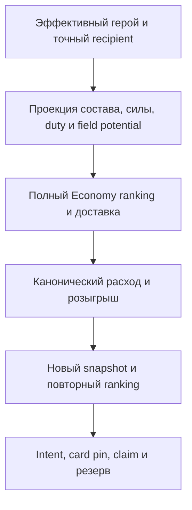

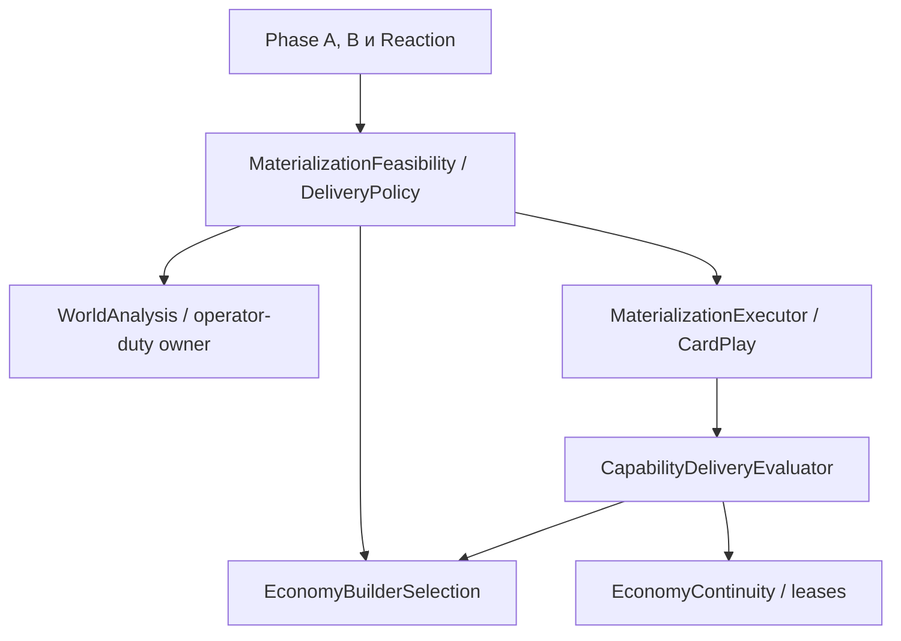

Обратная проверка: реальный CardPlay → состав/движение/обязанность оператора → новые builder routes → общий ranking → единственный `BeginEconomyDelivery`. Успех CardPlay по-прежнему не равен delivered1. Cached suitability остаётся snapshot-scoped; предварительная проекция не изменяет опубликованный snapshot и не расходует army/unit identity. Переданы и pass-local commitments, а не только durable assignments. Исключение для собственного Economy escort preparation не расширено на посторонний боевой кулак.

### 2. Пакет донора

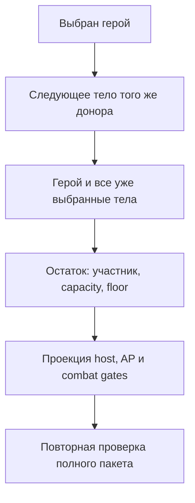

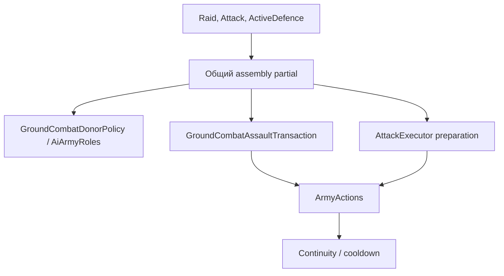

Пройдены обычный assault, preparation, pinned-host пересчёт, garrison и activated-host gates. Hero-only preparation сохраняет своё прежнее разрешение; обычный assault не получает права опустошать доноров. Исправлена именно общая same-hex выборка, а не только Raid caller. Контейнеры и карты не получают новых владельцев во время read-only планирования.

### 3. Refresh

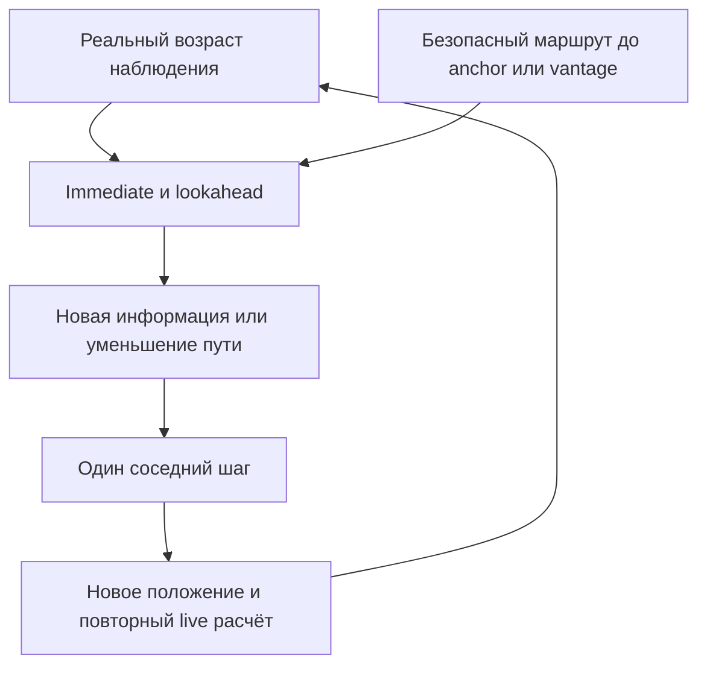

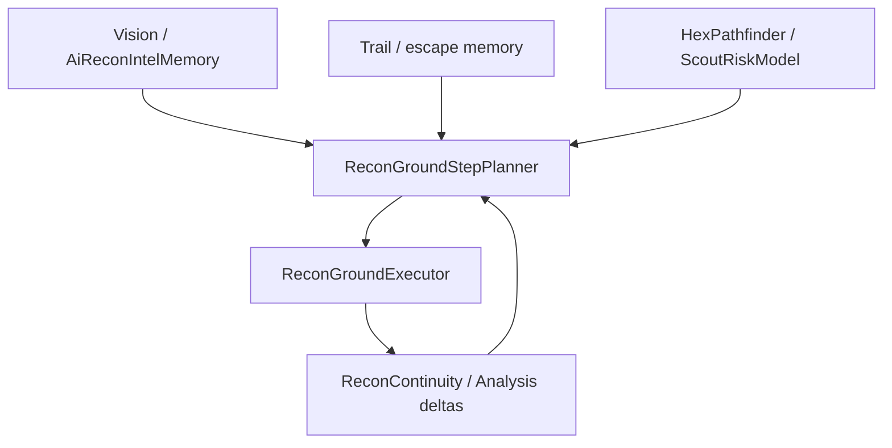

`FreshNeighborCount` сохраняет прежний смысл для Explore и emergency выбора сектора. Обычный Refresh не подменяет intel age физическим Visited. Маршрут пересчитывается по текущему безопасному входу, максимальной проходимой цене шага и скрытности; в Lookahead нет возвращения удалённого fresh-neighbor бонуса. Flee/EvadeDetector не вызывают новый Refresh route-score и не получили blacklist. Общий lifecycle не изменён.

### 4. Attack → Recon

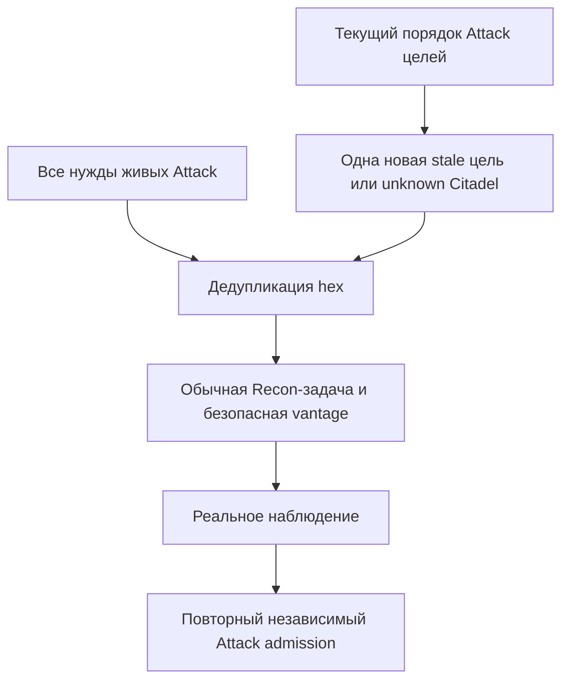

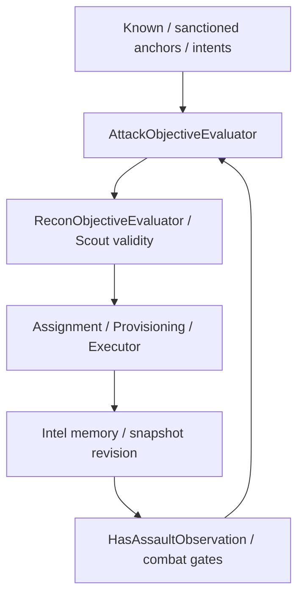

Новый запрос не вызывает mission planner, не читает скрытых защитников и не означает приказ атаковать. Existing target ordering переиспользован; один новый hex сверх живых операций. `ActorCommitments` для pre-operation проверки строится без Scout-ветви: канонический structural combat actor не является solo-Recce/air scout; иначе Scout-validity через `ReconObjectiveEvaluator.ForIntent` рекурсивно вызывает `ObservationNeeds`. Добавлен регрессионный случай с существующим Scout intent. Владельцы боя и Recon funding не изменены.

### 5. ResourceGain

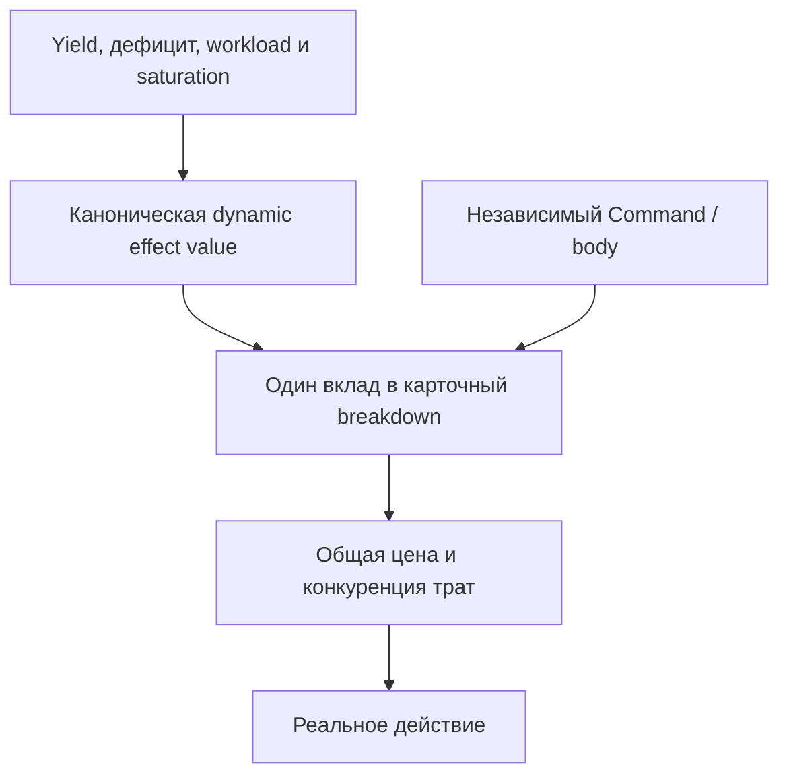

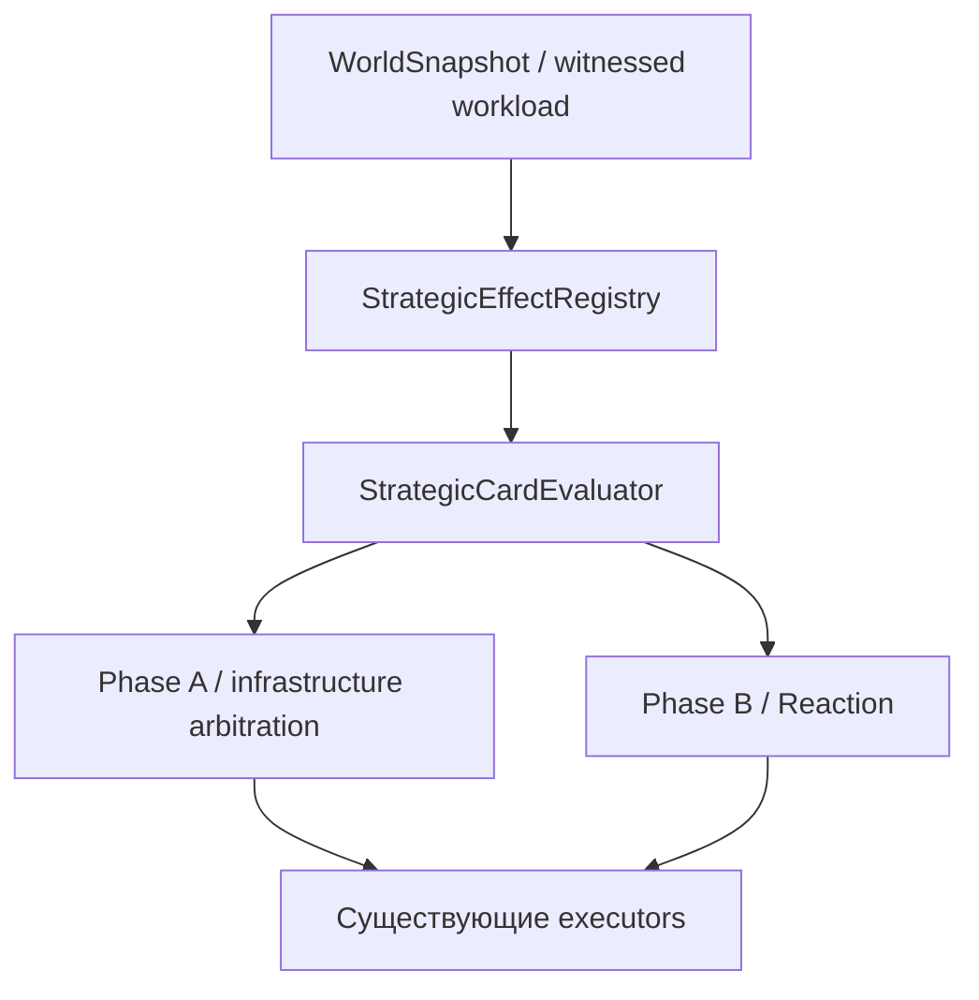

Удалена прежняя константа 3,6 и её отдельный decay, включая неиспользуемые конфиги. Ранний горизонт уже отражается в канонической `RecurringFutureOpportunity`; новый дополнительный ранний multiplier не введён. Target fit не умножает PlayerGlobal effect. Body/command полезность не удалена и не добавлена второй раз за тот же доход. Facility, Hero, Unit, прямые и generated/attach оценки используют общий effect-owner. Инфраструктурный вход Phase A теперь получает тот же witnessed workload, что конкурирующие materialization-карты.

### 6. Exact resource evidence

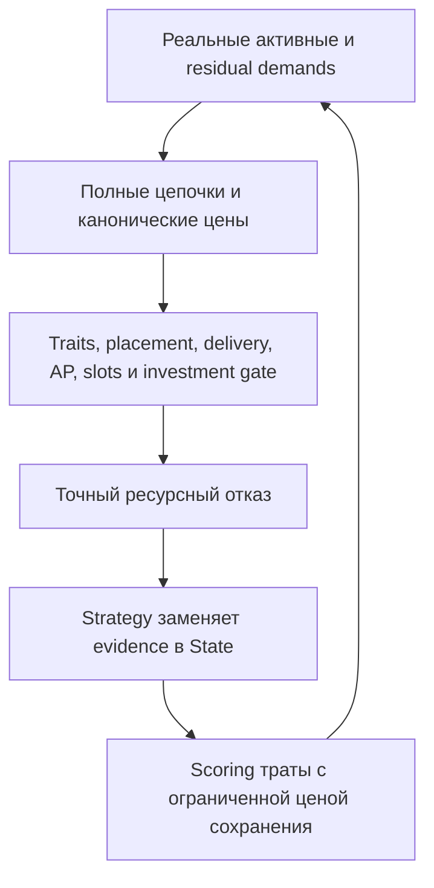

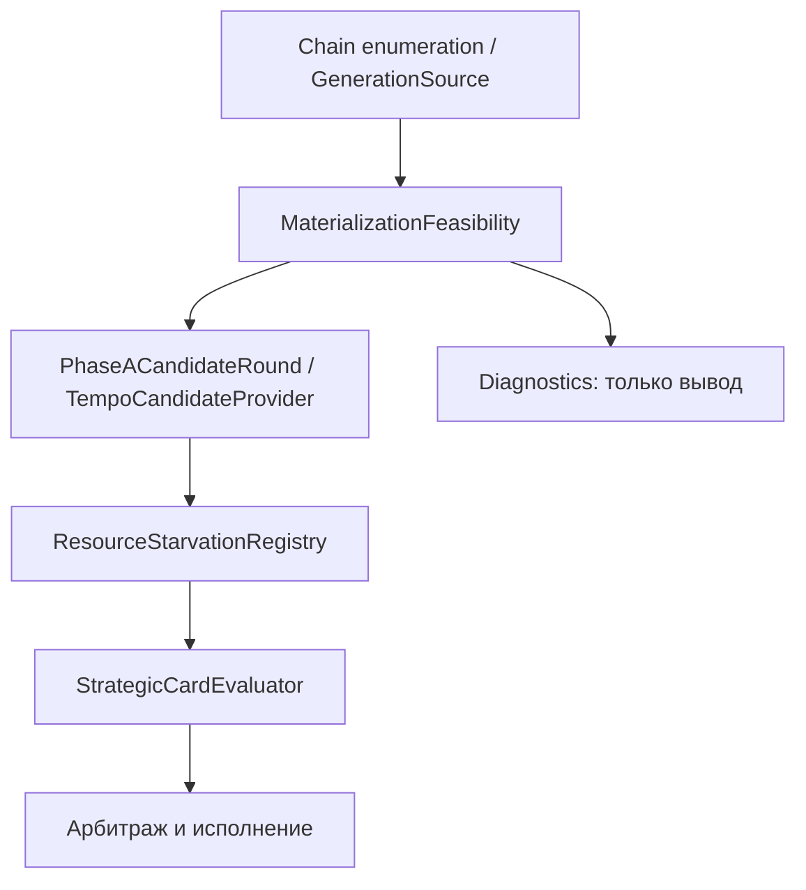

Feasibility сообщает конкретный отказ через callback; сама не пишет State. Strategy собирает весь набор до первого score; порядок demands не создаёт промежуточно различающихся scoring. `ResCost` берётся из `MaterializationPlanFactory`, generation и deploy не суммируются вручную повторно. Forecast generation не обходит существующее investment window. Недоступный placement, независимый delivery/AP/hand-slot отказ не создаёт evidence. Накопление не даёт право тратить чужой hold и не создаёт нового банка.

`BeginVerifiedPass` очищает exact blocks, сохраняя bounded decaying pressure. Phase A пересчитывает их при каждом новом раунде; dirty pass включает residual не переоцениваемых осей. Phase B делает то же перед обеими карточными ветвями после каждой реальной мутации. Уход потребности/карты или исчезновение отказа убирает добавочную цену при следующем расчёте. AP-only Draw сохраняет независимый допуск.

### 7. Видимость

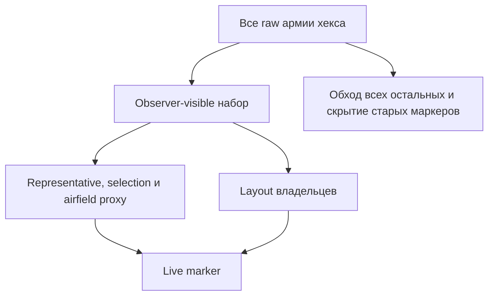

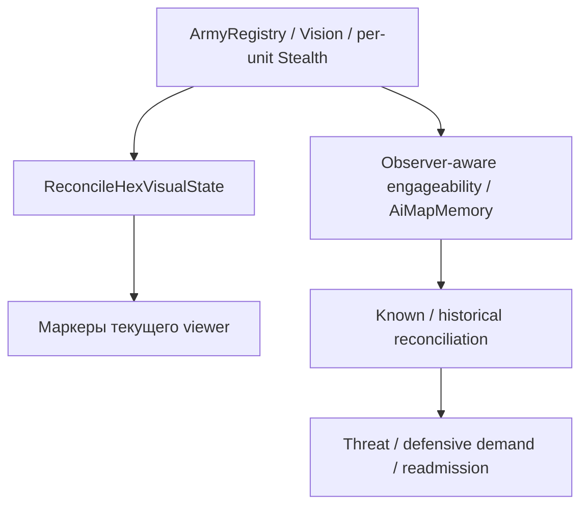

Knowledge-ветка отдельно прослежена: `ArmyRegistry.Register/MoveArmy/Unregister` → `NotifyContentChanged` на видимом hex; `VisibilityChanged` при изменении обзора; `StealthChanged` при смене скрытности/детекта; `AiMapMemory.ObserveArmies` перебирает **все** `AllAt`, использует `BattleInitiator.IsEngageable(enemy, player)` и записывает видимых участников по ArmyId. `WorldAnalysis.BuildKnown` читает память наблюдателя; `BuildThreat` согласует актуальные ids с историей `AiReconMemory`. Intel age обновляется отдельным owner на visibility/content событиях. UI имеет собственные подписки, включая смену viewer/stealth и завершение движения. `CurrentViewer` и DebugReveal не добавлены в AI knowledge.

Raw армии не удаляются и не обрезаются ранним выходом: скрытый/невыбранный маркер гарантированно получает `SetVisible(false)` при reconciliation. Собственный scout виден своему владельцу; смешанная армия представляет видимых участников по прежним правилам. One-marker-per-owner в покое и исключение для движущегося маркера сохранены в reconciler.

## Дополнительная диагностика ASSAULT-READY

`AttackContinuity` теперь пишет фактическое основание `power_floor`, `opportunity` либо `ongoing_assault` для уже начатого боя, текущую силу, строгую требуемую границу и известный win. Coverage неизвестной location-only цели помечается неизвестной. `AttackPreparationPolicy.AssessReadiness` и opportunity override не менялись; лог больше не утверждает >80% для всех случаев.

## Применённая калибровка поведения

После повторного аудита пользователь поручил применить предложенную калибровку. Применены три локальные настройки ниже; max preservation и короткий горизонт включены совместно. Сравнительных игровых прогонов до/после здесь нет, поэтому улучшение результатов матча не объявляется. Общий Radar, combat thresholds и архитектура сохранены.

| Рекомендация / эпизод | Реальные альтернативы и существующий owner | Точная возможность / текущее значение | Ожидаемое решение и риск | Статус |
|---|---|---|---|---|
| Реальный economic bottleneck; Draven H1 против избытка M | `EconomyResourceStanding.UsefulMarginalIncomeGain`, `DemandLayer.BuildExtractionScore`, `TaskScoreEvaluator.ResourcePriority`; extractor, collector, global carrier, Base конкурируют | Сохранить deficit bonus **4**, horizon **8**, hand paydown **2**, operational horizon **1**; источник оценивается его конкретным полезным gain. Не повышать весь ECO radar. | После №5–6 ProduceHuman/добыча H конкурируют с AP-source по фактам. Не переоценивать M только по наличию карты. | Уже обеспечено исправлениями 5–6 и существующими owners; нового веса сейчас не нужно. |
| Сохранить H1 ради H2; Draven T4–T5 | Brute против Ash Runner; прежняя стройка сохраняется, дополнительные Nora/Hunter не бесплатны | `stratResidualResourcePreservationMax` **2→3**; в preservation горизонт **8→2** через `economyHandPaydownHorizonTurns`. Общий deck horizon=8 сохранён. | Сильнее защита близкой покупки, слабее — удалённой. Риск max=3 — лишнее ожидание. При demand≤5 urgency остаётся нулевой. | Применено по поручению пользователя; накопление H2 не гарантируется. |
| Не плодить недоставляемых строителей; Cassia T5/T8 | ExistingArmy, reusable shell, new solo hero, готовый builder | Общий ranking, `economyBuilderFistShare=0.25`; extraction delivery max **3** хода, support max **2**. Значения оставить. | #19 не получает ложное Economy обещание; последний оператор не уводится. On-site и собственный builder сохраняют исключения. | Обеспечено №1. |
| Разводить scouts; свежий Refresh Cassia #16 | Полезный другой сектор, безопасный общий проход, остановка | Coverage factor теперь **1/(1+0.30×sectorClaims+0.70×nearbyClaims)**; nearby **0.55→0.70**, separation=2, sector/lookahead/reversal прежние. | Равные scouts чаще разойдутся; тесный общий проход не запрещается. Риск — слишком дорогая близкая полезная цель. | Применено по поручению пользователя; требуется игровой контроль узких коридоров. |
| Сведения о военной цели; Draven T17 | Stale Base (1,0), never-seen Citadel (5,-4), обычный Refresh | Новый адресный need до intent; intel stale band **2..8** оставить. После fresh observation надбавка исчезает через прежний owner. | Существующие scouts наблюдают цель; Attack независимо решает, идти ли в бой. | Обеспечено №4. |
| Сосредоточить силу вместо расходящихся рейдов; Cassia T6 | Законный same-hex пакет, существующие Gather/Return, рейд уже занятого актора с displacement price | Пакет учитывается целиком; `GroundCombatDonorPolicy.BorrowableDonorValues` и `AttackPreparationPolicy.ApplyPriority` уже оценивают существующие операции. Не добавлять auto-convoy. | Ложный отказ больше не охлаждает законную сборку. Переназначение нескольких будущих маршрутов без witness не обещается. | №2 обеспечивает исправление факта; новый cross-hex стратегический планировщик исключён. |
| Точка сбора и support против возврата кулака; Cassia T12 | Существующие staging Bases, same-hex donors и support routes | В commander sorting `SelectionCost → Turns → ArmyId`, первичный Command сохранён. В greedy body choice при равных rate и SelectionCost: `Turns → ArmyId`. Host comparison прежний. | Ближний support выигрывает при равных первичных критериях без второго ETA штрафа. Боевые пороги сохранены. | Применено; превосходство над конкретным возвратом #19 по старому логу не доказано. |
| Не держать готовую армию после ложного отказа; T6 cooldown до T9 | Другой законный donor или сохранение реального cooldown | Исправить feasible обещание, не менять cooldown длительность и witnesses. | Новая сборка не проваливается из-за забытых участников; реальный structural failure остаётся failure. | Обеспечено №2. |
| Оборонять вовремя и не отзывать бессмысленно; Draven T20 Base (0,2) | Гarrison/field defence, успевающий возврат, decisive strike | `AttackMarchPolicy.StrongholdNeedingArmy`: ETA и удержание с/без армии; existing max enemy ETA **2**, hold chance **0.70** сохранить. Калибровку 23 октября не отменять. | Наличие #19 уже известно, поэтому №7 не обосновывает усиление threat weights. Невозможно успеть — не ложное обещание защиты. | Нужны корректные факты; отдельная ошибка defensive policy в этом эпизоде не доказана. |
| Production усиливает ближайшую потребность; T20 низкие upgrade scores | Реальные recipient upgrades, hand play, сохранение ресурса | `DevelopmentOpportunityEvaluator` / `EquipmentUpgradeValuation` уже несут purpose/tactical contribution; investment threshold **0.60** на **2** хода оставить; scoring не поднимать за сам факт Production. | Улучшение конкурирует по выигрышу конкретного носителя, не создаёт военную нужду самостоятельно. | Дополнительная калибровка сейчас не обоснована; новый production planner исключён. |
| Mobility scout после upgrade | Ускорение, неизменная скорость, AP/Move ухудшение, бойцовый recipient | `EquipmentUpgradeValuation` уже отвергает MoveMax↓ или activation AP↑ для действующих Explore/Refresh; utility учитывает реальный bottleneck скорости. Это сохраняется. | Улучшение не срывает текущую разведку ради generic power. Для руки конкретная роль может ещё отсутствовать. | Уже существует защита текущего носителя; для неустановленной будущей роли — недостаточно данных. |
| Авиация без лишнего круга; Cassia T19 #36 | Продолжить sortie, посадка (1,0), recovery/rebase по endurance | Лог 16516–16547: MP **2/6→1/6→0**, 2-turn route, требуется и осталось **1** safe unlanded end; затем временно нет recoverable шага. `AiAirSortiePlanner`/existing recovery owners. Формулу топлива/радиус не менять по одному маршруту. | Это не доказательство лишнего круга: MP уже израсходованы. Для сравнения нужен полный sortie/recovery witness до и после посадки. | Недостаточно данных; изменения авиационной цепи не внесены. |

### Параметры и контроль результата

Калибровка применяется совместно по прямому поручению пользователя. Для оценки результата сравнивать одинаковые seed/save и начальные состояния; полный матч по старому текстовому логу не восстанавливается.

| Приоритет | Применённое изменение | Ожидаемый эффект | Критерий оценки |
|---|---|---|---|
| 1 — накопление H | Максимум preservation **2→3**, горизонт attainability **8→2** только в `ResidualResourcePreservationValue`. | Для demand=7,3, H1 против H2 и attainability=1 премия **0,329→0,493** card score. Для required H8, stock H1, income H1/turn, value=12 премия **0,250→0,141**: далёкая покупка меньше удерживает текущий ресурс. | Длина серий H0–H1, ход первой полезной покупки H≥2, отложенные срочные H1-задачи, неиспользованные AP. Накопление без последующей законной полезной покупки не считать успехом. |
| 2 — Gather | Ближайший support выигрывает при равных первичных критериях и цене, ID остаётся последним tie-break. Применено к командиру и greedy body choice. | Меньше ожидание равнозначной поддержки, новый ETA штраф в TaskScore не вводится. | ETA готовой сборки и число бесполезных маршрутов; сохранность первичного Command, combat gain/rate и цены. Для Cassia T12 лучшая альтернатива остаётся гипотезой. |
| 3 — scouts | `scoutStepCoverageNearbyWeight` **0,55→0,70**. | При одном nearby claim immediate coverage **0,645→0,588**; близкое дублирование дороже, общий проход допустим. | Новые наблюдённые hex на scout-turn, пересечение обзоров, время свежего наблюдения Attack-цели; отдельно узкие безопасные коридоры. |

Глобальный urgency ramp 5..12 пока сохранить: изменение его нижней границы затронет далеко не одно накопление ресурсов. Наличие exact block при value≤5 само по себе не добавляет preservation premium. Для такого случая сначала требуется показать полезную упущенную покупку, а затем обсуждать локальный договор её ценности.

## Проверки

Выполнено:

- `git diff --check` — успешно, ошибок whitespace нет.
- Проверка перечня изменённых файлов — нет Unity YAML, изображений, `.meta` и иных игровых ассетов.
- Поиск объявлений partial-классов, основных методов и callers; обновлены Phase A/B, workload measurement, diagnostics и Reaction feasibility-входы с доступными commitments.
- Источник-против-источника по шаблонам `AiPlanningLiveReadBoundaryTests`: direct-live reads **2→2, новых 0**; intent-registry reads **0→0**; прямые gameplay mutations **0→0**. Два существующих direct-live совпадения не вводились этой работой.
- `MaterializationDiagnostics`: записей в `ResourceStarvationRegistry` **0**.
- Существующий `coupling_matrix.py` на неизменяемых исходниках HEAD и рабочей копии: **327 C# файлов, 203 folder edges** в обоих случаях; новых рёбер **0**, foreign-type sets Orchestration и основного pipeline совпали.

Граница доступной среды: Unity, `dotnet`, `mono` и reference DLL отсутствуют. Compile baseline и managed NUnit-прогон **не выполнены**; зависимости по ТЗ не устанавливались. Исходный HEAD сохранён Git, но это не подмена compile baseline. Тесты ниже добавлены, **не запускались**. Числа из прошлых сессий (212 и т. п.) не являются результатом этой работы.

Добавлено 19 параметризованных/обычных регрессионных случаев в существующие файлы; дополнены 3 существующих PlayMode-сценария жизненного цикла движения. Все они здесь **не запускались**:

- `HexObjectLayoutTests`: скрытый scout/видимая армия в обоих порядках регистрации; stale hidden selection; затем исчезновение видимых членов и скрытие обоих маркеров.
- `AiGarrisonHeroTests`: Gather при равных цене/силе выбирает ближний support вместо меньшего ID; preparation берёт героя с телами одного донора, сохраняя последнего участника и допустимый остаток (2 случая).
- `AiReconGroundReactionRegressionTests`: свежий разворот к недостижимому anchor останавливается; безопасный геометрический detour сохраняется.
- `AiReconAttackObservationTests`: stale-цель без Attack intent запрашивается при существующем Scout intent; fresh observation снимает запрос.
- `AiV2ArchitecturalRegressionTests`: preservation для близкой, далёкой и малозначимой покупки с освобождением цены после исчезновения evidence (3 случая); замена exact evidence; projected builder admission для свободного/боевого/операторского/claimed случая; ResourceGain Facility меняет полезность с workload и учитывает effect ровно один раз.
- `AiCapacityUnlockTests`: production-вход `InfrastructureFulfillment.Propose` получает workload и exact resource evidence; Facility без upgrade и с ним платит один полный stage, Propose не меняет банк (2 случая).
- `ArmyMovementLifecyclePlayModeTests`: arrival выполняется при moving-флаге, settled — после re-keying и снятия флага ровно один раз; при гибели на промежуточном/финальном шаге settled не вызывается (3 дополненных случая).

Статическая проверка не доказывает отсутствие ошибок C# binding или успешный игровой replay. После переноса в Unity выполнить полный EditMode suite версии проекта; затем сценарии ниже. Сборку через stub/reference среду, если она будет использована позднее, не считать запуском Unity.

## Ручная проверка в Unity

Не нужны старые сейвы: состояния можно подготовить через существующие debug/editor инструменты. Для каждого случая фиксировать observer, ход, AP и H/E/M/T перед действием и после; отключённый диагностический вывод не должен менять выбор.

| № | Подготовка и последовательность | Ожидаемый результат / отрицательный контроль |
|---|---|---|
| 1 | На собственной базе heroless #19 с двумя боевыми телами; его projected power после Kessa ≥25% projected FieldStrikePotential. В руке Kessa и карта Base, target на другом hex. Запустить Economy Hero arbitration с достаточными AP/ресурсами. Затем отдельно пустой shell + Bolt у обслуживаемой им Production facility без второго оператора; потом добавить второго оператора вне shell. | Kessa→#19 не должна потратиться как Economy delivery; возможен другой законный placement или отказ до расхода. Bolt не уходит последним оператором; второй свободный оператор может снять duty-блок. Контроль: обычный solo hero на законном коротком extraction route допускается; on-site builder и собственный Economy intent сохраняются. Повторить с generated hero и attachment, меняющим effective abilities/Move/AP. Проверить один builder claim, build-card pin, owner reserve и follow-up AP. |
| 2 | Heroless host с одним слабым телом; рядом донор [Nadia, Medium infantry]. Повторить [Nadia, MI, MI], героя и тела из разных доноров, garrison с защищённым floor/оператором. Проверить Raid и Attack preparation; активировать host с ненулевой join-ценой и повторить. | Последний участник донора не обещается к передаче обычному assault. Вариант hero+body разрешён только с законным полным остатком. Результат capacity и garrison floor совпадает между planner и transaction. Нехватка AP активированного host не становится бесплатным join. Preparation сохраняет своё отдельное разрешение на lone hero. Непроходящий combat threshold не отменяется. |
| 3 | Scout A=(-1,3), B=(0,2), distant Refresh focus (4,0); оба hex и соседний обзор свежие, часть соседей физически unvisited. Записать A→B, оставить 1 MP, сделать повторный Continue. Затем открыть безопасный обход вокруг непроходимого/опасного коридора и восстановить MP. | Нет движения назад только из-за fresh-neighbor бонуса. Допустим stop/replan без траты MP. Реальный detour с уменьшающейся безопасной стоимостью сохраняется. Контроль: stale age≥2, новый Explore-сектор, Flee/Evade при угрозе; после исчезновения угрозы повторный вход остаётся возможен. Проверять `no-abab-loop` вместе с фактической полезностью. |
| 4 | Known hostile Base (1,0), intel age≥2, Attack intent отсутствует, свободная structural field армия проходит прежнюю readiness на известном opposition и имеет terrain route. Внести существующий Scout intent. Отдельно never-seen sanctioned Citadel (5,-4), мобилизация закрыта и известна другая Base. | Base получает адресную Recon-потребность без рекурсии. Вторая конфигурация сохраняет ранний search interest Citadel без выдуманных defenders. Несколько live Attack needs сохраняются, новых не более одного/проход. Контроль: fresh observation, захват/разрушение, eliminated owner; unknown/unreachable армия не превращается в обещание боя. |
| 5 | В одном и том же раннем состоянии сравнить AP-source Iri при witnessed workload 0 и при workload выше имеющихся AP. Затем ProduceMaterials при большом запасе/доходе M и ProduceHuman при дефиците H. Повторить Hero/Unit/Facility и generated/attach источник. | RoleFit источника следует реальной effectValue; прежних 3,6 за роль нет. Более насыщенный ресурс не получает равную фиксированную награду. Command/body остаются независимыми. Контроль: поздний ход с высокой используемостью AP может сохранять ценность источника. |
| 6 | В руке Rad Brute H2/E1/T1 и Ash Runner H1; имеется H1, остальная цена и AP для Brute с его законным placement/follow-up достижимы. Активна подходящая AGG-потребность. До дешёвой траты проверить exact block H2. Повторить Phase A, Phase B после Draw/Play и dirty-axis reentry. | Scoring H1 видит bounded preservation opportunity cost до выбора. Это не принудительное ожидание Brute: срочная польза может выиграть. Удаление demand/карты или невозможный placement/coverage/delivery снимают evidence. Отключение `ExplainNoChain` не меняет State/выбор. AP-only Draw не блокируется. Чужой Economy/Reaction hold недоступен. Для generated/attach проверить полную каноническую цену и investment gate. |
| 7 | На hex, законно видимом Ashen, два войска Concord одного владельца: hidden solo scout и видимая армия. Регистрировать в обоих порядках, менять viewer, selection и stealth/detection. Затем переместить видимую армию на уже видимый hex, остановить и увести её, оставив scout. | Видимая армия получает маркер в обоих порядках; scout остаётся скрыт и не даёт slot/count/name. Прямые memory sightings обновляются по ArmyId без изменения vision radius. После ухода видимой армии нет её ложного live marker. Контроль: собственный scout виден владельцу, смешанная армия показывает только видимых; airfield/garrison/prison/carrier/empty-shell сохраняют исключения. |
| Диагностика | Gather достигает readiness при 60% peak, но достаточном opportunity win; затем обычный >80%; затем location-only без defenders. | Соответственно `opportunity`, `power_floor`, либо честное неизвестное coverage. Gameplay gates не меняются. |

### Дополнительная матрица №7

| Состояние | Что проверять |
|---|---|
| Hidden зарегистрирован раньше visible / обратный порядок | Одинаковый live marker видимой армии |
| Только hidden враги | Нет их маркера и дополнительного layout slot |
| Несколько visible одного владельца | Один resting representative; собственный selection работает |
| Один hidden unit внутри mixed army | Наличие visible армии не раскрывает скрытый состав |
| Viewer owner → enemy → third party | Observer-specific marker и состав |
| Detection только одним игроком | Различаются только его законные сведения |
| Прибытие на уже visible hex | Content notification обновляет memory и UI |
| Движение → остановка у hidden scout | Видимая армия не теряет представителя |
| Airfield proxy / garrison | Невидимый proxy не вытесняет visible армию |
| Prison / carrier / empty shell | Исключения прежние, нет случайного представителя |
| Visible ушла, hidden остался | Нет live маркера ушедшей и раскрытия scout |
| AI threat есть, UI marker отсутствовал | Фиксировать visual-root отдельно от knowledge |

## Остаточные ограничения

Основной незакрытый этап верификации — реальная сборка/тесты и перечисленные игровые сценарии Unity. Ветка не содержит изображений или изменений баланса карт. Полный численный replay по исходному логу невозможен: в нём отсутствуют SHA сборки, полное состояние всех claims/duty и воспроизводимый seed/save.

Изменения добавляют canonical feasibility measurement до scoring и safe-route расчёт Refresh; их фактическое время в Unity не измерялось. Нужен профиль на крупной карте при сравнении нового матча. Для дополнительной авиационной гипотезы и точной идентификации пользовательского эпизода у Citadel доказательств пока недостаточно; подтверждённый visual-дефект устранён независимо от этих ограничений.
